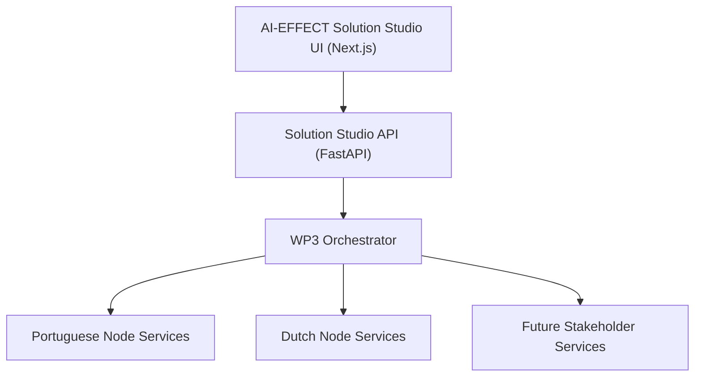

# AI-EFFECT Solution Studio

AI-EFFECT Solution Studio is a visual low-code/no-code platform for discovering, composing, validating, deploying, and monitoring AI-EFFECT services through the WP3 Orchestrator.

This repository provides a working MVP that integrates:

- AI-EFFECT Service Catalogue
- Visual Workflow Builder
- WP3 Package Import
- WP3 Orchestrator Integration
- Workflow Deployment Monitoring
- DataReference Inspection
- Portuguese Node Example
- Dutch Node Example

---

## Architecture



---

# Features

## Catalogue

- Browse services
- View service details
- View provider metadata
- Add services to workflow

## Workflow Builder

- Visual workflow composition
- Drag-and-drop node placement
- Service compatibility validation
- Edge validation
- Edge deletion and reconnection
- Workflow deployment

## WP3 Integration

- Import blueprint.json packages
- Import dockerinfo.json metadata
- Deploy workflows to WP3 orchestrator

## Deployment Monitoring

- Workflow status
- Task execution status
- DataReference inspection
- Artifact preview

---

## Current MVP Capabilities

AI-EFFECT Solution Studio is a local marketplace and workflow management portal for publishing, composing, deploying, and monitoring AI services connected to the WP3/orchestrator stack.

### Core workflow

- Publish or import AI services into the service catalogue.
- Compose services into saved workflow solutions using the Builder.
- Submit saved solutions to the orchestrator.
- Persist deployment records in the Solution Studio database.
- Synchronize deployment status from the orchestrator.
- Inspect workflow tasks and DataReferences.
- Preview supported artifacts such as inline JSON and CSV outputs.

### Solution lifecycle

Solutions support a production-style lifecycle:

- Active solutions appear in the main Solutions dashboard.
- Archived solutions are hidden from active operations.
- Archived solutions remain accessible in the Archived Solutions page.
- Archived solution workspaces are read-only.
- Deployment history is retained for audit and traceability.

### Deployment lifecycle

Deployments support audit-safe lifecycle management:

- Active deployments appear in operational monitoring.
- Archived deployments are hidden from active dashboards.
- Archived deployments remain recoverable from the Archived Deployments page.
- Solution workspaces show active deployments by default.
- Archived deployments can be filtered by solution.

### Service governance

Services support provider lifecycle governance:

- `active` services are visible in Catalogue and Builder.
- `deprecated` services remain visible but should be treated as legacy.
- `archived` services are hidden from default service listings.
- Archived services are blocked from new workflow submissions.
- Admin users can activate, deprecate, archive, and restore services.

### Runtime hardening

The backend workflow compiler resolves service runtime metadata from the current service registry at submission time. This prevents stale saved solution metadata, such as outdated hostnames or ports, from breaking future workflow submissions.


---

# Tested Use Cases

## Portuguese Node

File-Based Energy Pipeline

Workflow:

Workflow Input
→ GetConfiguration
→ GenerateData
→ AnalyzeData
→ GenerateReport
→ Workflow Output

Result:

✅ Completed successfully

Supported DataReferences:

- inline
- file

---

## Dutch Node

AI4EU Synth Benchmark Pipeline

Workflow:

Workflow Input
→ ConfigureAndSynthesize
→ RunBenchmark
→ Workflow Output

Result:

✅ Completed successfully

Supported DataReferences:

- grpc

---

# Prerequisites

Install:

1. Docker Desktop
   https://www.docker.com/products/docker-desktop

2. Git
   https://git-scm.com

Verify:

```bash
docker --version
docker compose version
git --version
```

---

# Repository Setup

Clone Solution Studio:

```bash
git clone https://github.com/adarshsunil/ai-effect-solution-studio.git
cd ai-effect-solution-studio
```

Start Solution Studio:

```bash
docker compose up --build
```

Open:

```text
Frontend:
http://localhost:13000

API:
http://localhost:18080

Swagger:
http://localhost:18080/docs
```

Health check:

```text
http://localhost:18080/health
```

Expected:

```json
{
  "status": "ok"
}
```

---

# WP3 Orchestrator Setup

Clone:

```bash
git clone https://github.com/paulban/ai-effect-wp3.git
```

Navigate:

```bash
cd ai-effect-wp3/orchestrator
```

Run:

```bash
docker compose up --build
```

Verify:

```text
http://localhost:18000/health
```

Expected:

```json
{
  "status": "ok"
}
```

---

# Portuguese Node Setup

Location:

```text
ai-effect-wp3/use-cases/file_based_energy_pipeline
```

Run:

```bash
docker compose up --build -d
```

Verify:

```text
http://localhost:18081/health
http://localhost:18082/health
http://localhost:18083/health
http://localhost:18084/health
```

Expected:

```json
{
  "status": "ok"
}
```

---

# Import Portuguese Package

Files:

```text
ai-effect-wp3/use-cases/file_based_energy_pipeline/export/

blueprint.json
dockerinfo.json
```

Import using:

```text
POST http://localhost:18080/admin/import/wp3-package
```

The services should appear in:

- Catalogue
- Builder

with provider:

```text
Portuguese Node
```

---

# Portuguese Workflow Test

Build:

```text
Workflow Input
→ input_provider1 / GetConfiguration
→ data_generator1 / GenerateData
→ data_analyzer1 / AnalyzeData
→ report_generator1 / GenerateReport
→ Workflow Output
```

Validate Workflow

Expected:

```text
Validation Successful
```

Submit to WP3

Expected:

```text
Workflow Status = completed
```

---

# Dutch Node Setup

Repository:

```text
https://github.com/paulban/ai-effect-wp3
```

Location:

```text
use-cases/dutch_node
```

---

## Start Data Synthesizer

Navigate:

```bash
cd use-cases/dutch_node/data_synthesizer
```

Run:

```bash
docker compose -f docker-compose-all.yml up --build -d
```

Verify:

```text
http://localhost:8003/health
```

Expected:

```json
{
  "status": "ok"
}
```

---

## Start Benchmark Runner

Navigate:

```bash
cd use-cases/dutch_node/benchmarking
```

Run:

```bash
docker compose -f docker-compose-all.yml up --build -d
```

Verify:

```text
http://localhost:8004/health
```

Expected:

```json
{
  "status": "ok"
}
```

---

# Import Dutch Package

Files:

```text
use-cases/dutch_node/ai4eu_pipeline_package/

blueprint.json
dockerinfo.json
```

Import using:

```text
POST http://localhost:18080/admin/import/wp3-package
```

Services should appear in Catalogue with provider:

```text
Dutch Node
```

---

# Dutch Workflow Test

Build:

```text
Workflow Input
→ grid_synth_service / ConfigureAndSynthesize
→ benchmark-runner / RunBenchmark
→ Workflow Output
```

Validate Workflow

Expected:

```text
Validation Successful
```

Submit to WP3

Expected:

```text
Workflow Status = completed
```

Deployment page should show:

```text
ConfigureAndSynthesize = completed
RunBenchmark = completed
```

---

# Current DataReference Support

| Protocol | Status |
|----------|--------|
| inline | ✅ |
| file | ✅ |
| grpc | ✅ metadata preview |

---

# Known Limitations

## File Artifact Preview

File preview currently depends on shared artifact storage.

Some file references may display metadata only.

---

## gRPC Preview

Current implementation displays metadata:

```text
synthetic-data:50051
benchmark-runner:50051
```

Direct payload inspection is not implemented yet.

---

## Authentication

Not implemented.

---

## Governance Workflow

Planned for future release.

---

## Cloud Deployment

Current MVP is intended for local Docker-based testing only.

AWS deployment will be added in future phases.

---

# Troubleshooting

## Solution Studio Not Running

Check:

```bash
docker compose ps
```

Expected:

```text
api
web
postgres
```

running.

---

## Orchestrator Not Running

Check:

```text
http://localhost:18000/health
```

---

## Service Connection Refused

Verify:

```bash
docker ps
```

and ensure the service container is running.

---

## Workflow Deployment Fails

Verify:

1. Orchestrator running
2. Service containers running
3. dockerinfo.json contains correct ports
4. Health endpoints return status=ok

---

# MVP Status

Implemented:

✅ Service Catalogue

✅ Service Details

✅ WP3 Package Import

✅ Workflow Builder

✅ Connection Validation

✅ Workflow Deployment

✅ Deployment Monitoring

✅ DataReference Inspection

✅ Portuguese Node Integration

✅ Dutch Node Integration

Planned:

⬜ Shared Artifact Storage

⬜ Advanced Artifact Preview

⬜ Governance Workflow

⬜ Authentication

⬜ AWS Deployment

---
