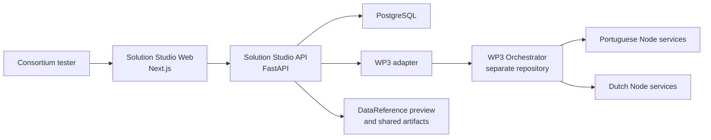

# AI-EFFECT Solution Studio

AI-EFFECT Solution Studio is the consortium-facing MVP for discovering, governing, composing, deploying, and monitoring Dockerized AI services. It provides a product layer over the AI-EFFECT WP3 Orchestrator: users work with catalogue services and visual solutions, while WP3 remains the execution mechanism.

The MVP is intended for local consortium testing. It is not a production certification authority, identity provider, or replacement for the WP3 runtime.

## Product positioning

Solution Studio supports three main activities:

- node providers publish service metadata and submit services for governance;
- solution designers compose approved services into saved workflows;
- TEF operators review services and monitor deployments, tasks, and evidence.

The role selector in the shell is a persona preview. It changes guidance only and does not grant permissions.

## Architecture

Solution Studio and WP3 are separate repositories and must be started separately.



The web application never calls WP3 directly. The API compiles the visual graph into the current WP3 `blueprint` and `dockerinfo` structure, submits it through the adapter, and normalizes monitoring responses.

## Solution Studio components

| Component | Responsibility |
|---|---|
| Dashboard | MVP entry point and role-oriented overview |
| Catalogue | Service discovery, metadata, lifecycle, interface, and trust information |
| Publish service | Public Git manifest preview or pasted-manifest import |
| Admin governance | Approval, rejection, reopening, activation, deprecation, archive, and restore |
| Solution Builder | Visual composition, design validation, save, readiness preparation, and confirmation |
| Saved solutions | Persistent solution workspaces and deployment history |
| Deployments | Workflow status synchronization, task inspection, and DataReference evidence |
| Runtime preflight | Governance, runtime metadata, and provider-managed health checks |
| WP3 adapter | Workflow submission and monitoring calls to the external orchestrator |

## Technology stack

- Next.js and React with React Flow for the web application
- FastAPI, Pydantic, SQLAlchemy, and Requests for the API
- PostgreSQL 16 for local persistence
- Docker Compose for the supported MVP environment
- Python 3.12 and Node.js 20 container bases

Dependencies in the MVP use unpinned or `latest` package declarations in several places. Release reproducibility should be strengthened before production use.

## Repository structure

```text
apps/
  api/
    app/
      models/                  SQLAlchemy models
      schemas/                 API request and response models
      services/                compiler, imports, WP3 adapter, readiness
      main.py                  FastAPI routes
  web/
    app/                       Next.js routes
    components/                shared shell and UI utilities
docs/                          architecture, testing, capability, and release docs
examples/service-manifest/     example AI-EFFECT service manifests
docker-compose.yml             local Solution Studio stack
```

## Prerequisites

- Windows 10 or 11 with PowerShell
- Docker Desktop with Linux containers and Docker Compose v2
- Git
- the separate AI-EFFECT WP3 repository, including the orchestrator and example services

Verify the local tools:

```powershell
docker --version
docker compose version
git --version
```

## Local startup

Clone Solution Studio and the WP3 repository into separate directories. The companion repository URL used by the current MVP documentation is:

```powershell
git clone https://github.com/adarshsunil/ai-effect-solution-studio.git
git clone https://github.com/paulban/ai-effect-wp3.git
```

Repository access and branch selection are consortium responsibilities. The layout of the external WP3 repository can evolve; check its own README if a path below differs.

### 1. Start WP3 separately

From the WP3 repository:

```powershell
Set-Location .\ai-effect-wp3\orchestrator
docker compose up -d --build
Invoke-RestMethod http://localhost:18000/health
```

WP3 must be reachable from the host at `http://localhost:18000`. The Solution Studio API reaches it from Docker through `http://host.docker.internal:18000`.

### 2. Create the shared artifact volume

Solution Studio declares `wp3_artifacts` as an external Docker volume:

```powershell
docker volume inspect wp3_artifacts 2>$null
if ($LASTEXITCODE -ne 0) { docker volume create wp3_artifacts }
```

### 3. Start Solution Studio

From this repository:

```powershell
docker compose up -d --build
docker compose ps
```

To rebuild only the web application:

```powershell
docker compose up -d --build web
```

To stop the stack without deleting its database volume:

```powershell
docker compose down
```

Do not add `-v` unless the local database and stored test records should be deleted.

## Ports and health endpoints

| Service | Local address | Verification |
|---|---|---|
| Web | <http://localhost:13000> | `Invoke-WebRequest http://localhost:13000` |
| API | <http://localhost:18080> | `Invoke-RestMethod http://localhost:18080/health` |
| API documentation | <http://localhost:18080/docs> | Open in a browser |
| PostgreSQL | `localhost:15432` | `docker compose exec -T postgres pg_isready -U solution_studio -d solution_studio` |
| WP3 Orchestrator | <http://localhost:18000> | `Invoke-RestMethod http://localhost:18000/health` |

The expected Solution Studio API health response is:

```json
{"status": "ok"}
```

## WP3 Orchestrator dependency

WP3 supplies execution and workflow/task status APIs. Solution Studio currently uses:

- `POST /workflows`
- `GET /workflows/{workflow_id}`
- `GET /workflows/{workflow_id}/tasks`

If WP3 is offline, catalogue and solution editing remain available, but submission and monitoring calls will fail. Runtime readiness checks service health independently; a ready result does not prove that WP3 is reachable or that operation-specific inputs are valid.

## Portuguese Node setup

The companion WP3 repository currently documents the Portuguese file-based energy pipeline under:

```text
use-cases/file_based_energy_pipeline
```

Start it from the WP3 repository:

```powershell
Set-Location .\use-cases\file_based_energy_pipeline
docker compose up -d --build

Invoke-RestMethod http://localhost:18081/health
Invoke-RestMethod http://localhost:18082/health
Invoke-RestMethod http://localhost:18083/health
Invoke-RestMethod http://localhost:18084/health
```

The intended workflow is:

```text
Workflow Input
-> input_provider1 / GetConfiguration
-> data_generator1 / GenerateData
-> data_analyzer1 / AnalyzeData
-> report_generator1 / GenerateReport
-> Workflow Output
```

`AnalyzeData` requires an upstream input file. An `AnalyzeData`-only workflow can pass runtime readiness and still fail during WP3 execution with `No input file provided`.

## Dutch Node setup

The companion repository currently documents two Dutch services:

```powershell
Set-Location .\use-cases\dutch_node\data_synthesizer
docker compose -f docker-compose-all.yml up -d --build
Invoke-RestMethod http://localhost:8003/health

Set-Location ..\benchmarking
docker compose -f docker-compose-all.yml up -d --build
Invoke-RestMethod http://localhost:8004/health
```

The representative composition is:

```text
Workflow Input
-> grid_synth_service / ConfigureAndSynthesize
-> benchmark-runner / RunBenchmark
-> Workflow Output
```

## Importing services

### Manifest import through the UI

1. Open <http://localhost:13000/publish>.
2. Preview a public Git repository containing `ai-effect.service.json`, or paste manifest JSON.
3. Review validation messages and the normalized service.
4. Confirm the import to the catalogue.
5. Open **Admin** and approve the service before deployment testing.

Example manifests are available in [`examples/service-manifest/`](examples/service-manifest/). Public Git preview is supported; authenticated private-repository import is not.

### WP3 package import through the API

The admin import endpoint accepts parsed `blueprint.json` and `dockerinfo.json` objects:

```powershell
$PackageRoot = Resolve-Path ".\export"
$Body = @{
  provider = "Portuguese Node"
  category = "File-Based Energy Pipeline"
  trust_badge = "Imported"
  blueprint = Get-Content "$PackageRoot\blueprint.json" -Raw | ConvertFrom-Json
  dockerinfo = Get-Content "$PackageRoot\dockerinfo.json" -Raw | ConvertFrom-Json
} | ConvertTo-Json -Depth 100

Invoke-RestMethod `
  -Method Post `
  -Uri http://localhost:18080/admin/import/wp3-package `
  -ContentType "application/json" `
  -Body $Body
```

Imported services should be reviewed in Admin. A service must have status `approved` or legacy `validated` to be deployment-eligible.

## Main user journey

1. Import or publish a service.
2. Approve it in Admin and confirm its lifecycle is active or, for compatibility, deprecated.
3. Open **Build solution**.
4. Add services and connect Workflow Input through every service to Workflow Output.
5. Select **Save draft** when an explicit checkpoint is useful.
6. Select **Validate design** to check structure, complete paths, disconnections, and adjacent interface types.
7. Select **Prepare & deploy**. The Builder automatically creates or updates the saved solution before preflight.
8. Resolve any deployment-readiness blockers.
9. When readiness is ready, select **Confirm deployment**.
10. Open **Deployments** to synchronize and inspect the run.

Manual saving before deployment is not required. The automatically saved solution ID is carried into preflight, WP3 submission, and the deployment record.

## Runtime-readiness process

Preparation runs only after design validation succeeds. The API checks each selected service in sequence:

1. the service exists;
2. it is not archived or rejected;
3. its review status is `approved` or legacy `validated`;
4. host, port, and health path metadata are valid;
5. its health endpoint returns a 2xx response within two seconds.

| Service result | Meaning |
|---|---|
| `ready` | Eligible, configured, and returning 2xx |
| `unavailable` | Health endpoint timed out, could not be reached, or returned non-2xx |
| `misconfigured` | Service reference or runtime metadata is incomplete or malformed |
| `ineligible` | Governance or lifecycle state prevents deployment |
| `unknown` | Referenced catalogue service no longer exists |

A blocked result prevents the confirmation action. The submission endpoint independently reruns preflight and returns HTTP `409 Conflict` if readiness is blocked, so direct clients cannot bypass the guard.

Runtime preparation is provider-managed in this MVP. Solution Studio reports ownership and recommended action but does not start, restart, or inspect service containers.

## Deployment monitoring

The Deployments page synchronizes active deployment status from WP3. Open a run to inspect:

- workflow status and identifiers;
- individual task status;
- input and output DataReferences;
- inline JSON or CSV preview;
- HTTP/HTTPS JSON, CSV, or text preview;
- local file preview when the artifact is mounted into the API.

gRPC, S3, and orchestrator-managed artifact references currently provide limited or metadata-only evidence. See [Known limitations](docs/KNOWN_LIMITATIONS.md).

## Quick verification checklist

```powershell
docker compose ps
Invoke-RestMethod http://localhost:18080/health
Invoke-WebRequest http://localhost:13000
Invoke-RestMethod http://localhost:18080/services | ConvertTo-Json -Depth 10
Invoke-RestMethod http://localhost:18080/solutions/summary | ConvertTo-Json -Depth 10
Invoke-RestMethod http://localhost:18080/deployments | ConvertTo-Json -Depth 10
Invoke-RestMethod http://localhost:18000/health
```

Then verify in the UI:

- Catalogue loads and service details open.
- An approved service can be added to Builder.
- A blank workflow is blocked by design validation.
- An offline service is reported as unavailable.
- Changing the canvas clears old readiness.
- A ready workflow requires explicit confirmation.
- The confirmed run appears in Deployments with a non-empty solution link.

## Local database notes

The MVP uses SQLAlchemy `Base.metadata.create_all(...)` rather than a migration framework. Existing local databases may require manual schema adjustments when model fields change. Preserve the PostgreSQL volume when test history is needed.

## Documentation

- [Team testing guide](docs/TEAM_TESTING_GUIDE.md)
- [Current capabilities](docs/CURRENT_CAPABILITIES.md)
- [Operation Contract Registry V1](docs/OPERATION_CONTRACTS.md)
- [Known limitations](docs/KNOWN_LIMITATIONS.md)
- [MVP release notes](docs/MVP_RELEASE_NOTES.md)
- [Service onboarding](docs/service-onboarding.md)
