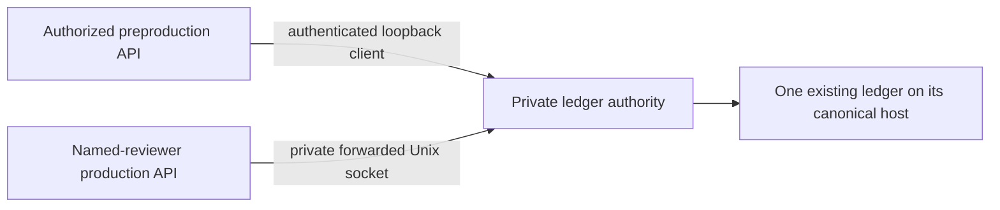

# Restricted-beta shared accounting (inactive preparation)

This is a separate private authority over the **same existing Windows ledger**.
No service, policy, tunnel, credential or new allowance was activated by this
implementation. Defaults are empty/off. Never copy the ledger into a container
or production database, and never enable a second writer to a replica.



## Fixed policy and explicit scope change

| Phase | Shared count transition | Phase lifetime reservations | Per request |
|---|---|---|---|
| New acceptance checkpoint | 13 -> 15 | 2 permits / USD0.010 | USD0.005 |
| Initial beta, after confirmed acceptance | 15 -> 25 | 10 permits / USD0.050 | USD0.005 |

The global money ceiling stays **USD0.10**. Settled prior charges and all original
rows/audits remain. Enough original money must remain to fund a phase before its
activation; there is no add-funds operation. A permit counts even if its process
dies before dispatch. Settlement can reduce the conservative held charge but
never refunds a call or a phase's lifetime reservation total.

The legacy local/qualification database guard remains unchanged. A **distinct**
shared-authority client is proposed for normal PostgreSQL environments. Its
credential is bound, in the audited policy, to an exact consumer, environment,
scope and fingerprint of PostgreSQL host/port/database/role (not password).
Changing any field denies access. SQLite, a renamed qualification database,
simultaneous local-file and authority configuration, or a partial authority
configuration cannot become a fallback. This scope extension is opt-in source
awaiting review, not an activated exception to the old guard.

Every request requires gpt-6-luna, low reasoning, Standard/default processing,
output <=2,000, framed input bound <=32,000, no SDK retries/fallback and a fresh
single-dispatch permit. The authority fixes USD0.005 reservation, not a client
supplied price. Explicit prompt_cache_options.ttl=30m pins the conservative
USD0.125/MTok write bound; ordinary input USD0.10/MTok and output USD0.50/MTok are
covered. Cache discounts are never needed to fit. See the
[current model](https://developers.openai.com/api/docs/models/gpt-6-luna),
[pricing](https://developers.openai.com/api/docs/pricing) and
[cache lifetime documentation](https://developers.openai.com/api/docs/guides/prompt-caching),
checked 11 November 2026. Recheck before actual spending; this is not permanent
pricing authorization. Unexpected tier/12-hour writes, missing usage or an
overrun stop accounting; do not report that outcome as a bounded provider pass.

## Integrity, concurrency and uncertainty

The operator supports only the two exact transitions above. Initial activation
requires the reviewed canonical path, filesystem identity, file SHA-256, exact
13 settled rows, open count-exhausted policy and unchanged USD0.10 ceiling. Beta
requires 15 settled/acknowledged rows, two acceptance permits and an attributable
acceptance-pass evidence reference. The code does not fabricate that attestation
or automatically decide that response quality passed. Failed acceptance cannot
activate beta. Previous checkpoint files are not edited or reopened.

New tables are installed transactionally in the existing ledger only during a
future explicit operator apply. Audit events form an append-only hash chain over
policy, requests, mappings and historical amendment data. SQL triggers protect
prior usage and audit events. Every transaction verifies the audited projection.
The active ledger binds its canonical path and filesystem identity; copied files
are refused. This detects drift and accidental out-of-band writes; it is not a
claim to defeat a hostile filesystem administrator who can replace code/data.

BEGIN IMMEDIATE serializes all reservations, including different processes and
environments. One in-flight/unresolved permit is allowed globally. Concurrent
contenders get a denial and make no provider request. FULL synchronous rollback
journaling is required; WAL is refused without changing its mode. There is no
time-based expiry, reservation refund, checkpoint reopening or missing-file
initialization. A busy/missing/corrupt store denies dispatch.

The private protocol is status -> reserve -> settle -> acknowledge. A unique
reservation key can authorize dispatch **once**; replay/lookup only observes it.
No transport mutation is automatically retried. The SDK is constructed only
after a fresh receipt. Usage settles before structured response parsing, even
when the model output is malformed. Only numeric usage, response identity and
accounting metadata are retained, never prompts, response text or provider keys.

- Crash or lost reservation reply: the durable full hold remains and all clients
  pause. Read-only inspection/lookup identifies the permit; do not send again.
- Lost settlement reply: usage is durable but unacknowledged; all clients remain
  paused. Reconcile its recorded receipt/hash, not another model response.
- Lost final acknowledgement reply: usage was already durably confirmed to the
  caller before acknowledgement was sent. Inspect its exact status; never infer
  that the call was free or automatically repeat it.
- Missing/uncertain usage: full reservation stays held. Do not manufacture zero
  usage. If no genuine provider accounting record exists, stop the scope and
  retain the failure. No code path clears this hold by elapsed time.
- Late confirmed usage can be settled after a stop, but cannot reopen spending.

## Supported operator commands (future gated operation)

Use the already installed Python environment and this reviewed source. Read-only
inspection is safe before policy activation:

```powershell
& <existing-python> deploy/restricted-beta/amend_shared_allowance.py --ledger <exact-existing-ledger> --inspect
& <existing-python> deploy/restricted-beta/amend_shared_allowance.py --ledger <exact-existing-ledger> --request <private-reviewed-request.json>
```

The second command is a **dry run by default**. Its private JSON must contain
phase, scope_id, authority_id, exact bindings (consumer_id/environment/
database_scope/token_sha256), expected_sha256, expected_ledger_path,
expected_file_identity, operator and authorization_ref; beta also requires
acceptance_evidence. There are no default real identities, token values or
wildcard bindings. Only after all release gates pass may the operator add
`--apply`. Never run a demonstration/test fixture against the real ledger.

An attributable stop JSON contains scope_id, expected_sha256, operator and
authorization_ref. `--stop-request <private.json>` previews it; adding --apply
permanently closes spending without deleting history or refunding permits.
There is no reopen command. --inspect cannot be combined with --apply.

Inspection exposes unresolved request keys/status/usage hashes. Genuine late
usage is reconciled through the authenticated settlement/acknowledgement protocol
for that same permit. Recovery never makes a model request or allocates another
permit. Audit/usage contradictions require operator investigation; no SQL patch
or automatic restore is supported. Inert backups must not become another
authority. A disk-loss/restore or file-identity change deliberately fails closed
and requires a separately reviewed reconciliation, not reactivation of a stale
backup over newer spending. Process restart on the same file is supported/tested.

## Proposed private transport, not provisioned

Keep the authority on the current canonical ledger host. After audited policy
activation, the native process can use the installed environment:

```text
DESIGN_AI_AUTHORITY_LEDGER=<exact existing canonical file>
python -m uvicorn app.accounting_authority:create_app --factory --host 127.0.0.1 --port <reviewed private port>
```

The factory refuses an unactivated policy. It is **not** mounted on app.main or
the portal proxy. It has no amendment endpoint, OpenAPI UI or provider client.
Do not expose its listener to the LAN/public Internet. Existing SSH can forward
a private Linux Unix socket to this loopback listener, for example the reviewed
shape `ssh -N -R <private-server-socket>:127.0.0.1:<authority-port> renew@<existing-server>`.
No such command has been run. Before release, verify the actual Windows/OpenSSH
forward, socket lifecycle, a narrowly scoped API-UID ACL and read-only socket
mount in an isolated environment. Do not change existing server permissions or
mounts merely to prepare this proposal. A lost tunnel or sleeping Windows host
pauses model requests; existing design controls remain independent.

The preproduction native API can use authenticated loopback HTTP; the Linux API
can use the forwarded Unix socket with logical URL http://accounting.internal.
Verified HTTPS is also supported; plaintext remote HTTP, redirects, URL
credentials, environment proxies, relative sockets and TLS-disable flags are
not supported. The selected transport/consumer fingerprints must be reviewed
and tested end-to-end before activation. Neither SSH availability nor TLS
production compatibility has been claimed by unit tests.

New client settings, all currently empty/off: DESIGN_AI_BUDGET_AUTHORITY_URL,
DESIGN_AI_BUDGET_AUTHORITY_SOCKET, DESIGN_AI_BUDGET_AUTHORITY_TOKEN,
DESIGN_AI_BUDGET_AUTHORITY_ID, DESIGN_AI_BUDGET_SCOPE, DESIGN_AI_BUDGET_CONSUMER,
DESIGN_AI_BUDGET_ENVIRONMENT. Shared clients require DESIGN_AI_RESTRICTED_BETA=true,
exact existing reviewer IDs, and empty legacy local budget/checkpoint settings.
Do not alter retained demonstration profiles to prepare this configuration.
Keep DESIGN_AI_ENABLED=false, keys disconnected and execution grants empty until
the applicable owner/sign-in/review/catalogue/transport/acceptance gates pass.

No production account, ledger policy, service, tunnel, port, permission, provider
request or execution grant was created by writing this implementation/runbook.
