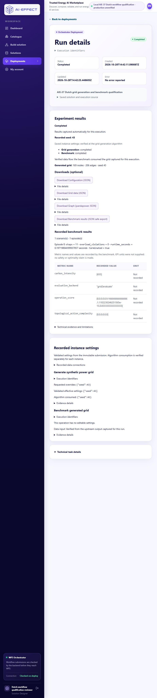
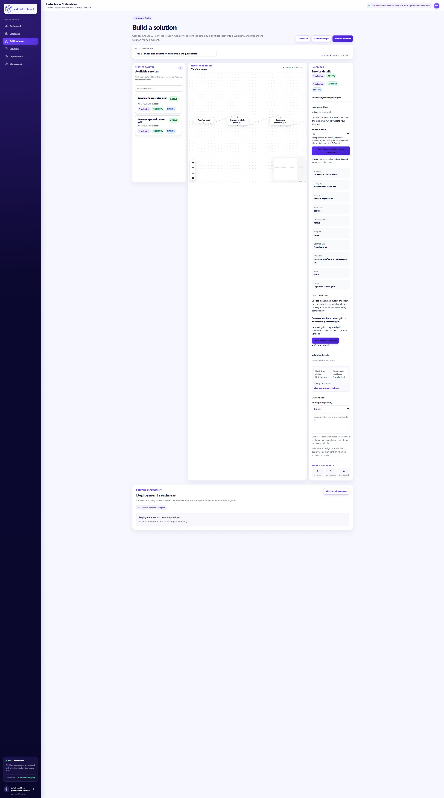

# AIE-37 — Dutch catalogue workflow qualification

28 October 2026. **Locally qualified, production compatibility unverified.**
AIE-18 remains **In Review**. One new local workflow completed; no provider call,
production operation, hardware access, merge or tracker update was performed.

## Result and review

The selected existing Dutch-node workflow generates a synthetic transmission grid
and benchmarks that **same grid** with the existing no-op baseline agent. It
helps a researcher inspect a generated network and a reproducible software
benchmark setup. It is a genuine producer/consumer chain, rather than two
independent generators.

- Saved solution: `98eadd46-5b58-4517-b706-f2a7b9ed6bc4`.
- Workflow: `wf-45c1c8c84ed3`, completed; both tasks completed.
- Builder: <http://localhost:23121/builder?solutionId=98eadd46-5b58-4517-b706-f2a7b9ed6bc4>.
- Results: <http://localhost:23121/deployments/wf-45c1c8c84ed3#results>.
- Submitted/observed seed **43**; **169 nodes, 206 edges**. One scenario,
  one 11-step episode; recorded backend `grid2evaluate`.
- The later saved draft deliberately uses **42**. Reloading it does not change
  the run's seed 43, submission, task references, evidence or artifact hashes.

Review checklist: inspect the named connection in Builder; select the generator
and see current seed 42; open the recorded run and see requested/effective/consumed
seed 43; inspect the benchmark's verified upstream input; download the four files.
**Do not confirm another deployment.** The one execution permission is consumed.

[Machine-readable evidence](AIE37_QUALIFICATION_EVIDENCE.json) contains exact
versions, image IDs, contract IDs, task references, checksums and history checks.
[Schema details](../deploy/aie37/SCHEMAS.md) describe required data and unknowns.

## Baseline and dependencies

Worktree/branch: `local-backups/aie37-portal`,
`codex/aie37-workflow-qualification`, based on Portal
`fd4b88be692cf9944837cc5fb4c5450ecfa54df8`. Implementation commit: `2df5019e4c9c73d71cef62613f381d524758a0b3`.

This is a separate review change, stacked on Portal
[PR #9](https://github.com/IRESI-EU/ai-effect-solution-studio/pull/9), which depends
on [PR #8](https://github.com/IRESI-EU/ai-effect-solution-studio/pull/8).
The runtime requires the maintained configuration work in WP3
[PR #3](https://github.com/AI-EFFECT/ai-effect-wp3/pull/3), stacked on
[PR #2](https://github.com/AI-EFFECT/ai-effect-wp3/pull/2). Those PRs and their
heads were preserved. No WP3 source change was needed for this task: its existing
single-output forwarding implements the deliberately restricted binding transport.

The existing acceptance, AIE-18 integration, instance-edit and real-provider
verification reports were read in the preserved pilot checkout. The source
review records in this checkout remain historical. Existing Dutch automatic
capture evidence, including `wf-d642cb742578`, established the meaningful chain;
the repeated AIE-18 generator runs were only parameter-delivery evidence.
One fresh execution was needed to exercise the new saved binding, typed
configuration, maintained orchestrator and complete artifact path together.

## Candidate inventory

### Dutch — selected

User/purpose: synthetic transmission-grid research followed by a baseline software
benchmark. Existing catalogue provider: Dutch Node / AI-EFFECT Dutch Node.
Authoritative implementation: AI-EFFECT/ai-effect-wp3
`ba598b2459f9986dac4e37dcc5d7d3298f25dc3a`, under
`use-cases/dutch_node`; underlying grid synthesizer is TU Delft's pinned source.

Existing operations are `ConfigureAndSynthesize` and `RunBenchmark`, catalogue
version 1.0. The earlier export's labels (`benchmark-runner Input`) did not
establish semantic compatibility, and it contained no active I/O contracts.
Its account/node ownership and repository fields were null. Provider attribution
does not replace genuine node-manager attestation. Only the new local mirror has
an explicit Dutch-node owner and repository provenance; originals were untouched.

Supported setting: integer seed 42/43. The adapter forwards it to the original
configuration and synthesis operations; observation at
`PowerGridGenerator.__init__(seed)` plus returned output proves consumption.
No data input is required by this qualified generator variant. Its immutable
manifest identifies protobuf JSON grid data and native pandapower JSON. The
benchmark requires exactly that associated capture and returns a captured result.

Dependencies: private Docker HTTP control network, native pinned Python packages,
dedicated evidence volumes and a read-only upstream mount. No runtime host ports,
LLM credentials, external dataset URL or arbitrary algorithm upload are exposed.
Studio sign-in/ownership checks protect results and downloads; local runtime HTTP
has no service authentication. Production TLS/service authentication is unverified.

Resolved local blockers: semantic/persisted bindings, instance-parameter adapter,
readiness fingerprint agreement and complete authorized artifact association.
Limitations: synthetic topology; flat static load/generation series from the
operating point; no-op agent; limited episode coverage; unknown KPI units and
scientific validity. Runtime seconds and execution IDs are not reproducible bytes.

### Danish — useful next candidate, not qualified here

User/purpose: a SYSLAB heat-network designer enumerates alternatives and reviews
SVG drawings. Existing Danish-node catalogue export (export timestamp
17 October 2026; filename retained from the earlier acceptance work) lists
`GenerateTopology` and `RenderTopologies` as approved, version 2.0.
Source inspected in WP3 review head
`0221b7ecd4a2d5f072de640350ebc599df22131a`, based on maintained
`e8914565e966a2d78879c314f980574769d31b87`.
Full file fingerprints and existing local image IDs are in the evidence JSON.
Those running images were inspected, not rebuilt or executed.

`GenerateTopology` consumes `run_config.supplies/loads` and forwards
`allow_hx`, `allow_bypass`, `how_many` to `enumerate_networks`.
`RenderTopologies` consumes nonempty `networks`, uses `NetworkDrawing`, and
writes SVGs and a JSON drawing index on its shared data volume. This is a real
chain and can bypass the LLM configuration assistant with valid structured input.

Blockers: no qualified saved slot contract/renderer artifact capture in the
existing parameter proof, no bounded end-to-end evidence for this actual renderer,
and production ownership/auth/storage remain unverified. The SYSLAB YAML records
physical assumptions and unknown measurements; generator feasibility and ranking
are not hydraulic validation. `ValidateTopology` explicitly returns a dummy
verdict. No physical control is proposed. Two repeated topology generators are
not treated as a renderer pipeline.

### German — deferred for external-runtime lifecycle

User/purpose: an offline simulation engineer converts pandapower CSV load/static
generator profiles into Grid2Op chronics. Source: the same maintained WP3 review
head, `use-cases/germany-node`. The package metadata identifies
`ProvideData → GenerateChronics → FormatOutput` and three `latest` image names;
local image content IDs were recorded. A current active semantic contract,
production module version and authenticated owner attribution are unknown.

`GenerateChronics` consumes a shared-directory manifest, substitutes
`round_decimals` (default 3) and `compress` (default false) into the native
configuration, restarts VILLASnode through `/api/v2/restart`, then polls for five
chronics CSVs. The source demonstrates consumption, not a new live proof.
Dependencies include read-only source datasets, shared writable per-run storage,
the long-running VILLASnode REST endpoint and provider-managed lifecycle.

The historically documented native VILLAS image
`ai-effect-villas-node:f2fbc82b` is absent locally. No German runtime was started.
The existing production overlay also documents native-hook restart/recovery
behavior. Qualifying it would need external lifecycle/recovery and trustworthy
artifact association beyond this one-run scope. Rounding/compression, data quality,
units and scientific applicability require owner review. Production was not queried.

## Contracts and saved bindings

The existing `OperationContract` registry remains the authority. The immutable
[qualification export](../deploy/aie37/contracts.json) bootstraps that registry
and supplies the matching runtime declaration; it is not a second mutable registry.
Runtime and registry definition digests must agree.

| Instance/slot | Contract identity and version | Meaning |
|---|---|---|
| `generate-grid.captured_grid` | `urn:aieffect:nl:configure-and-synthesize:capture` / 1.0.0 | Exactly one immutable synthetic-grid capture reference |
| `benchmark-grid.captured_grid` | `urn:aieffect:nl:run-benchmark:capture` / 1.0.0 | Required single upstream input with the same schema/version |
| `benchmark-grid.benchmark_capture` | Same benchmark contract | Terminal benchmark capture; a different semantic/schema identity |

Each service instance saves `data.operation_contract` with contract ID/version.
The connection saves `data.binding.source_slot/target_slot`. API Save and compile
resolve the active registry contract and reject stale/missing pins, unknown slots,
incompatible semantic/schema/version/representation/format/protocol/cardinality,
unresolved required inputs, cycles, duplicate links and unsupported merges.
Schema identity must be explicit; shared JSON labels are insufficient.

The compiler snapshots full definitions, provenance, definition digests and the
explicit binding in `solution_studio_metadata.capability_bindings`. WP3's existing
graph forwards the **whole reference unchanged**. This transport cannot select
subfields or merge multiple outputs. Settings and binding pins must use the same
contract; submission matches saved nodes, settings, bindings and revision under
the existing ownership/revision protection.

Existing supported unqualified designs retain their compatibility path, labelled
semantically unverified. Their existing UI mismatch guard remains. No contracts
were activated on original/shared services. This does not certify legacy graphs.

## Runtime and real execution

The isolated project is `ai-effect-aie37`: frontend 23121, API 28185,
PostgreSQL 28145; other services have no host ports. It has its own database,
Redis and evidence volumes. It does not mount provider ledgers or earlier evidence
volumes writable. Offline/provider verification profiles retain their guards.

| Component | Source/identity |
|---|---|
| Dutch algorithms | WP3 `ba598b2459f9986dac4e37dcc5d7d3298f25dc3a`; unchanged pinned base images |
| grid-synthesizer | `b36740438a95db60d30f3681daa72a26e1d2dd73` |
| grid2benchmark | `b90860bfd06c68378592573ca89e77e9a05693b4` |
| grid2evaluate | `5b696493d3391052d471f1e6ea6ab25775985e6a` |
| Grid2Op | `b8376c4e1c13980b50505a21ff0b4a5c22927bfa` |
| Maintained orchestrator | `c6695d8444edb14b94111f16d8620c460880849b`; source inventory checked, published fixes in WP3 #2/#3 |
| Parameter validator | Exact shared release artifact SHA-256 `1861736c1bd9c8a1e4d3aa86b1a2f58ef27bf5e272d682a619062cfb8b7171aa` |
| Derived capture adapter | `d2ad9bda04177167c62d928a615f8ed202cefc3d0f854ef80368dac0b8614cc4` |

Full image IDs at submission and after the final API hardening are recorded in
the evidence JSON. The final audit matched all 65 API files, both capture adapters
and 24 maintained orchestrator source files to their recorded bytes. These byte
fingerprints describe the Windows build worktree; Git normalizes text line endings.
Rebuilt images must generate their own source/image lock, rather than reuse this
run's runtime identity file. Capture/algorithm/orchestrator images were not changed after
execution. API image locks v1/v2/v3 were retained; v2 submitted the run, v3 adds
strict redirect handling and reuses one compilation during readiness. No new run
was used for that hardening.

Before confirmation, both approved operations, source bytes for all 65 API files,
seven image IDs, seed 43, exact saved binding, empty workflow input, local runtime
destination and zero prior submissions were checked. DNS, health and
`/control/capabilities` were checked **from the actual API Docker network**.
Readiness verifies parameter transport through the maintained orchestrator and
exact I/O contract fingerprints directly at both services, with bounded timeouts
and no redirects.

Builder **Save → reload → Validate design → Prepare & deploy → Confirm deployment**
submitted the single workflow. Recorded tasks:
`task_60e852c4` (generation) and `task_e23bc51c` (benchmark).
The benchmark's recorded input equals the generator's output reference, including
workflow/task/manifest digest. Its manifest and safe export record that grid's
digest; association never uses filename or time similarity.

| Artifact | Bytes | SHA-256 |
|---|---:|---|
| Configuration | 1441 | `24f9e01c17119611c6c8315e5415d95cf1843cbb3993b70c1187f3cd0bc8e301` |
| Grid | 148660 | `c7f41cf987de793ac92cad894393188df4918ff8028b8cd05a674188d0199d16` |
| Pandapower network | 129851 | `a521315934294f2850d03b713e4cc29f0f0710f84b02ee95625f5dbc6f0f0462` |
| Benchmark safe export | 856 | `096befec9ccd5d65f19c38d20239dcd5b8f955745144fc66b199883384eaf189` |

Authorized downloads through the frontend proxy matched both metadata and actual
captured files. The browser's grid download matched too. Anonymous requests for
all four returned 401; cross-owner rejection is separately covered by fixtures.
Later Builder Save/reload with seed 42 left the complete historical submission,
tasks, evidence and download hashes unchanged.

## Verification and boundaries

- Portable API: **209 passed**, no skips; disposable SQLite/HTTP/provider doubles.
- PostgreSQL registry/input/artifact suite: **65 passed** in a fresh dedicated
  `*_test` database on the qualification cluster, then removed.
- Web utilities: **22 passed**; TypeScript and final Next 16.3.8 production
  webpack build passed.
- Binding tests cover wrong/missing schemas, meanings, formats, protocols,
  cardinality, pins, slots, versions, required/optional inputs, invalid data,
  ownership/revisions/history, unavailable endpoints, malformed replies, timeouts
  and redirects. Adapter doubles verify parameter delivery and preserved failures.
- Existing capture fixtures cover hashes, path confinement, unauthorized access,
  run isolation, delayed/missing evidence and failed/idempotent recording.
- The profile's one-submission guard locks its source row before claiming a
  durable capture record. A failed attempt also consumes permission. Fixture
  tests reject replacement submissions; no second live request was sent.

The first test invocations exposed a missing temporary parent/import path, a
legacy mocked-compiler fixture regression, and missing host protobuf/image-layout
dependencies in adapter tests. Those failures were retained as failures; setup
and the legacy path were corrected, and adapter doubles made explicit. A
sandboxed Next worker spawn failed; the normal authorized Windows build passed.
No failed workflow was retried or relabelled.

Gitleaks 8.30.1 passed the staged implementation. It initially flagged the two
local API Docker image tags as generic API keys.
Only those exact lines carry explanatory allow annotations; no credential,
directory or general scanner rule is excluded. Private configuration, account
records, raw captures, provider ledgers and checkpoints remain untracked.

No new live concurrency, crash recovery, cancellation, timeout or retry study is
claimed. The selected operations return synchronously. The maintained worker
records HTTP timeouts/failures; capture claims preserve failures and prevent
recomputation under the same identity. Synchronous cancellation/recovery is not
qualified, and no unrelated lifecycle framework was added.

Read-only preservation checks found **no differences** in the four earlier
databases, earlier container/image identities, 126 private checkpoint/evidence
files or 195 original dirty source files. Only new namespaced volumes were
written. Provider usage remains **12/12**, US$0.10 ceiling, US$0.003784750 accounted,
US$0.096215250 remaining and **zero outstanding reservations**; no amendment.

## Setup and recovery

Use this checkout's [qualification files](../deploy/aie37). Existing pinned base
images, the maintained orchestrator image and the earlier private Dutch catalogue
export are prerequisites; private credentials and exports are intentionally not
published. The baseline IDs are verified before builds; no `latest` image is
silently fetched. The local source export lacks ownership metadata, as noted above.

For a **new explicitly authorized** installation only:

1. Run `prepare.py --private-dir <new ignored directory> --source-metadata <existing private export>`.
   It refuses an existing directory and writes fresh local-only configuration.
2. Set `AIE37_PROFILE_DIR` to that directory. Build with
   `docker compose -f deploy/aie37/compose.yaml build`.
3. Run `lock_runtime.py <private directory>`; preserve its image lock.
4. Start with both `compose.yaml` and the generated lock:
   `docker compose -f deploy/aie37/compose.yaml -f <images.lock.json> up -d --no-build`.
5. Initialize the **empty** database once:
   `docker exec -e PYTHONPATH=/app ai-effect-aie37-api-1 python /qualification/initialize.py`.
   Copy `/tmp/aie37-reviewer.json` to the private local directory without printing
   its password. It must never be included in logs, screenshots or commits.
6. Build/start `apps/web` on loopback 23121 with
   `INTERNAL_API_URL=http://127.0.0.1:28185`, telemetry disabled and the local
   qualification environment label. Use Next's supported `build --webpack`.

For this **existing, consumed** profile, skip preparation and initialization.
Reuse `local-backups/aie37-profile-20261028` and `images.lock.v3.json`; restart
only the identified qualification processes if necessary. Never remove volumes,
reset rows, reinitialize credentials or allocate another profile to regain this
task's execution permission. Earlier image locks remain in the private directory.

`verify.py --private-dir <directory> --output <new JSON path>` performs only
authorized results/download checks for the explicitly recorded workflow. It does
not discover another run, submit, retry, repair or call a provider. Preserve each
verification output. If runtime/evidence is unavailable, diagnose it without
submitting again or rewriting the captured data.

## Review evidence

## Production gaps and AIE-38

Production still needs genuine node-owner attestation and governance, immutable
maintainer-published images, actual deployment-network/auth/TLS/storage validation,
independent scientific review of the synthetic/static-profile benchmark, units,
retention/access policy, broader data/versions, load/isolation/recovery and
independent first-user acceptance. Historical production reports are not
revalidated by this local work. No production readiness claim follows from this run.

This supports a precise next AIE-38 milestone: from a disposable **one-step Dutch
generation draft**, propose adding the existing `RunBenchmark` catalogue
operation and its explicit `captured_grid` connection. Show the structural diff,
validate pinned contracts and unchanged source settings, then require explicit
Apply/Save. Preserve history and keep execution separate. That conversational
structural editing is **not implemented here**, and no new provider allowance is
authorized by this evidence.
