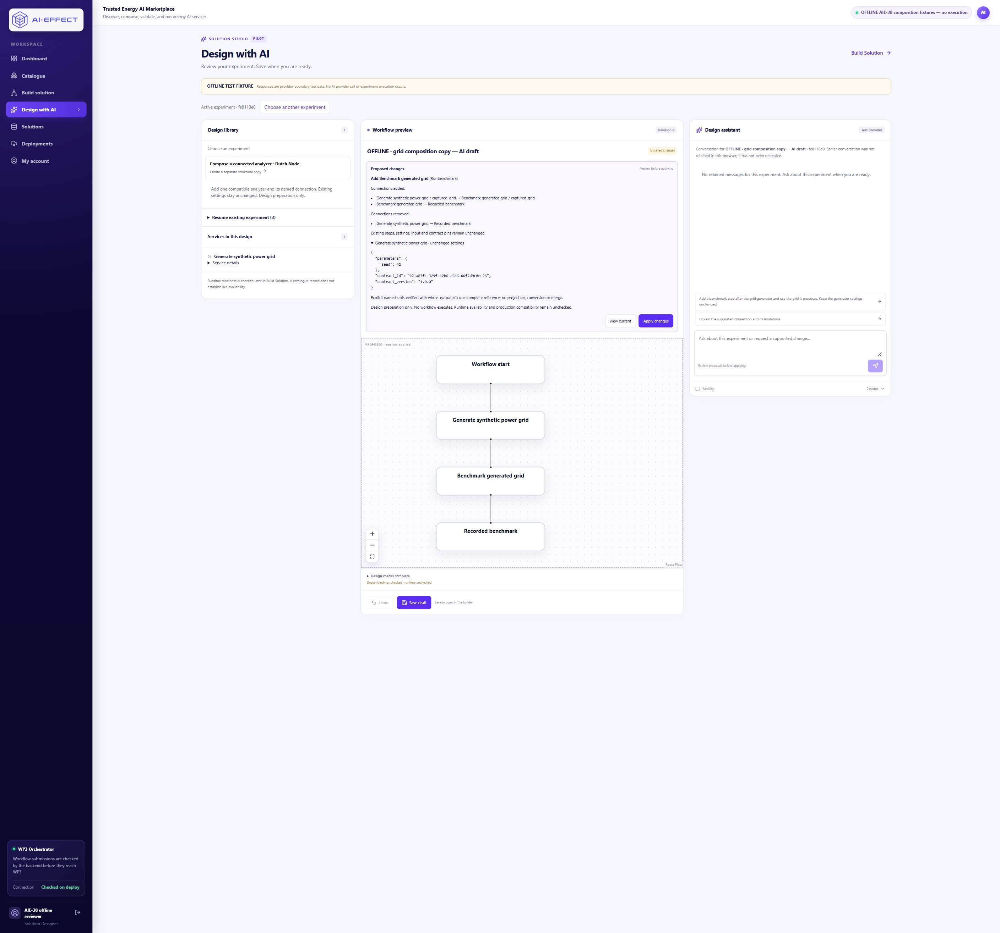

# AIE-38 — Bounded conversational workflow composition

28 October 2026. **Offline structural milestone implemented and verified.**
Recommended status: **In Review for this milestone**. The whole conversational
composition task is not complete. AIE-18 remains **In Review**; production
compatibility is explicitly unverified. No tracker was updated.

**29 October review follow-up:** the complete final-source backend inventory now
records **339 passed / 1 failed** across three isolated suites. The remaining
legacy failure also occurs on the AIE-37 base; it has not been hidden or repaired.
A fresh pending proposal and independent participant/observer materials are
**prepared; awaiting human walkthrough**. See the follow-up section below.

## Supported behavior

A designer explicitly chooses **Compose a connected analyzer** from an
operator-enabled template with `structural_append_only=true`. This creates a
separate owned draft through the existing start/copy flow. It does not change the
source solution. `instance_settings_only` and structural scope are mutually
exclusive, and existing settings-only copies still reject structural edits.

The supported edit appends **one existing authorized analyzer** to the current
terminal service, binds its one required upstream input, and replaces the single
terminal workflow-output edge. This is reusable registry-driven behavior: no
Dutch service ID, operation name, slot name, schema or contract definition is
hard-coded in the mutation. The Dutch benchmark is the explicitly queued test
case. The target must have an active unique pinned `whole-output-v1` contract,
one input/output and no editable execution parameters. Existing settings remain
fixed. No new service is onboarded.

The main offline request was:

> Add a benchmark step after the grid generator and use the grid it produces. Keep the generator settings unchanged.

Pending review leaves the design at revision **0**. Explicit Apply produces
revision **1**. Undo restores the complete original design at revision **2**.
A second explicitly queued fixture, review and Apply produces revision **3**;
explicit Save, reload and Builder preserve the exact resulting graph. These
responses are provider-boundary fixtures, **not real-provider interpretation**.

## Exact design difference and preserved data

The disposable source is `aie38-one-step-source`, copied from saved AIE-37
solution `98eadd46-5b58-4517-b706-f2a7b9ed6bc4` using read-only source access and
normal owned-draft creation. Its baseline contains `input → generate-grid →
output`, with no benchmark service. Complete revision-0 designs are retained
privately; their canonical sorted-JSON SHA-256 is
`268d7394acb61dfb20f80504948667e8cd41c8f80be9464404befea52d96b4c5`.

For the saved desktop copy:

- Added instance: `c4b7cc19-cb51-455f-92e2-93b828a6cc8f`, catalogue service
  `aie37-benchmark`, operation `RunBenchmark`.
- Removed edge: `aie38-generator-output`, `generate-grid → output`.
- Added edge: `c4b7cc19-cb51-455f-92e2-93b828a6cc8f-input`,
  `generate-grid.captured_grid → c4b7cc19-cb51-455f-92e2-93b828a6cc8f.captured_grid`.
- Added edge: `c4b7cc19-cb51-455f-92e2-93b828a6cc8f-output`, new benchmark → `output`.
- The original input-to-generator edge is unchanged. All original node objects,
  positions, labels, service identity, seed **42**, configuration, contract pin,
  workflow input (**null**) and unrelated design fields are unchanged.

The original workflow-output node retains its source label, **Recorded benchmark**.
That is a design boundary label inherited from the source; it is not evidence of
a new benchmark run. The structural review explicitly shows both its removed
and added connection. No execution occurred for either copy.

| Instance | Operation contract | Version |
|---|---|---|
| Preserved `generate-grid` / `aie37-synth` | `921a87fc-329f-42b6-a546-ddf7d9c0ec26` | 1.0.0 |
| Added benchmark / `aie37-benchmark` | `441153b2-9b3b-48c1-81e4-649645f30143` | 1.0.0 |

Their identities remain `urn:aieffect:nl:configure-and-synthesize:capture` and
`urn:aieffect:nl:run-benchmark:capture`. The named binding requires identical
semantic concept, schema/version and data-reference representation, compatible
protocol/content types and cardinality one. The grid schema is
`urn:aieffect:nl:dutch-local-capture-v1:grid`, protocol `file`, content type
`application/json`. Shared JSON display labels cannot establish compatibility.
The existing AIE-37 validator/compiler remains authoritative.

## Proposal authority, review and mutation guarantees

`AssistantTurn` accepts the new edit kind `append_bound_operation`. Its `node_id`
must identify a current terminal instance. Its JSON value contains exactly
`local_ref`, `service_id`, `contract_id`, `contract_version`, `source_slot` and
`target_slot`. Extra fields, provider-supplied service metadata/definitions,
arbitrary new node IDs, projections and merge instructions are rejected.

`local_ref` is a bounded proposal-local alias. This single-add scope resolves
the target internally; it exposes no general cross-proposal graph-reference
language. The existing server UUID mechanism allocates a stable new instance ID
when the pending proposal is stored. Apply reuses that allocation. Alias/identity
collisions and targets outside the current draft are rejected.

Catalogue eligibility, caller authorization, active unique contract, explicit
slots and the complete resulting graph are checked before storing a proposal.
Review describes the added operation, named source, added and removed connections,
unchanged settings and the limits of design compatibility. It states **design
preparation only**, with runtime availability and production compatibility unchecked.

Apply uses the existing owner-scoped locked draft/revision/proposal checks.
It acquires catalogue/contract locks in deterministic service order, reconstructs
the candidate from registry authority, revalidates the complete graph and compares
the exact candidate plus catalogue/contract-definition fingerprints with review.
Changed definitions, eligibility, metadata or revision fail before draft mutation.
The transaction records one full-design Undo entry and increments one revision.
Concurrent/repeated Apply cannot add a duplicate. Existing analyzer identities
are also rejected as duplicate additions; an explicit fixture demonstrates the
correct no-edit explanation path when the analyzer already exists.

Undo restores the entire prior design, not only nodes or parameters. Save uses the
existing explicit authorized persistence path, reserved solution identity and
Builder fingerprint protection. No execution, readiness probe, runtime configuration
change, governance update or spending amendment is part of Apply/Undo/Save.

## Provider context and offline boundary

The focused context contains the authorized draft ID/revision, current instance
IDs/labels/operations/settings/pins, current connections, relevant compatible
catalogue candidates and slot definitions. The same validator determines candidate
eligibility. It excludes template payloads, workflow-input contents, unrelated
conversation history, credentials, environment files, artifact contents and private
runtime addresses. The existing redactor also protects metadata text. Catalogue
descriptions/notes are untrusted data, never instructions or authority.

The real provider remains the normal application's provider. No fixture or fallback
was installed there. The separate [offline harness](../deploy/aie38/README.md)
overrides its dependency, strictly parses explicitly queued single-use responses
and sends them through the real chat, MCP, backend validation, review, Apply and
persistence paths. Queueing binds the exact draft ID, revision, request and context.
SDK calls raise; missing/mismatched fixtures fail closed.

The harness explicitly rejects workflow submission, runtime preflight, deployment
and orchestrator routes with **403**. The unreachable orchestrator setting alone
is not relied upon. Only pure compilation is allowed. The final guard checks
exercised both workflow submission routes, runtime-preflight, deployments and an
orchestrator route; all returned 403 and created zero execution records.

## Verification

| Acceptance area | Evidence |
|---|---|
| Exact main edit and pending immutability | Provider-boundary tests; rendered desktop/narrow; complete design comparison at revision 0 |
| Ambiguous source | Valid fixture graph with two grid-producing instances; clarification returns no proposal or mutation |
| Unknown/unauthorized/ineligible operation | Strict candidate and before-Apply eligibility/authorization rejection tests |
| Wrong slots/schema/unresolved pin | Candidate tests, schema/contract drift tests and existing AIE-37 binding suite |
| Merge/projection/cycle/duplicate | Closed payload rejection and complete malformed-graph rejection tests |
| Stale revision/catalogue/contracts | Reconstructed candidate and fingerprint rejection; no partial mutation |
| Repeated/concurrent Apply | Portable repeated rejection; real PostgreSQL concurrent race has one winner |
| Full Undo | Exact baseline equality in portable, PostgreSQL and both rendered copies |
| Save/reload/Builder | Exact persisted nodes/edges; seed 42 and named binding visibly checked and design validated |
| Settings-only restrictions | Final targeted-instance regressions plus explicit structural rejection |
| Identity/cross-draft safety | Trusted UUID collision, local-alias collision, current-instance and other-owner rejection |
| Historical evidence | Immutable snapshot fixture; all five existing databases unchanged; four actual AIE-37 capture files rehashed |

- Full portable backend suite: **234 passed**, before three final additional
  structural cases. Final structural/settings-only focused suite: **44 passed**
  (28 structural plus 16 existing instance-edit cases).
- Final provider adapter/structural run: **36 passed**, one temporary-directory
  setup error. That single mocked-provider test then **passed** with an explicit
  writable disposable `--basetemp`; no product/provider failure was relabelled.
- PostgreSQL registry/input/artifact suite: **65 passed** in a fresh random
  `*_test` database. Persistence suite: **11 passed**, including structural
  concurrency. After lock ordering was tightened, the focused PostgreSQL structural
  race/persistence case passed again. Only suite-owned databases were removed.
- Existing UI utilities: **22 passed**. Final TypeScript and optimized Next
  **16.3.8 webpack build passed**. Existing deprecation/module warnings remain.
- Rendered desktop: normal login, separate-copy creation, request, readable review,
  Apply, Undo, re-propose, Apply, Save, reload and matching Builder inspected.
- Rendered narrow: the actual app in a labelled **390 × 844 CSS-pixel iframe**
  completed the same journey. Both review and Builder measured **367/367** client/
  scroll widths, without horizontal overflow. This is responsive-layout evidence,
  not physical-device interaction or independent usability testing.

The first PostgreSQL runner stalled before producing test output and was stopped;
the bounded diagnostic restart passed. A read-only ledger query initially used an
incorrect column name; it failed without writing and was corrected using the
actual schema. An early frontend encoding/library-copy issue was corrected before
the final build and screenshots. These diagnostics are not runtime/provider passes.

## Preservation, history and allowance

The before/after checkpoint compared **all tables of five existing databases**,
existing container/image identities, **156** private configuration/checkpoint/
evidence files and **195** original dirty source files. All comparisons matched.
This includes the qualification database's consumed execution permission, saved
seed-42 review solution, accounts, contracts and historical submission records.
All four raw capture files for `wf-45c1c8c84ed3` also matched their recorded SHA-256.
This does not claim a new exhaustive hash of every runtime volume.

The new profile contains zero deployments, execution submissions and local capture
records. It reused the PostgreSQL cluster and started only two host processes;
no new runtime/container stack, provider allowance or algorithm execution was created.

The original ledger is byte-for-byte unchanged, SHA-256
`c506929d99ae8b63de7e7d941d06aaac48ef27a4bea8eedc1a12fe407959b165`:
**12/12 calls**, ceiling **US$0.10**, accounted **US$0.003784750**, remaining
**US$0.096215250**, zero outstanding reservations or unsettled charges. New
provider attempts, tokens, charges, amendments and workflow executions: **zero**.
Earlier task checkpoints and exhausted states remain preserved.

## Local review and identifiers

| Copy | Draft | Saved solution | Revision |
|---|---|---|---|
| Desktop | `09e27e0b-5bfb-4de7-82b5-6c520bbf5ac9` | `ae5f2c0d-fda4-4868-9eb4-4650873f1130` | 3 |
| Narrow | `d4804225-f516-4e59-b4c0-786e2f153562` | `8910ff57-a03b-447e-b91c-c876574c3aab` | 3 |

1. Open the [desktop draft](http://localhost:23122/design-ai?draftId=09e27e0b-5bfb-4de7-82b5-6c520bbf5ac9).
   Confirm OFFLINE fixture labelling, revision 3 and Draft saved.
2. Open [its Builder](http://localhost:23122/builder?solutionId=ae5f2c0d-fda4-4868-9eb4-4650873f1130).
   Inspect generator seed 42, benchmark and the named data connection. Validate design.
3. Open the [narrow fixture](http://localhost:23122/api/offline-fixture/narrow?draft_id=d4804225-f516-4e59-b4c0-786e2f153562).
   Inspect the saved draft; follow its Builder link and check seed/binding.
4. Use a new normal copy plus an explicitly queued response to replay proposal
   review. Existing saved copies are completed evidence. Do not deploy or send
   real-provider requests. Private sign-in is in the new ignored profile only.

Screenshots: [desktop review](screenshots/aie38-review-desktop.png),
[narrow review](screenshots/aie38-review-narrow.png),
[desktop Builder](screenshots/aie38-builder-desktop.png),
[narrow Builder](screenshots/aie38-builder-narrow.png).
Exact IDs/diffs/checksums: [machine-readable evidence](AIE38_COMPOSITION_EVIDENCE.json).

## Review stack and remaining work

Separate branch/worktree: `codex/aie38-bounded-workflow-composition`,
`local-backups/aie38-portal`, based on AIE-37
`bd18c212e479084f3dc6b1f169f1163dc1631619`.
The draft PR is stacked on Portal [#10](https://github.com/IRESI-EU/ai-effect-solution-studio/pull/10),
which depends on [#9](https://github.com/IRESI-EU/ai-effect-solution-studio/pull/9)
and [#8](https://github.com/IRESI-EU/ai-effect-solution-studio/pull/8).
Runtime qualification dependencies remain WP3
[#3](https://github.com/AI-EFFECT/ai-effect-wp3/pull/3) and
[#2](https://github.com/AI-EFFECT/ai-effect-wp3/pull/2); no WP3 source changed.
All five existing PR heads were rechecked and preserved.

There are no GitHub Actions workflows. Existing review branches have Vercel
Preview records; the newly observed Production record belongs to `main` at
`70168fd14bfe4fe64229b16e1d75dbc1e419457d` (a separate README update).
Publication targets only the new review branch; no existing head, production
branch, merge, force-push or deployment setting is changed.

Unsupported: arbitrary replacement/deletion, internal insertion, branching/loops,
multiple additions in one proposal, parameterized new analyzers, workflow-input
routing, multi-slot transport, conversions/projections/merges, onboarding and
general cross-proposal references. Runtime reachability, scientific/algorithm
validity, provider intent quality, independent usability and production acceptance
are separate gates. Earlier parameter-provider checks and earlier algorithm runs
are not evidence of conversational structural interpretation here.

Next bounded step: an independent human walkthrough of this offline review/Undo/
Save journey, followed by a separately authorized provider-interpretation plan if
needed. The exhausted shared allowance cannot be amended, replaced or bypassed by
this work. Production qualification and broader composition remain open.

## 29 October 2026 — complete backend run and human-walkthrough preparation

**Status: prepared; awaiting human walkthrough.** No participant was available
in this task. No human completion, hesitation, interpretation, quote or assistance
outcome is recorded. The agent's readiness inspection is preparation evidence only.
The structural scope, application code, test expectations and product terminology
are unchanged. This follow-up does not implement lifecycle/vocabulary redesign.

### Complete final-source backend results

Tested PR #11 commit: `a10ea3142039dc256ff3481e368eb5d2768a1edc`.
Backend tree: `2e180c6a9e998456f0ca155e246c73a98e6380a1`.
All backend test files were included, using separate processes because their
SQLite/PostgreSQL configurations and application imports differ. Documentation-only
follow-up commits retain this exact backend tree; no frontend behavior changed.

| Suite | Actual result | Time |
|---|---|---|
| `apps/api/tests` — complete portable backend, including all final cases | **237 passed**, 1941 warnings, zero skips | 171.32 s |
| `apps/api/app/tests` — all legacy backend files, short temporary path | **91 passed, 1 failed**, 15 warnings, zero skips | 14.77 s |
| `apps/api/postgres_tests` — complete persistence suite | **11 passed**, 91 warnings, zero skips | 50.18 s |
| Registry/input pair, separately checked before the full legacy directory | **65 passed**, 3 warnings | 9.78 s |

The 65 registry/input cases are a subset of the 92 legacy cases and must not be
counted twice. Complete inventory: **340 distinct tests; 339 passed, 1 failed**.
The full backend result is therefore **not all green**. The earlier 234-case
portable run is retained as historical evidence, not presented as the final run.

Commands used the existing Python environment with provider keys/allowance paths
cleared, an explicit `PYTHONPATH=apps/api`, `pytest -q --tb=short
--disable-warnings`, and fresh suite-owned test databases. The portable suite used
`--basetemp=local-backups/pytest-complete-20261029`. The full legacy suite was also
run with a short unique OS temporary directory. No original profile database was
used as a test database. Only test-created databases were removed.

The initial full legacy run recorded **88 passed / 4 failed**. Three package-import
failures arose when this long Windows checkout made copied proto paths exceed the
existing `VARCHAR(250)` column. Rerunning the unchanged full directory with a short
temporary path resolved those three failures; the original failed log is preserved.
No column limit, product validation or test expectation was changed.

The remaining failure is
`app/tests/test_package_import.py::test_missing_service_reference_returns_actionable_load_error`:
it expects HTTP **200** when creating a solution referencing `missing-service`,
then HTTP 409 on load. The existing create endpoint instead returns **409** at
creation. The identical test also fails with **409 versus 200** on AIE-37 base
`bd18c212e479084f3dc6b1f169f1163dc1631619`, in a separate disposable database.
The relevant endpoint and legacy test have no AIE-38 diff. This is a verified
pre-existing expectation/validation mismatch, retained for separate triage; this
review does not weaken the missing-service guard or silently rewrite the test.

Raw logs and exact commands are retained privately in
`local-backups/aie38-walkthrough-20261029/`; their SHA-256 values and actual outcomes
are recorded in the existing machine-readable evidence. No test or provider failure
has been converted into a participant pass.

### Fresh pending handoff

- Draft: `fe8110e0-631d-4527-aedc-2979e44ed83b`, **revision 0**.
- Pending proposal: `b6a8ba50-b61f-482a-b9d3-9ba340037071`.
- Trusted candidate instance: `1f13ef55-91c8-4fab-a3d4-3cee49672799`.
- Reserved future solution: `2b58ac9e-6341-4b2b-88b3-d5607027c0d2`;
  **no saved solution exists for this new copy yet**.
- Current design remains the complete one-step baseline, SHA-256
  `268d7394acb61dfb20f80504948667e8cd41c8f80be9464404befea52d96b4c5`.
  Seed 42, generator identity/pin/settings/input and original connections are unchanged.
- Normal authorized start/copy and chat/proposal routes created this new copy using
  one explicitly queued provider-boundary response. The queue was consumed.
  The agent did not Apply, Undo or Save the participant copy.

Exact URLs:

- [Pending proposal — start here](http://localhost:23122/design-ai?draftId=fe8110e0-631d-4527-aedc-2979e44ed83b).
- [Optional narrow fixture — same draft](http://localhost:23122/api/offline-fixture/narrow?draft_id=fe8110e0-631d-4527-aedc-2979e44ed83b).
- [Future Builder URL — only after participant Save](http://localhost:23122/builder?solutionId=2b58ac9e-6341-4b2b-88b3-d5607027c0d2).
- [Sign in](http://localhost:23122/login); reopen the exact draft link after login.

The existing private credential file is
`local-backups/aie38-profile-20261028/private-config.json`, relative to the original
production-ui checkout, not the review worktree. Login identifier:
`aie38-offline@example.test`. Read its password locally and privately; do not
print it in chat, logs, observation notes or screenshots. No credential reset,
new account, permission change, process restart or new stack was needed.

### Participant brief and observer checklist

Give the person [the short participant brief](AIE38_PARTICIPANT_BRIEF_2026-10-29.md).
It asks them to explain changes/preserved data, Apply and Undo, Apply again, Save
and open Builder, and explain whether an experiment has executed. It does not ask
for arbitrary chat, and it does not supply the observer's answer criteria first.

Use [the unfilled observer/operator checklist](AIE38_OBSERVER_CHECKLIST_2026-10-29.md)
to record independent/assisted completion, hesitation, confusing wording, exact
help and on-screen evidence. All observation fields remain **Not observed / Not
recorded**. Record actual participant background before calling the result independent.
This fixture assesses prepared-proposal review and controls; it is not real-provider
interpretation or the complete first-time-user journey.

Undo clears the pending proposal. The observer therefore has one explicit planned
fixture setup step before the second Apply: run the prepared private
`local-backups/aie38-walkthrough-20261029/restore_prepared_proposal.py`, then ask the
person to refresh. This helper is prepared and syntax-checked, **not executed** on
this copy. It requires exact revision-2 baseline state, queues the existing fixture
and sends only its known request through the normal application path. It never
Applies/Saves/executes and refuses unexpected state. Record this planned assistance
separately from any unplanned coaching; do not claim an entirely unassisted journey.

The checklist records candidate wording concerns for later team discussion,
including Active experiment / Workflow preview / Draft saved, the inherited
Recorded benchmark boundary label, design checks versus runtime readiness, and
missing browser conversation history for an operator-prepared proposal. These
are preparation notes, **not participant findings**. Existing workflow/run/session
terminology remains unchanged while the team agrees vocabulary.

### Preservation and boundaries

Read-only before/after checks found no differences in the five earlier databases,
protected files, container/image identities or original dirty source. Both completed
AIE-38 drafts remain revision **3**, with complete state/history unchanged; every
pre-existing saved solution in the offline profile is unchanged. The new draft
remains at revision **0**, with pending proposal and no Undo history or saved solution.
Normal sign-in creates/refreshes only this offline account's sessions.

The new offline profile still contains **zero** deployments, execution submissions
and local capture records. Its explicit submission middleware returned **403**.
The ledger SHA-256 remains
`c506929d99ae8b63de7e7d941d06aaac48ef27a4bea8eedc1a12fe407959b165`:
12/12 calls, US$0.10 ceiling, US$0.003784750 accounted,
US$0.096215250 remaining, zero unsettled charges/outstanding reservations.
New real-provider calls, workflow executions, allowance changes, production changes
and merges are **zero**. The consumed qualification permission is preserved.

AIE-18 remains **In Review**. Broader AIE-38 composition is incomplete. Next step
is the actual independent walkthrough, with observed results recorded separately;
the known legacy test mismatch remains visible for separate triage. No provider
allowance or production acceptance follows from this preparation.
