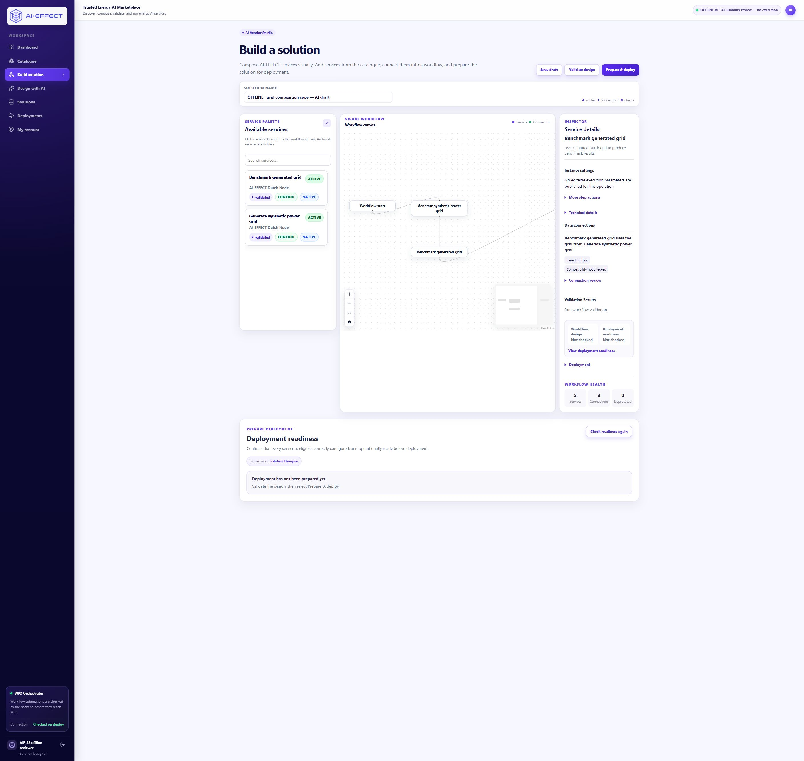

# AIE-41 — Builder and proposal-review usability refinement

29 October 2026. Focused review branch stacked on draft PR #11. No new composition capability.

## Owner-guided baseline

The owner reports completing **Apply → Undo → Apply → Save → Builder → refresh** successfully, with generator seed **42** and the connected benchmark preserved. This is **owner-guided feedback**, not independent first-time-user evidence:

- “The technical name captured_grid was difficult to locate.”
- “The interface felt text-heavy and complicated.”

The owner copy is draft `fe8110e0-631d-4527-aedc-2979e44ed83b`, revision **3**, saved as `2b58ac9e-6341-4b2b-88b3-d5607027c0d2`. A read-only inspection confirmed that state. This refinement did not reset or replay Apply/Undo/Save on it. The existing independent-participant brief and unfilled observer checklist remain preparation; **prepared; awaiting independent human walkthrough**. No observations were fabricated or substituted with these agent checks.

## Scope and source

PR #11 was verified OPEN/DRAFT at `dd8ecb4d6910b7f6039a3df13596b5620ad75e74` before creating `codex/aie41-builder-review-usability`, and rechecked unchanged before publication. Implementation commit: `e892d204716517cc869061312f8339f3e32291c3`; web tree `bcf419e1f182b991aa362f788eb7d536693ec8fa`.

The API tree remains `2e180c6a9e998456f0ca155e246c73a98e6380a1`, identical to PR #11. Contracts, binding authority, authorization, revision protection, compile/Save/Apply/Undo/execution routes and catalogue entries are unchanged. No workflow/run/session terminology redesign is included.

## What changed

- Data connections lead with actual endpoint labels and the selected source slot: **“Benchmark generated grid uses the grid from Generate synthetic power grid.”** The generic formatter also handles other operations and missing metadata. Labels do not establish compatibility.
- Persistence and checking are separate: **No binding selected**, **Binding configured · not saved**, **Saved binding**, **Compatibility not checked**, **Compatibility checked successfully**, and **Connection requires attention**. A successful check is tied to the exact endpoints, service identities, contract pins and named slots returned by the compiler. Actual design edits clear checks. A saved binding can remain saved while another setting has unsaved changes.
- Exact `captured_grid` names, schemas, pins, protocols, content types, instance IDs and whole-output transport limits are under **Connection review → Technical details**. Existing bindings are never overwritten by viewing. **Use published connection** is under explicit **Edit connection** when configured; selecting exactly the same published binding is a no-op. Pin/slot changes still invalidate checks and require Save/revalidation.
- Inspector prioritizes the selected step's name, a short purpose derived from catalogue input/output metadata, and supported settings. Provider/interface metadata and badges are collapsed. Errors, deprecated-service/sidecar warnings and required-input problems remain visible. Selecting an edge opens its connection review; no selection shows a compact instruction and graph count.
- Proposal review leads with the addition, its data source and unchanged parameters (including seed 42). Added and removed connections remain explicit under **Connection changes**; IDs/pins are under **Technical details**. Current versus proposed previews, OFFLINE banner, Apply/Undo/Save controls and the statement that Apply does not execute remain present.
- Canvas labels display at 14px, including historical inline-styled nodes, without changing stored style or positions. Proposal graph initial fit favors readable labels. Existing Builder viewport storage and **Fit workflow** are unchanged; an explicitly selected overview can still shrink a wide graph. Narrow Inspector scrolling uses the page rather than a second capped scroll area.

## Validation-message investigation

Before and after the changes, fresh loading, node selection and React Flow measurement did **not** reproduce “The solution changed and must be validated again before deployment.” After successful design validation, step selection, connection selection, details expansion and Fit workflow retained the valid state. No speculative loading/measurement invalidation rewrite was made.

On the disposable saved copy, changing **Random seed 42 → 43** without Save correctly cleared the successful connection check and showed that warning. Reload discarded that local edit, restored **42**, and removed the changed-design warning. No unsaved value was persisted. Re-selecting the identical published connection retained the successful check. Design validation continues to be separate from runtime readiness.

## Focused checks and actual outcomes

All frontend source at the implementation commit is covered by the final optimized build; no frontend source changed after it.

| Check | Actual result |
|---|---|
| Focused UI tests | **28 passed, 0 failed** (22 existing + 6 connection/purpose tests) |
| TypeScript `tsc --noEmit -p tsconfig.json` | Passed |
| Next optimized build `next build --webpack` | Passed; Next 16.3.8, 14 static pages |
| Generic summaries, unknown metadata, saved/configured/checked distinctions | Unit checks passed |
| Contract drift/missing definition/wrong slot | Attention state tested without rebinding or registry mutation |
| Desktop actual application | 1910 × 1074 CSS pixels; final node font 14px, retained viewport scale 0.9; selected step and connection/details accessible |
| Narrow actual application iframe | 390 × 844 CSS pixels; document client/scroll width both 367; no horizontal page overflow; proposal diff and seed setting accessible |
| View-only interaction persistence | Existing saved rows and completed draft histories unchanged; selection/details retained successful validation |
| Real setting edit | Revalidation required; reload restored saved seed 42 |
| Apply/Undo/Apply/Save/Builder/reload | Passed on **new disposable** draft below; Undo full design exactly matched its starting design |
| Provider / submission controls | Offline fixture provider mode `test`; SDK denial/harness unchanged; submission middleware returned **403** |
| Backend | No backend changes or new backend run. Existing full result remains **339 passed / 1 verified baseline failure**, not fully green |

Commands from `apps/web`:

```powershell
node --test --test-isolation=none lib/connection-review.test.ts lib/builder-viewport.test.ts lib/copy-instance.test.ts lib/submitted-settings.test.ts lib/experiment-journey.test.ts app/design-ai/session.test.ts app/design-ai/allowance.test.ts app/deployments/results.test.ts app/publish/guided-manifest.test.ts
node node_modules/typescript/bin/tsc --noEmit -p tsconfig.json
# Existing offline API route; no provider key; telemetry disabled:
node node_modules/next/dist/bin/next build --webpack
```

The Node test runner emits its existing module-type performance warning; tests pass. An early typecheck identified two possibly-undefined edge-data accesses, fixed before the final checks. The font cascade correction was verified against the rendered computed style. Initial automated SVG-locator clicks could not hit a zero-width vertical stroke; a direct pointer click at its observed location verified edge selection and the connection-focused Inspector. These are agent verification notes, not participant observations.

## Disposable copy and preservation

A new draft `83eb8349-643d-4e77-9886-74fc9c25b166` was prepared through normal authorized offline start/chat routes. The queued fixture was labelled provider-boundary test data; no real provider was used. Initial pending revision **0** was captured before changes. Apply produced revision **1**; Undo revision **2** exactly restored the complete starting design. The explicit existing fixture was queued again for that exact revision and known supported prompt, then Apply produced revision **3**. Save created `ba9d85b0-3389-4c07-bc0a-d27c7f7e908f`; saved nodes/edges exactly match the current draft. Original node identities, full settings, pins and positions are preserved; seed remains **42**. This copy is now saved, not a pending-participant handoff.

The original checkout remains dirty exactly as checkpointed; implementation uses a separate managed worktree at `local-backups/aie41-portal`. Existing offline database/guarded API/cluster/runtime stack were reused. Only the identified fixture **web** process on 23122 was rebuilt/restarted; API 28186 was not restarted. Original process records were retained, and attributable new process records are private under `local-backups/aie41-review-20261029/`.

Read-only before/after comparison found no differences in the five earlier databases, 156 protected evidence/profile files, existing container/image identities or original dirty source. All three pre-existing completed drafts remain revision **3**, and all pre-existing solutions, services, contracts, account credentials and permissions are unchanged. Normal authorized sign-in updated only the offline account's login audit timestamps and sessions; this is recorded separately. The profile has **zero deployments, execution submissions and local capture records**.

The existing allowance file is byte-for-byte unchanged, SHA-256 `c506929d99ae8b63de7e7d941d06aaac48ef27a4bea8eedc1a12fe407959b165`: **12/12 calls**, US$0.10 ceiling, **US$0.003784750** accounted, **US$0.096215250** remaining, **zero** outstanding reservations/unsettled charges. No amendment, provider call, workflow execution, production change, merge or tracker update occurred.

## Screenshots

These are agent-rendered offline fixture checks, not usability participant evidence. Builder before/after use the same preserved owner solution and selected benchmark; no node positions were rearranged or saved for images. Proposal before/after use the separate disposable pending copy. Full-page screenshots retain surrounding application context; the narrow fixture explicitly labels its viewport and limitations.

| Surface | Before | After |
|---|---|---|
| Builder | [Before](screenshots/aie41-builder-before.png) | [After](screenshots/aie41-builder-after.png) |
| Proposal | [Before](screenshots/aie41-proposal-before.png) | [After](screenshots/aie41-proposal-after.png) |



Additional evidence: [seed 42/settings](screenshots/aie41-builder-settings-after.png), [exact connection technical details](screenshots/aie41-connection-details.png), [narrow proposal](screenshots/aie41-proposal-narrow.png), [narrow Builder](screenshots/aie41-builder-narrow.png), [genuine unsaved edit requires revalidation](screenshots/aie41-real-edit-revalidation.png).

## Exact review links and operator checklist

- [Owner's preserved Builder — review here](http://localhost:23122/builder?solutionId=2b58ac9e-6341-4b2b-88b3-d5607027c0d2).
- [New disposable saved draft](http://localhost:23122/design-ai?draftId=83eb8349-643d-4e77-9886-74fc9c25b166).
- [New disposable Builder](http://localhost:23122/builder?solutionId=ba9d85b0-3389-4c07-bc0a-d27c7f7e908f).
- [Narrow fixture — starts on the same new saved draft; follow Open in Build Solution](http://localhost:23122/api/offline-fixture/narrow?draft_id=83eb8349-643d-4e77-9886-74fc9c25b166).
- [Sign in](http://localhost:23122/login), then reopen the exact review link. Existing identifier: `aie38-offline@example.test`.

Private credentials are in `local-backups/aie38-profile-20261028/private-config.json` **under the original production-ui checkout**, not the review worktree. Read the password only locally; never include it in chat, logs, notes or screenshots. No account/profile/permission/credential changes are needed. The full private credential location is `C:\Users\as\OneDrive - Maynooth University\Projects_2025\AI-effect\Web_Portal\ai-effect-solution-studio\ai-effect-solution-studio-production-ui\local-backups\aie38-profile-20261028\private-config.json`. The private before/after captures contain database/account data and must not be published.

Three-step owner checklist:

1. Open the preserved Builder link and explain which step supplies the grid and which consumes it, using **Data connections**. Distinguish a saved binding from a successful compatibility check.
2. Select **Generate synthetic power grid** and find **Instance settings → Random seed → 42**. Select the benchmark and confirm it has no published editable execution parameters.
3. Expand **Connection review → Technical details** and locate both exact **captured_grid** slots, pins and transport limits. Viewing/selecting needs no Save and executes nothing. Do not select Prepare & deploy.

## Remaining limits and follow-up

Independent first-time-user usability remains unverified; the independent checklist is still unfilled. Owner feedback on this revised UI has not yet been collected. The labelled fixture assesses prepared proposal review/controls, not real-provider intent interpretation or the complete first-time-user journey; do not require arbitrary chat that it cannot interpret. Current recorded benchmark / workflow / experiment / run / session wording concerns remain for team agreement, without a lifecycle redesign in this PR.

The compatibility compiler remains authoritative; display metadata cannot prove runtime availability or scientific validity. Only the existing bounded terminal-analyzer addition is supported. Arbitrary structural composition and production compatibility are unverified. The backend baseline failure remains visible. **AIE-18 and the bounded AIE-38 milestone remain In Review; broader AIE-38 composition is incomplete.**

Review dependency: this branch → **#11 → #10 → #9 → #8**. Publishing this draft review branch uses the repository's existing **Preview** deployment path; production remains at its pre-existing main-branch deployment. No merge or tracker change is authorized.
