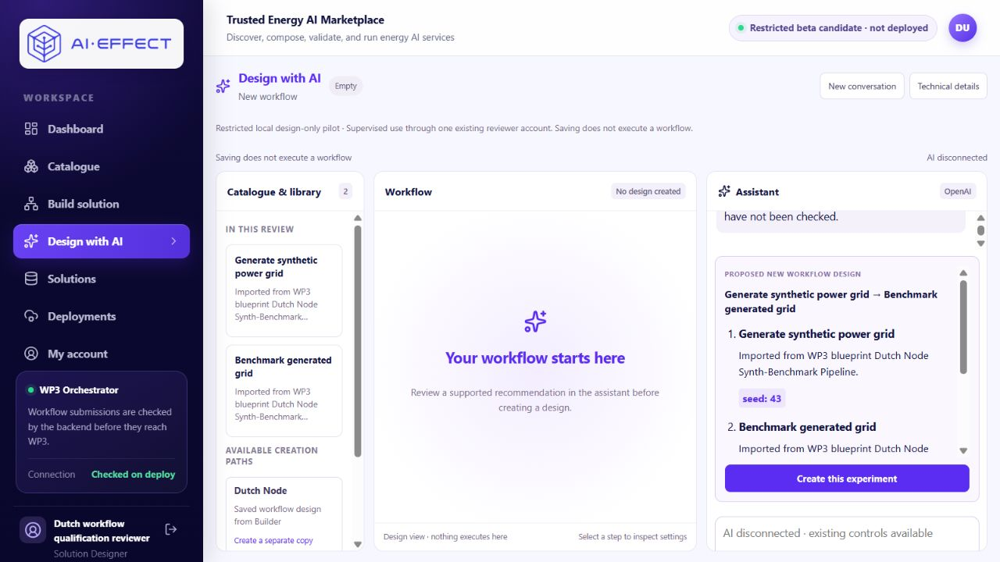

# Paused pilot: conversational repair, 12 November 2026

Status: corrected local candidate available for review; **no genuine retest run**.
The participant observations remain conversational-usability failures. Offline
checks do not establish that the provider will now converse successfully.

## Checkpoints and publication order

- Base: [PR #20](https://github.com/IRESI-EU/ai-effect-solution-studio/pull/20)
  at `14680bbebfb4db62c44330058f6593f26e28f7ce`.
- Focused stacked draft: [PR #21](https://github.com/IRESI-EU/ai-effect-solution-studio/pull/21).
- Implementation and tests were pushed and remotely verified **first**, at
  [f1e49485e37eac5a2e5963695b4a06efdd270f5c](https://github.com/IRESI-EU/ai-effect-solution-studio/commit/f1e49485e37eac5a2e5963695b4a06efdd270f5c).
  This is the actual packaged and serving source. This evidence/runbook follows
  separately; documentation-only commits do not change the served application.
- [Sanitized machine record](CONVERSATION_REPAIR_2026-11-12.json).

## Demonstrated causes and limits of the trace

The retained pilot audit contains eight settled structured provider responses
and their usage. It did **not** capture the provider request bodies. Browser
conversation history is local to each browser. The connected browser did not
expose the participants' external browser tabs, so no browser transcript was
invented, reconstructed or overwritten. The owner's supplied visible exchange
and the retained provider output can be compared; exact historical wire input
cannot be proven retrospectively.

| Response | Retained structured response | Previous server/presentation behavior |
|---|---|---|
| 1 | Clarification, with explanatory prose and a seed question | Prose replaced by question |
| 2 | Registered-workflow recommendation for seed 43, with explanation | Prose replaced by generic recommendation text |
| 3 | Setting explanation for an existing draft | Plain text displayed raw Markdown and technical terms |
| 4 | Clarification between a provided grid and generating one | Question displayed; provided-grid path lacked application evidence |
| 5 | Explanation of existing services, then registered-workflow/seed clarification | Explanation discarded |
| 6 | Explanation of seed randomness and limits, then seed clarification | Explanation discarded, appearing to ignore the question |
| 7 | Provider repeated seed clarification, with no selected seed | Genuine repeated question in the response; server also discarded prose |
| 8 | Registered-workflow recommendation for seed 42 | Recommendation finally surfaced |

Responses 4–8 align lexically with the reported Participant 2 sequence. The
audit does not store participant identity; responses 1–3 must not be treated as
verified participant attribution. No assistance level, understanding or
independent completion is inferred.

Separately established source defects:

- Discovery had no answer-only outcome. Registered-workflow instructions forced
  a seed question even when the operation declared a supported default.
- The backend replaced clarification explanations with only `discovery.question`.
  It also replaced useful recommendation prose. This demonstrably concealed the
  answer about seeds that the provider had actually returned.
- The UI sent only six history messages, truncating each to 2,000 characters,
  without disclosure. Focused draft handling discarded history entirely.
- The latest user answer was passed directly to the provider in source. At the
  first reported numeric answer, six preceding messages could still fit the old
  window. Thus history truncation alone does **not** establish why that first
  `42` was ignored. At the next turn, the opening pair would fall out. The
  provider's seventh response repeated the question; its exact received request
  remains unavailable.

## Bounded correction

`answer_only` carries no candidate, question, template selection, settings or
edits. Explanation requests need not become recommendations or questions.
Clarification retains the useful message and appends its structured question
once. Pending request/question context survives intervening explanations and
reloads within the same owner/conversation. It is untrusted conversational data;
it supplies no service, contract, revision or execution authority.

The actual form now sends complete history within the existing 12-message,
5,000-character-per-message and 16,000-total-character bounds. Exceeding them
preserves the messages and typed choice and visibly refuses before a request;
it does not silently remove context. Current server-read draft state and
authorization remain authoritative. New conversation isolates both history and
pending clarification; existing storage stays backward compatible.

The current operation's declared default is exposed to discovery. The qualified
registered path uses a seed default only if that pinned contract actually
declares a supported integer value. An explicit selected value wins; missing
required values without defaults are rejected. The review labels a used default
and the draft's supported settings remain editable before Save. There is no new
universal seed default or extension of this profile's seed range to other services.

Instructions answer the immediate question, describe supported inputs and
creation limits, avoid unsupported user-provided grids, and explain that seeds
control randomness rather than quality or benchmark version. They avoid claims
of guaranteed different output or reproducibility. Model prose remains fallible;
server-validated identifiers, contracts and explicit actions alone confer design
authority. No-match retains the server's honest limitation message, preventing
free prose from advertising an invented executable service as a supported match.

Assistant text uses a small React-escaped presentation subset for paragraphs,
lists, bold and code, with scoped readable list styles. HTML and scripts remain
text; Markdown images are omitted, links are inactive text and nothing is fetched.
No dependency or workspace layout redesign was introduced. An opt-in private
audit now includes sanitized request/history/pending context with responses for
a later retest. It remains outside public logs and the spending ledger. Original
eight-response evidence is unchanged and separate from future audit output.

## Offline checks and actual local update

- **191 backend tests passed** across conversation repair, discovery/composition,
  targeted settings, structural composition, prompt-first discovery, provider
  adapter and accounting protocol. These use isolated databases/provider doubles;
  they are not a paid conversation or scientific execution.
- **24 host frontend checks**, host typecheck, **18 packaged frontend checks**,
  production web build/typecheck and API dependency checks passed.
- Checks exercise actual API routes and the actual page form/rendering with
  doubles: clarification → explanation → one numeric choice, paraphrased questions,
  no mutation, declared/missing defaults, explicit values, stale authority,
  owner/new-conversation separation, preserved full context or visible refusal,
  and safe Markdown. Doubles prove transport/control behavior, not model reasoning.
- The known unrelated full-backend baseline failure remains historical; no
  unrelated full suite was rerun or claimed fixed. Initial focused failures and
  corrective runs remain in private logs; the final 191-case set is green.
- Staged and source-range secrets scans passed. Only tracked source entered the
  offline build context. Installed dependency images/base digests were reused;
  no dependency download, upgrade, production deployment or migration occurred.

The existing `ai-effect-aie37` **api/web only** were updated with `--no-deps
--no-build --pull never`, provider key empty and execution grant empty.
All 68 serving API Python files exactly match the package manifest, both image
revision labels match the source checkpoint, and web BUILD_ID is
`6y7rN_AJRS7b9xNgfh1Ab`. Actual API/web environment values are unchanged.
Designer authentication and normal config/templates/draft GET routes pass.
The authorized private discovery tool still advertises
`pair-a5c5793a07b3017820d63c7a`; its current declared registered seed default is 42.
The first proposed retest's measured framed input is 25,869 bytes under the
existing 32,000 bound. This read-only calculation reserves nothing.

All six solutions, six drafts, five submission records, four deployments, four
local execution records, two contracts, user roles/statuses and 36 capture-file
hashes match the preservation baseline exactly. This includes the completed
engineering acceptance and current participant saved states. No chat, Create,
Apply, Undo, Save or execution was replayed in the normal database. Existing
browser history was left intact. The original pilot's eight audit responses
retain SHA-256 `806c704e1803c424e87195f700059732c46c802b42ce32c8dd5ca469077fa0a2`.

The consistent private PostgreSQL backup is 47,474 bytes, with verified restore
listing and SHA-256
`dc9e1e81c2170c723425c79ef78cb2813bc245777e4ef1eea213b26f4e26064e`.
It is not a ledger copy or a new profile. The canonical ledger's bytes and all
rows also match before/after; no reset, amendment, checkpoint reopening or hold
release occurred.

## Operator handoff and rollback

Review at **http://127.0.0.1:23121/design-ai**. Existing designer:
`aie37-designer@example.test`. Read its password privately from
`<original checkout>/local-backups/aie37-profile-20261028/reviewer.json`;
do not paste it into notes, chat or screenshots.

Private records: `<original checkout>/local-backups/conversation-repair-20261112/`.
They contain participant-response copies, before/after row/hash snapshots,
consistent backup, focused test/build logs, image/build manifests and the
previous operator script. Do not commit this directory.

The original supervised-pilot start/stop helper was privately backed up. Its
optional `candidate.private.json` now points to this repair's build manifest and
separate private audit directory, so a later Stop does not silently revert the
application. Scope, token, database fingerprint, ports and policies are unchanged.
**Start-Pilot was not run; do not reconnect during this paused review.**

Retained rollback application source:
`9e21d1b0ba17e1d122c08dd155dd66d348eafbd8`, API
`sha256:d8b3673a30168239dfdf5de5518cb7f628cace897128635b52424da2943c60d4`,
web `sha256:75a5374bdb6f0e08a810ebdd564b1640649fcd65ffe4b843b71588e8b25f197e`,
BUILD_ID `osSD-WxNhHuZ2gPiGZGCo`. These images and the original build record remain.
For a source-only rollback, verify zero outstanding reservations, retain provider
disconnection, point the existing operator back to its original image record
(remove the optional pointer), and run its disconnected stage command for
api/web only. Do not restore the database or ledger. Preserve the newer browser
history; old UI code would again truncate outgoing context.

## Remaining allowance and later genuine retest

Stop-Pilot completed normal settlement before disconnection. Read-only current
accounting: **23/25 shared calls; 8/10 pilot; two calls remain; zero outstanding**.
Shared conservative accounted cost USD **0.009429750**; monetary balance
USD **0.090570250**, unchanged global ceiling USD0.10. The eight pilot requests
used 26,003 input and 1,901 output tokens and conservatively account for
USD0.004200875. Pilot lifetime reservations are USD0.040 of USD0.050; the two
remaining requests can reserve at most USD0.010 aggregate, USD0.005 each. Calls,
reservations and spend made by this repair task: **zero**.

Prepared later plan, **not executed and provider remains disconnected**:

1. Supervisor revalidates the published/serving source, current authorization,
   catalogue/default/pins, genuine model/pricing, original accounting TLS and
   exact scope (8/10, two remain, no holds), input/output bounds and empty execution
   grant. Existing authority certificate expires 15 November; never bypass TLS.
   Only resume within the existing authorization; no replenishment or new scope.
2. In a **fresh conversation**, send once: “What benchmarking capability is
   available, and what does its seed setting mean? Please explain before
   recommending a design.” This combines discovery and the unfamiliar-setting
   question to fit the two remaining calls. Expect a useful, grounded explanation,
   with no unnecessary Create/recommendation; one necessary question is allowed.
3. Send once: “42. Use that seed for the supported generate-and-benchmark design;
   recommend it for review.” Expect the choice retained without another seed
   question and an appropriately grounded recommendation. Retain the actual
   response and audit; stop on error, unclear authority or another clarification.
   No retry, third send, fallback or manual response repair. Preflight the actual
   second-turn framing before spending; if over bound, stop rather than truncate.
4. Only for a valid recommendation, the person explicitly creates/reviews/applies
   and saves their **new** design, then reopens it and explains that Save did not
   execute anything. These controls need no provider request. Never replay either
   participant's original work or enable execution.
5. Settle normally, record actual outcome and independent observations separately,
   then Stop-Pilot. Do not clear uncertain holds. After both requests the original
   shared 25-call and pilot ten-call ceilings must deny further calls.

The candidate is technically prepared for this bounded later retest, subject to
that fresh preflight. Four separate paid conversational turns cannot fit the two
remaining calls. If the combined first turn or next response fails, preserve the
failure; this plan does not guarantee completion or replenish the allowance.
Human retest observations: **prepared; awaiting supervised human retest**.
Independent usability, genuine-provider correction, production compatibility and
scientific/runtime execution are unverified by this work.
