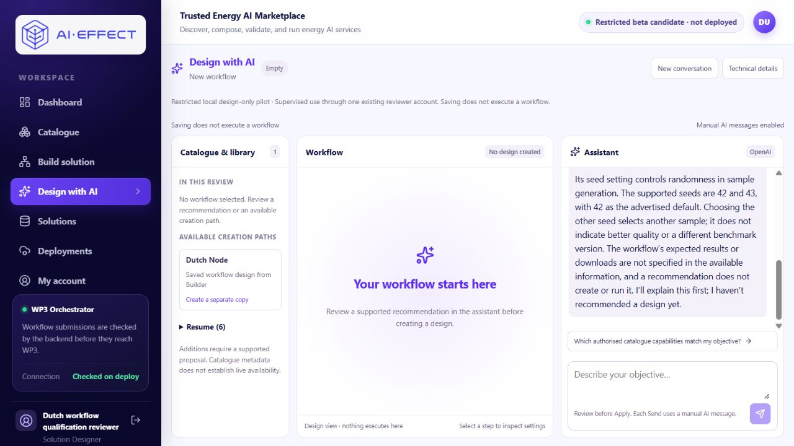
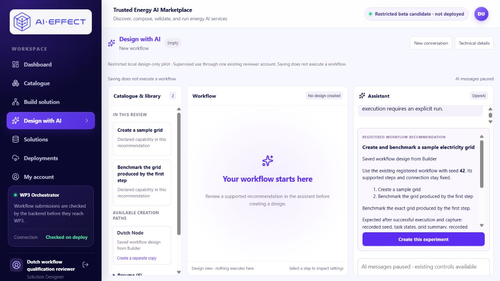
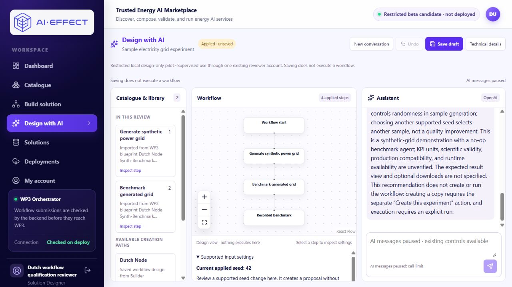
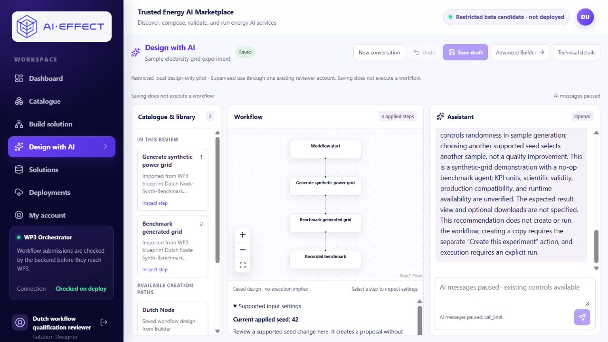

# Genuine repair retest, 12 November 2026

**Agent-operated genuine-provider verification, not independent human usability.**
Both dialogue requests pass their specified criteria. The requested controls
sequence is **partial**: Create, review, Save and refresh pass; a separate Apply
was **NOT RUN**, because the registered copy was created with seed 42 already
applied and no pending proposal. This is not a full controls-acceptance pass.
No response, success criterion or application source was repaired during the test.

Review: [PR #21](https://github.com/IRESI-EU/ai-effect-solution-studio/pull/21)
at `8548a907d37fc25ed50d6955e562f77c95607807`. Serving application source remains
`f1e49485e37eac5a2e5963695b4a06efdd270f5c`; web BUILD_ID
`6y7rN_AJRS7b9xNgfh1Ab`. Both retained image identities are in the
[complete sanitized structured evidence](CONVERSATION_RETEST_2026-11-12.json).
Original participant failures and the earlier engineering acceptance remain intact.

## Preflight and normal path

The worktree and remote review head matched the authorized checkpoint. Actual
API/web image IDs/revision labels and all 68 serving API Python hashes matched
the corrected package. Designer authorization and normal discovery succeeded;
the complete authorized catalogue projection, defaults, contract definitions and
pins matched the preceding repair checkpoint. Database identity and all existing
saved state were unchanged before spending.

The actual API verified the existing HTTPS accounting authority, CA, certificate
validity through **15 November 2026 12:59 UTC**, and exact retained consumer,
environment and PostgreSQL scope. Status was 23/25 shared, 8/10 pilot, zero
outstanding, USD0.090570250 remaining, with USD0.040 of the USD0.050 pilot lifetime
reservation cap consumed. Both USD0.005 reservations fit without any amendment.

Current [official Luna pricing](https://developers.openai.com/api/docs/models/gpt-6-luna)
and [cache accounting](https://developers.openai.com/api/docs/guides/prompt-caching)
were fetched before spending: per million tokens, input USD0.10, cached reads
USD0.01, 30-minute writes USD0.125, output USD0.50. The retained ledger
conservatively charges every input token at USD0.125; it does not depend on cache
discounts. The official unregionalized Responses endpoint, gpt-6-luna, low
reasoning, Standard (`default`), 30-minute cache, output limit 2,000 and zero
retries/fallback remained unchanged. No provider probe was made.

The existing Start-Pilot procedure reconnected that same candidate and scope.
New conversation was pressed on the normal origin, creating an empty conversation
without modifying an earlier transcript. Both prompts below were sent exactly
once through the actual browser form, web proxy, authenticated API, provider and
durable accounting path. No fixture, injected response or direct SDK shortcut was
used. Actual framed bounds were **25,869** and **26,865** bytes, each below 32,000;
the second was checked from the exact first response and its complete two-message
history before dispatch. Retained provider input confirms those two messages,
the exact latest request and no omitted/truncated history.

## Actual requests and assessments

### Request one — PASS

> What benchmarking capability is available, and what does its seed setting mean? Please explain before recommending a design.

Actual message, unchanged:

> The available benchmarking capability is the existing registered workflow “Create and benchmark a sample electricity grid.” It creates a sample grid, then benchmarks that exact grid. It is a synthetic-grid demonstration with a no-op benchmark agent; KPI units and scientific validity are not established, and production compatibility and runtime availability are unverified.
>
> Its seed setting controls randomness in sample generation. The supported seeds are 42 and 43, with 42 as the advertised default. Choosing the other seed selects another sample; it does not indicate better quality or a different benchmark version. The workflow’s expected results or downloads are not specified in the available information, and a recommendation does not create or run it. I’ll explain this first; I haven’t recommended a design yet.

Structured outcome: `answer_only`; candidate/question/template/seed/composition
settings null; edits empty. The backend rendered that explanation rather than
replacing it with a question. The response describes seed choices within this
registered local workflow, not as universal limits; it separates generation
randomness from quality and benchmark version. It predicts no grid counts or
guaranteed reproducibility. There was no forced choice, actionable recommendation,
draft or proposal mutation. All pre-existing database rows/hashes matched after
this request. Usage settled with no outstanding reservation before continuing.

### Request two — PASS

> 42. Use that seed for the supported generate-and-benchmark design; recommend it for review.

Actual message, unchanged:

> I recommend the existing registered workflow “Create and benchmark a sample electricity grid,” using seed 42. It creates a sample grid and benchmarks that exact grid. Seed 42 controls randomness in sample generation; choosing another supported seed selects another sample, not a quality improvement. This is a synthetic-grid demonstration with a no-op benchmark agent; KPI units, scientific validity, production compatibility, and runtime availability are unverified. The expected result view and optional downloads are not specified. This recommendation does not create or run the workflow; creating a copy requires the separate “Create this experiment” action, and execution requires an explicit run.

Structured outcome: `supported_recommendation`, seed **42**, question null,
candidate `workflow-283fb89a71a310be07f72cbd`; template null, edits empty,
composition settings null. The current authorized registered-workflow authority
was revalidated by the application at revision
`9c41db47b7938acbdc761928fbd45ed737aec368d8cbd8f2a1a2e6f20e599228`.

It retained the supplied seed without asking again, described generation followed
by benchmarking that grid, and accurately identified a registered copy rather
than new composition. It did not claim current runtime or scientific readiness.
“Execution requires an explicit run” is a necessary-action statement, not an
authorization: the actual grant was empty throughout and no run was permitted.
Chat itself created, applied and saved nothing; all original state still matched
immediately before explicit Create.

**Retained wording concern:** both messages say expected results/downloads are
unspecified. The discovery projection given to the provider omitted those fields,
while the server's validated recommendation card includes recorded seed/task/grid/
benchmark results and four optional downloads. This is a real prose/card
inconsistency, left unchanged and visible. It does not change the fixed selection
criteria, but should be addressed before another pilot. No production or scientific
success is implied by listing potential result fields.

## Controls and persistence — partial

| Check | Actual result |
|---|---|
| Explicit Create | PASS: new owned draft `4451cffc-24bd-4349-9d14-0059987755e6`, separate from all earlier work |
| Review | PASS: seed 42, both operations and their connection reviewed |
| Separate Apply | **NOT RUN**: no pending proposal/Apply control; Create returned the already-applied registered design at revision 0 |
| Save and refresh | PASS: new solution `1cb4c118-677d-4b39-9ac6-3f96280ac8d0`, Saved state and seed 42 persist |
| Identities, settings, pins and binding | PASS: exact node/edge/configuration equality from creation through saved draft and solution GETs |
| No execution | PASS: no new submission, deployment or local execution; 36 capture hashes unchanged; grant empty |

The registered Create path returns the draft directly when the recommended seed
already equals the source's current seed. Only a differing seed prepares a
parameter proposal. Here the source already used 42, so the UI displayed
“Applied · unsaved”; supported settings showed “Current applied seed: 42” and a
disabled Review seed change button. Undo was also disabled. No seed was switched
to 43, no artificial no-op proposal was injected and no helper forced Apply.
The unchanged-seed copy was saved through the visible Save draft action once.
Thus the requested separate Apply step remains unverified in this retest.

Both new records belong to the existing `aie37-designer` account. Preserved
processing identities: `generate-grid`, `benchmark-grid`; edge
`grid-to-benchmark`, binding `captured_grid` → `captured_grid`. Contract pins:

| Instance | Contract ID | Version |
|---|---|---|
| generate-grid | 921a87fc-329f-42b6-a546-ddf7d9c0ec26 | 1.0.0 |
| benchmark-grid | 441153b2-9b3b-48c1-81e4-649645f30143 | 1.0.0 |

The registered copy retains its established binding; this is not a new native
composition or fresh runtime qualification. The saved design's generator
configuration and authorized effective-parameter view both show seed 42. The
page states “Saved design · no execution implied” and “Saving does not execute a
workflow.” No readiness probe, grant, workflow submission or algorithm was invoked.

## Exact usage and shutdown

| Request | Input | Output (includes reasoning) | Reservation USD | Conservative charge USD | Rate-derived cost USD |
|---|---:|---:|---:|---:|---:|
| 24: explanation | 3,716 | 203 (0 reasoning) | 0.005 | 0.000566000 | 0.000565925 |
| 25: selection | 3,906 | 239 (45 reasoning) | 0.005 | 0.000607750 | 0.000365945 |
| **Total** | **7,622** | **442** | **0.010** | **0.001173750** | **0.000931870** |

Rate-derived cost uses the returned usage buckets and fetched rates; it is not an
invoice. Across both responses: 6 ordinary input, 5,514 short-cache-write input,
2,102 cached-read input tokens; zero 12-hour writes. Reasoning tokens are included
in output, not added again. The ledger conservatively charges all input at the
maximum 30-minute write rate.

Both usage records were normally settled and acknowledged. Final read-only
accounting: **25/25 shared; 10/10 pilot; zero calls remaining; zero outstanding**.
Pilot lifetime reservations: **USD0.050/0.050**. Pilot conservative total:
USD0.005374625. Shared conservative total: **USD0.010603500**; shared remaining
balance: **USD0.089396500**; original ceiling **USD0.10**, unchanged.

Accounting status denies dispatch with `call_limit`, and the actual Send control
is disabled. No third provider request or denial probe was sent. Stop-Pilot ran
after normal settlement and verified the provider key disconnected and execution
grant empty. The API's `provider_configured` is false; the UI displays the
exhausted allowance as “AI messages paused: call_limit.” The application remains
accessible. No reset, amendment, replacement scope or forced hold release occurred.

All prior 23 accounting rows and original eight pilot responses remain unchanged.
All pre-existing solutions/drafts, submission/deployment/execution records,
contracts, user roles/statuses and 36 capture hashes remain identical. Only the
one explicitly created draft and one saved solution were added. Source and build
identities remain the preflight candidate; no application edits, builds or test
suites ran during the paid retest. Private read-only evidence scripts were
adjusted for Windows UTF-8 and the existing API/ledger field shapes; these did not
change any provider response, application behavior, saved design or accounting.

## Handoff and recommendation

- [Fresh conversation](http://127.0.0.1:23121/design-ai?conversationId=e4cc1cfc-d0f9-4fda-b3aa-dc5953a8627c)
- [Saved design and retained conversation](http://127.0.0.1:23121/design-ai?draftId=4451cffc-24bd-4349-9d14-0059987755e6)
- [Saved Builder URL](http://127.0.0.1:23121/builder?solutionId=1cb4c118-677d-4b39-9ac6-3f96280ac8d0)

Existing sign-in remains unchanged; use the private
`<original checkout>/local-backups/aie37-profile-20261028/reviewer.json`.
Private snapshots, exact audit copies and verification scripts are under
`<original checkout>/local-backups/conversation-retest-20261112/`; no credentials,
participant transcripts, raw database rows or private configuration are published.
Published accessibility snapshots normalize trailing layout whitespace only;
private originals and exact structured message strings remain unchanged.

Keep the pilot paused. Review the already-applied registered-copy/Apply boundary
and align result/download explanations with validated catalogue facts before a
broader usability session. No further spending or source correction is performed
by this retest. This verifies **explanation plus explicit selection** only; it does
not fully reproduce clarification → explanation → numeric-answer conversation,
establish broad conversational quality or replace independent human retesting.
Independent usability, runtime/scientific validation and production compatibility
remain unverified. No production deployment, merge or tracker update occurred.
