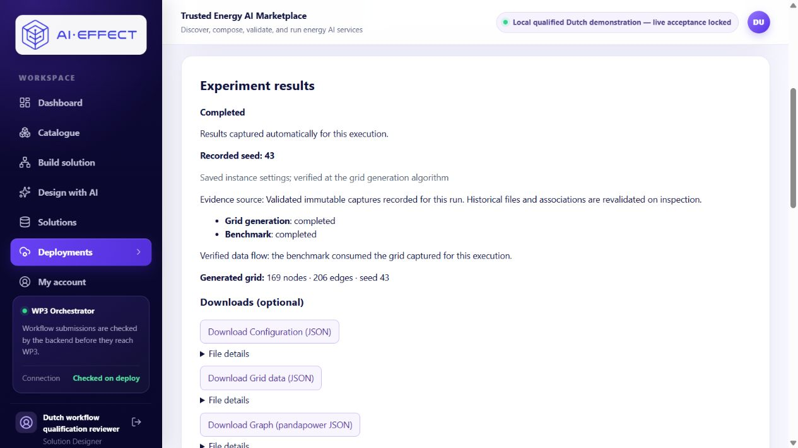
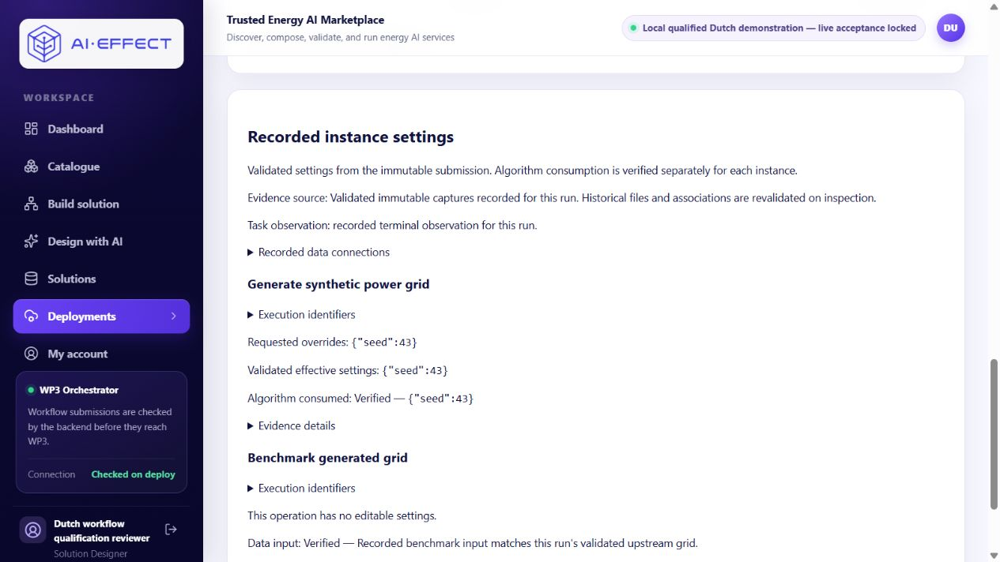

# Recorded evidence correction — 1 November 2026

**Separate correction and regression-verification record.** The [original 31 October live acceptance](DESIGN_AI_LIVE_ACCEPTANCE_2026-10-31.md) and its recorded UI failure remain unchanged. This work re-inspected the existing run; it did not repeat provider interpretation or execution acceptance.

Owner review: **refresh [the same results page](http://localhost:23121/deployments/wf-1b6eb7caaf57#results)**. No copy, Save, model request, new grant or workflow is needed.

## Diagnosis from the actual authorized responses

Before editing, normal signed-in requests to these three routes returned:

| Response | Actual before correction |
|---|---|
| `/api/deployments/by-workflow/wf-1b6eb7caaf57/results` | `available`; algorithm-consumed seed 43, validated same-grid binding and all four captures |
| `/api/workflows/wf-1b6eb7caaf57/submitted-configuration` | Valid immutable submission for owned solution `ef10cde8-15d4-4f6d-82dd-0525a16de4fd`, generator task `task_60e852c4`, benchmark task `task_e23bc51c` |
| `/api/workflows/wf-1b6eb7caaf57/instance-evidence` | `{"state":"unavailable","instances":[]}` |

The generic reader's `load_qualification` required `capture.qualification_enabled()`. That is the **legacy** execution-profile guard and intentionally requires Design with AI to be disabled. Actual flags were AIE-37 qualification **true**, Design with AI **true**, provider key **absent**, legacy qualification **false**, qualified demo profile **true**, automatic capture **true**. The generic reader therefore exited before reading the valid capture. This was a backend routing error, not merely wording.

The immutable submission/capture owner, saved solution, request and submission ID matched. The recorded terminal-observation digest was valid, with both expected task identities and their exact input/output references. Missing files or failed execution did not cause the observed empty response.

There were two additional integration defects: the generic reader fetched live orchestrator state directly instead of supporting recorded terminal observations, and it gated both instances on aggregate collection success. The frontend matched only logical instance ID, hid distinct evidence states behind “Unverified,” and did not refresh when capture became available after an already-terminal status.

## Correction

- The generic qualified reader accepts the existing bounded demo identity as well as the existing legacy qualification profile. The **execution** guard is unchanged. No arbitrary runtime adapter/profile is enabled.
- Both views use the same qualified capture validator. The bridge checks the owned workflow/solution, immutable request/configuration/binding snapshots and exact submission link. Instance projection separately matches logical instance, operation/node key, task, configuration and input binding. Editable solution values are never used for historical settings.
- Generator consumption is verified only after its configuration, grid and graph pass integrity/seed checks. Benchmark input is independently verified against this run's upstream manifest/grid digest and runtime references. A valid generator artifact or completed task cannot certify the benchmark.
- A valid recorded terminal observation is preferred for historical inspection. Its digest, workflow and complete task identities are checked, and files/manifests/associations are revalidated on every inspection/download. Cached success is not trusted. Missing or invalid observations cannot establish consumption during a runtime outage.
- Responses preserve pending, unavailable, inaccessible, conflicting and invalid per-instance verdicts with useful reasons. The frontend also rejects mismatching workflow/submission/task/node identities and refreshes evidence when captured results become available.
- Both sections name the same **validated immutable captures recorded for this run**, explain their historical nature and show generator-consumed **seed 43** and independently verified benchmark input.

Runtime timestamps are not part of the preserved terminal observation. Historical inspection does not invent missing live-only metadata; those timestamp fields can remain unavailable. Status, task references, immutable settings and artifact association remain recorded.

## Existing-run verification

The corrected actual responses both return **available**, with the same source and historical flag. The generic section reports `algorithm_consumed={"seed":43}` for `generate-grid` and `input_binding_verified=true` for `benchmark-grid`; it does not claim benchmark parameters or a generator input binding. Both use **recorded terminal observation for this run**. Browser rendering confirmed those same values after loading the existing URL.

The immutable submitted-configuration response is unchanged. All four authorized downloads still match the original live-acceptance hashes; unsigned requests return 401.

| Artifact | Original and current SHA-256 | Signed in / unsigned HTTP |
|---|---|---|
| configuration | `24f9e01c17119611c6c8315e5415d95cf1843cbb3993b70c1187f3cd0bc8e301` | 200 / 401 |
| grid | `c7f41cf987de793ac92cad894393188df4918ff8028b8cd05a674188d0199d16` | 200 / 401 |
| network | `a521315934294f2850d03b713e4cc29f0f0710f84b02ee95625f5dbc6f0f0462` | 200 / 401 |
| benchmark | `4e88e9b2bf9e71c94548498b31d635b889a3b5b6b39bd39ed5a35422ee79b1f0` | 200 / 401 |

## Source, build and regression checks

- Correction source commit: **`d0568d89ea018e91c4af65c9b6a8833e321c1e58`**, on existing PR #13.
- Backend source fingerprint: `a7fdeee238292e24b7d0cf9f2f275482c3e51dcd4349b0f403bd3ed63dd40875`.
- Existing native web build: **`_9OUF0yBLv4pKPA0e0pex`** on port 23121; API 28185.
- API image: `sha256:993302f295ac9feb511b448ea9730bf9aa6b64312841b43ac82b9a880a00cce8`, rebuilt from the existing local base without dependency upgrades, pulls or runtime-image changes.
- **111 related API tests passed**, 1,187 existing deprecation warnings, 64.88 seconds. Suites: qualified instance evidence, goal-to-results, instance parameters, automatic capture, qualification guard/runtime and deployment results.
- **6 focused frontend tests passed**; TypeScript and Next webpack production build passed.
- Focused regressions cover the discovered feature-flag mismatch; separate pending/failed evidence; wrong workflow/submission/task associations; missing/corrupt/unreadable files; a correctly hashed but semantically wrong grid; historical inspection without live runtime calls; revalidation after corruption; ownership; and immunity to editable-solution changes.
- The older test that changed a completed terminal observation into a failed history now uses independent terminal histories; preserved completed history is not rewritten to construct the failure case.

No unrelated full backend suite was rerun. Its known baseline failure remains visible: `apps/api/app/tests/test_package_import.py::test_missing_service_reference_returns_actionable_load_error`, expected creation HTTP 200 versus actual 409. The previous complete inventory was **369 passed / 1 failure**. These focused checks are not a claim that the complete backend is green.

## Preservation and remaining limits

All existing engineering rows in both the qualification and port-23122 fixture databases match their before-correction fingerprints, including the preserved run, submitted snapshot, capture collection, saved solution, accounts and draft histories. Original acceptance reports, old/new checkpoints and grant files are unchanged. Normal sign-in audit/session changes are excluded from engineering-state hashes.

The shared ledger is **byte-for-byte unchanged**, still **13/13**, with zero outstanding reservations. Provider remains disconnected, execution-grant setting blank, ledger mounted read-only and worker stopped. No provider request, workflow, grant, allowance amendment, ledger modification, saved-design edit, new profile, production change, merge or tracker update occurred. Only the existing API/native web were rebuilt/restarted; owner review needs only refresh.

The original acceptance was not retrospectively made fully successful. This separately verifies correction of its evidence-display failure using existing artifacts. Independent human usability and production compatibility remain unverified. The synthetic/no-op benchmark and scientific/KPI-unit limitations remain. AIE-18 remains **In Review**; broader AIE-38 composition remains incomplete.

[Sanitized correction evidence](DESIGN_AI_EVIDENCE_CORRECTION_2026-11-01.json) records source/build identity and outcomes. Private actual before/after responses, logs and re-downloaded bytes remain under `<original-checkout>/local-backups/evidence-display-correction-20261101/`. Startup is recorded there with native web PID 88044; no credentials/environment contents are published.
