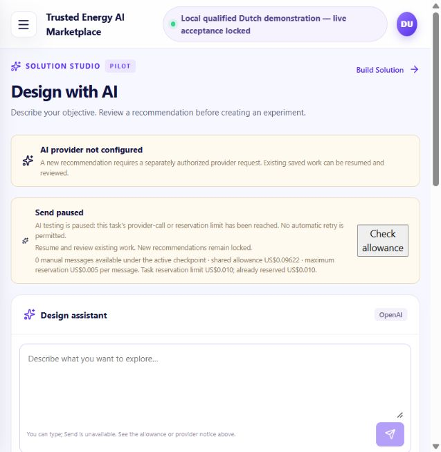

# Design with AI: one goal to its recorded results

31 October 2026. **Implemented and verified with labelled test doubles; new live acceptance awaits authorization.** No paid provider request, allowance amendment, workflow submission or algorithm execution occurred in this milestone. Independent human acceptance and production compatibility remain unverified.

## One starting point

Open **[Design with AI](http://localhost:23121/design-ai)**. It now uses the existing isolated AIE-37 qualification profile, its catalogue, database, designer and captured-runtime configuration. This is the normal application with the real provider adapter disconnected, not a queued-response fixture. The page intentionally says **AI provider not configured / Send paused**. No unrelated draft is automatically restored.

Existing login identifier: **aie37-designer@example.test**. Read its password only from `<original-checkout>/local-backups/aie37-profile-20261028/reviewer.json`. Do not print, copy into reports, reset or screenshot credentials. `<original-checkout>` is the preserved production-ui checkout, not this review worktree.

The separate port-23122 AIE-41/AIE-38 offline review application, account, owner solution and execution-denial harness are preserved. It is not the integration runtime. No new database, account, service catalogue or application stack was created. Only the existing AIE-37 API was replaced with the integration image and its native Windows web process rebuilt/restarted on its existing port. Redis, worker, orchestrator and both algorithm services remain stopped. The existing database remains running.

## What was disconnected, and what changed

| Gap found | Bounded integration |
|---|---|
| The earlier guided seed experiment used workflow run input and different contracts. The qualified Dutch capture workflow uses typed instance settings. | Recommend the existing qualified two-step workflow; carry supported seed 43 as a registry-validated parameter proposal. No new graph synthesizer or service is introduced. |
| AIE-38 adds one terminal analyzer while preserving existing settings. That structural mode cannot also change the generator seed. | Keep AIE-38's structural scope unchanged. This demonstration instantiates an already registered generator-to-benchmark workflow, then changes its seed. |
| Save, technical Builder and deployment were separate navigation steps. | After explicit Save, review readiness and explicitly confirm execution in the same Design with AI workspace. Full Builder remains optional. |
| The browser registered deployment history after dispatch, risking loss on a failed response/navigation. | Commit a durable attempt before dispatch and register the resulting workflow/history on the server before returning. Refresh reads the attempt; repeated confirmations cannot dispatch it again. |
| Terminal task state depended on a live orchestrator even when immutable captures existed. | Record the exact associated run's first complete terminal task observation and digest. If the runtime later disappears, identify recorded status explicitly and revalidate that run's files on every download. |
| The old supported operator command handled only 10-to-12, and host checkpoint paths differed inside Docker. | Add a separate, narrow, audited 12-to-13 command and exact inspected bind-mount mapping. Test only disposable ledgers. Neither preview nor apply was run against the shared ledger. |

The approved catalogue and active operation registry remain authoritative. Recommendation revisions include the saved source, current catalogue metadata and contract definitions. Explicit creation revalidates and locks that authority; stale or incompatible facts fail before a copy is created. The assistant supplies no executable graph. Parameter validation, owner checks, Apply/Undo/Save and revision protection remain in force. A pending proposal must be Applied or rejected before Save.

The saved source remains `98eadd46-5b58-4517-b706-f2a7b9ed6bc4`, currently seed **42**. Supported generator settings remain integer **42/43**. The benchmark receives the generator's named `captured_grid` output through the existing qualified whole-output binding. Results are conditional on successful explicit execution and capture. The synthetic grid, no-op benchmark, unknown KPI units and scientific-validity limits from [AIE-37](AIE37_CATALOGUE_QUALIFICATION.md) still apply.

## Short demo runbook — after separate authorization only

1. Sign in at the starting URL above. Begin without `draftId`, an active draft or restored unrelated conversation. Confirm the registered Dutch workflow is available. Send this **one exact prompt once**:

   > Create a sample electricity grid using seed 43 and benchmark it.

2. Review the recommendation: **Create a sample grid → Benchmark the grid produced by the first step**, supported seed **43**, the same-grid connection, and results only after successful execution/capture. It must identify an existing registered workflow, not claim arbitrary composition. No draft or execution should exist yet.
3. Explicitly choose **Create this experiment**. Review the pending seed **42 → 43**, with the benchmark and connection preserved. **Apply**, then **Undo** and verify 42. Use the existing supported seed control to prepare 43 again; **Apply**, then **Save**. These controls make no further model request. Keep the exact new owned copy and draft URL.
4. Choose **Review execution readiness**. Design validation, service eligibility, live runtime health, contract/binding/configuration compatibility and the saved revision must pass. Saving itself executes nothing. An absent operator grant leaves execution locked. Full Builder is optional; unresolved configuration issues must be reported, not silently repaired.
5. Choose **Start execution**, review the confirmation, then **Confirm and start execution once**. The server commits the attempt claim before dispatch and retains its immutable submission digest. Navigate to **that new workflow ID**. If navigation fails, **Check stored execution status / View this run's results** resumes the same attempt without redispatch.
6. On that exact run, inspect recorded seed **43**, both task states, the supported grid summary, recorded benchmark values and same-grid input provenance. Download the authorized Configuration JSON, Grid JSON, Pandapower graph JSON and Benchmark JSON; record their hashes. Do not substitute historical workflow `wf-45c1c8c84ed3` or its values for this new attempt. Later saved-design edits must not rewrite the submitted display.

This runbook has **not been performed live** in this milestone. Agent-run fixtures prove the software path only. No new human observation is claimed; human walkthrough remains pending. Current product terminology is retained. Workflow/run/session wording concerns stay in the [existing usability follow-up](AIE41_USABILITY_REFINEMENT.md), outside this bounded integration.

## Failure and recovery rules

- Unsupported goal, missing/incompatible service, unsupported seed or stale recommendation: preserve the response/error; no draft creation or manual repair reported as provider success.
- Stale proposal, unsaved/pending changes or saved-solution drift: reject Apply/Save/execution. Review the actual state; no silent rebasing.
- Unauthorized draft, attempt, result or download: deny before inspecting runtime/capture data.
- Lost submission response, missing/invalid runtime ID, historical-ID collision or association failure: preserve the durable attempt and uncertainty/warning. Reconcile read-only; **no automatic retry**. This is local claim/replay protection, not distributed exactly-once execution.
- Failed tasks, incomplete capture, missing or corrupted files: display the actual failure or unavailable evidence. A recorded terminal task observation does not manufacture artifacts or establish algorithm success.
- A refresh or duplicate confirmation can return the existing run, but cannot create another dispatch. A one-execution grant is also consumed across different saved copies.

## Verification and source provenance

Review base: Portal PR #12, `c352ca4fab8e065d3105d91ff38c96d92ba9497f`. Branch: `codex/design-ai-goal-to-results`. The full backend inventory was run against the final implementation source, SHA-256 **`8bc9938b586856f947e3eab2b544165029bea755dfa9ade083327e5c92556a81`**; each suite checked that the source did not change during its run. The implementation commit is recorded in the machine evidence after committing. Tests use separate disposable databases and explicitly labelled provider/runtime/algorithm/capture doubles. They make no paid calls or real submissions.

| Check | Actual result |
|---|---|
| Portable backend: `python -m pytest apps/api/tests -q` | **265 passed**, 2,152 existing deprecation warnings, 163.24s |
| Legacy backend: `python -m pytest apps/api/app/tests -q` | **91 passed, 1 failed**, 15 warnings, 17.17s |
| PostgreSQL: `python -m pytest apps/api/postgres_tests -q` | **13 passed**, 106 warnings, 42.58s; includes concurrent same-attempt and cross-copy grant claims |
| Complete backend inventory | **369 passed / 1 failed / 0 skipped**; not fully green |
| Web Node tests | **36 passed** |
| TypeScript | Passed, `tsc --noEmit -p tsconfig.json` |
| Next production build | Passed, `next build --webpack`, 14 pages; staged build ID `j-ZtMetOu_Ihgvr2lpCg2` |
| Actual staged application | Signed in using existing designer; ordinary landing shows no draft, no conversation/activity, real-provider mode, provider disconnected and Send paused |
| Real formatted-context audit | Read-only probe stopped before provider: 6,636 characters, conservative input bound **20,653 ≤ 32,000**, max output 2,000; registered workflow and seeds 42/43 |
| Preservation | Both qualification/offline engineering databases and all **55** protected profile/evidence/ledger files match before/after fingerprints; normal sign-in audit/session changes excluded |

The unchanged baseline failure is `apps/api/app/tests/test_package_import.py::test_missing_service_reference_returns_actionable_load_error`: expected creation HTTP 200, actual 409. It also fails on the earlier AIE-37/PR11 baseline and predates these changes. It is not suppressed, repaired or counted as passed. Final source includes the three late AIE-38 cases that postdated its earlier full run.

Coverage includes the complete prompt-to-recommendation-to-copy/Apply/Undo/Save-to-confirmation/results path with doubles; immutable historical seed and four verified downloads; unsupported/missing service; stale contract/revision/Save; ownership; duplicate/replayed/uncertain submission; failed execution; absent/corrupt capture; runtime outage using only the same run's recorded terminal observation; and paid-provider/legacy-submission gate enforcement. The new allowance tests use disposable ledgers and verify one additional slot only, preserved records/money, preview immutability and refusal at 13.

Maintained WP3 source `c6695d8444edb14b94111f16d8620c460880849b` matches all **24** recorded qualification source-file hashes. Its parameter validator digest remains `1861736c1bd9c8a1e4d3aa86b1a2f58ef27bf5e272d682a619062cfb8b7171aa`. The relevant parameter/worker/workflow/API implementations match published WP3 PR #3 head `0221b7ecd4a2d5f072de640350ebc599df22131a` (readiness file differs only in line endings). No WP3 change or new runtime execution was needed.

Private raw logs, JUnit, preservation hashes and startup records remain under `<original-checkout>/local-backups/demo-acceptance-20261031/`; no credentials or private environment contents are published. Sanitized [machine evidence](DESIGN_AI_GOAL_TO_RESULTS_EVIDENCE.json) accompanies this report.

## Current task status — recommendations only

| Task | Implementation / offline verification | Real-provider verification | Actual execution | Human acceptance | Production | Recommended tracker status |
|---|---|---|---|---|---|---|
| AIE-18 parameterisation | Typed instance settings, validation, independent copies and immutable submission integrated; offline tests retained | Two historical targeted-instance cases passed; this Dutch goal not yet sent | Earlier bounded algorithm-consumption evidence retained; no new edited demonstration run | No independent acceptance | Unverified | **In Review**, unchanged |
| AIE-37 qualification | Existing Dutch two-step contracts, binding and capture path reused; other national candidates remain unqualified | Not required for earlier qualification; new recommendation pending | Historical `wf-45c1c8c84ed3` completed with same-grid benchmark; new run pending | Independent acceptance pending | Unverified | **In Review** for bounded local qualification |
| AIE-38 composition | Existing one-analyzer addition retained; broad composition incomplete. This journey recommends an existing workflow | Structural interpretation and this goal remain unverified live | No AIE-38 structural execution claimed | Prepared independent walkthrough still awaits a human | Unverified | Bounded milestone **In Review**; broader composition **In Progress** |
| AIE-40 execution/results | Same-workspace review/confirm, durable attempt/history and exact-run recorded results integrated; failure/concurrency checks pass | New end-to-end interpretation pending | Earlier captures retained; new integrated submission/results pending | Pending | Unverified | **In Review** for this integration, acceptance pending |
| AIE-41 usability | Existing overview, settings and bounded Technical details retained; mandatory Builder removed from this journey | No new provider claim | No new execution claim | Earlier owner feedback informed UI; independent first-time-user acceptance pending | Unverified | **In Review** |

Portal review dependency remains **new integration → #12 → #11 → #10 → #9 → #8**; WP3 **#3 → #2**. All existing heads remain unchanged. No merges, tracker updates or production deployment occurred. The milestone is **not live-accepted or complete** merely because offline checks pass.

## Exact authorization requested next

Authorize only: the one prompt in this runbook, **one actual provider attempt**, **gpt-6-luna / low reasoning / Standard**, max output **2,000** including reasoning, zero retries, no fallback; maximum aggregate reservation/spend **US$0.005**. Then, conditional on a valid recommendation and successful explicit review/Save/readiness, authorize **exactly one new local Dutch seed-43 generator → benchmark workflow**, on the same saved owned copy. No other model messages or executions.

The shared ledger remains **12/12**, ceiling **US$0.10**, accounted **US$0.003784750**, remaining **US$0.096215250**, zero outstanding reservations. Its SHA-256 is unchanged: `c506929d99ae8b63de7e7d941d06aaac48ef27a4bea8eedc1a12fe407959b165`. Separate approval must explicitly supersede the no-increase rule **only for a supported 12-to-13 amendment** on this exact ledger. Preserve all 12 records, the original 10-to-12 audit, all exhausted checkpoints and the monetary ceiling/balance except normal one-request charges. No reset, replacement ledger, additional funds or direct SQLite patch.

The [operator procedure](DESIGN_AI_GOAL_TO_RESULTS_OPERATOR.md) prepares one new immutable 1-call/US$0.005 checkpoint and one attributable, cross-copy-consumed execution grant only after approval; previews and applies the supported amendment once; verifies the genuine current context/settings and complete allowance before the request; and checks old Redis work before starting the existing worker. The current API has no key/grant and a read-only ledger. The live override has **not** been activated.

Stop without another provider request or workflow attempt on clarification/refusal, invalid proposal, drift, failed readiness, unexpected queued work, uncertain dispatch, failed tasks or unavailable/mismatched capture. Do not answer a clarification or manually repair a response and report it as a pass. Record the actual response, token usage, settled cost/holds, remaining money, exact new IDs and artifact hashes. At **13/13** the shared count ceiling must again block further calls. Reconcile uncertain charges normally; never release unknown usage by assumption.

Standard pricing rechecked 31 October: per million tokens, input US$0.10, output US$0.50, cached input US$0.01, default 30-minute cache writes US$0.125. The adapter requests no extended cache retention. Its conservative 32,000-input/2,000-output reservation is US$0.005 and assumes no discount. Sources: [model](https://developers.openai.com/api/docs/models/gpt-6-luna), [pricing](https://developers.openai.com/api/docs/pricing), [cache retention](https://developers.openai.com/api/docs/guides/prompt-caching). Revalidate these before separately authorized spending if they change.
