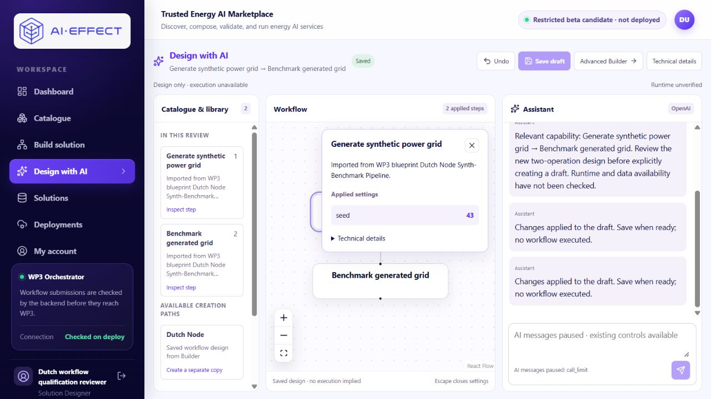
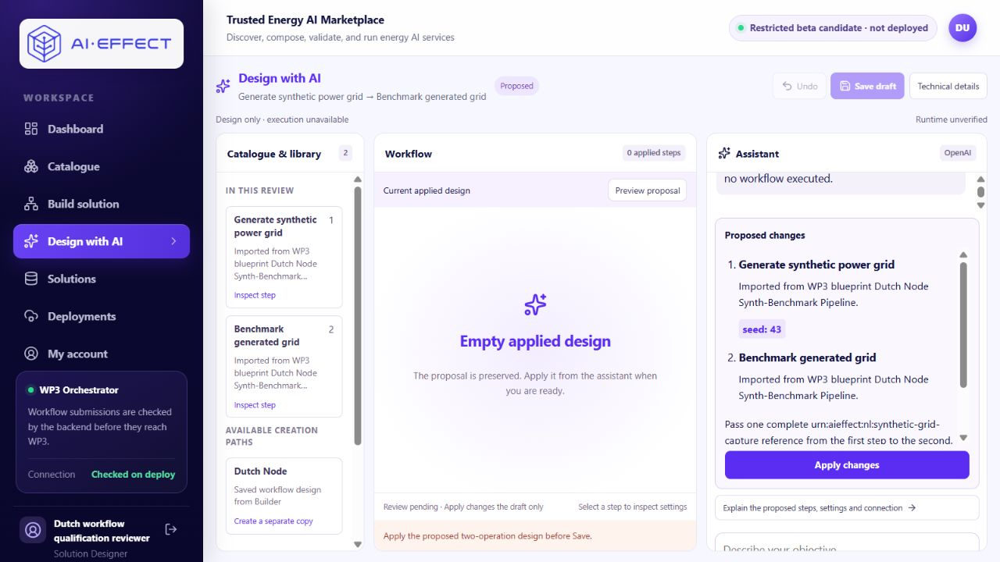
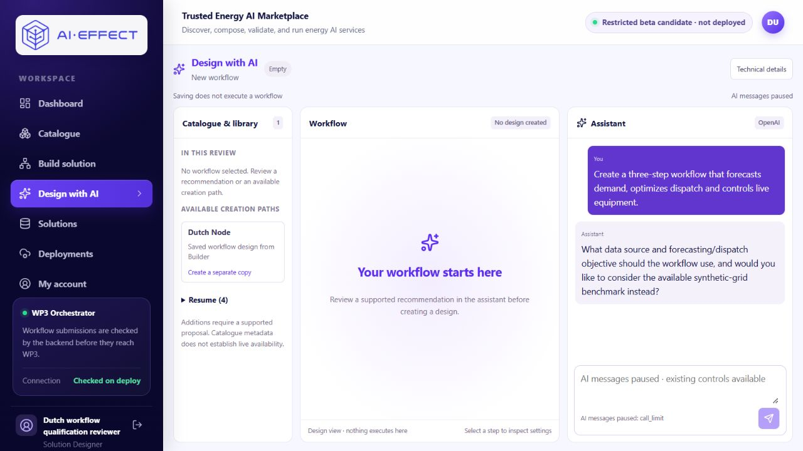

# Genuine local composition acceptance

Starting checkpoint: PR #18, dca4838d0d41ca2bc18b1271adb4684bf7979f5d.
This record is separate from the completed platform parameterisation runs.

## Preflight and fixed acceptance

Normal application: http://127.0.0.1:23121/design-ai, retained aie37 designer.
No synthetic catalogue, provider fixture or template-policy clearing is allowed.
Read-only discovery advertises pair-a5c5793a07b3017820d63c7a at revision
26add1b21313352f06577e801fb4178c012cd3b4ed7f3d0505d5e7401a10a0db:
ConfigureAndSynthesize, seed 43, then RunBenchmark, captured_grid to captured_grid,
whole-output-v1. This is a local adapter contract, not partner-native authority.
The registered workflow remains advertised alongside the new composition pair.

The owner authorizes the existing canonical ledger's audited 13→15 amendment,
one new two-call scope, USD0.005 per request/USD0.010 lifetime reservations and
unchanged USD0.10 shared ceiling. No beta amendment, execution grant or workflow.
Use gpt-6-luna/low/Standard, output ≤2,000, zero retries/fallback, explicit 30m
cache lifetime and framed input ≤32,000. Rates rechecked 12 November 2026:
input USD0.10, 30m writes USD0.125, cached USD0.01, output USD0.50 per million.
Sources: [model](https://developers.openai.com/api/docs/models/gpt-6-luna),
[pricing](https://developers.openai.com/api/docs/pricing),
[cache lifetime](https://developers.openai.com/api/docs/guides/prompt-caching).

Case A, exactly once:
> Create a new two-step design that generates a sample electricity grid using seed 43 and benchmarks that same grid. Do not copy a registered or saved workflow.

Require a genuine new-pair recommendation, no chat-side mutation, then explicit
Create, Apply, complete empty-state Undo, Apply again with stable identities,
Save and refresh retaining settings, contract pins and binding in Design with AI.
Execution remains unavailable. Clarification, refusal, wrong selection, invalid
output, uncertain accounting/transport or retention failure ends acceptance.
Preserve failures; no second attempt, manual repair or model explanation.

Only after A passes, use a separate conversation for Case B, exactly once:
> Create a three-step workflow that forecasts demand, optimizes dispatch and controls live equipment.

Require a specific clarification/no match, no Create authority or mutation.
Do not answer the question or modify A's saved copy.

## Local accounting integration correction

The retained API is a Linux container, while the unique canonical ledger remains
on Windows. The client now accepts an explicit private CA file for HTTPS only.
Normal certificate and hostname verification remain enabled; missing/corrupt CA,
plaintext remote HTTP, redirects, environment proxies, retries and local fallback
remain denied. The local authority binds Windows loopback only; Docker Desktop's
host gateway reaches it using verified HTTPS. No production tunnel is required.
The private CA is not installed into the OS/browser trust stores.

The qualified-profile provider guard now permits the exclusive shared authority
in place of legacy checkpoint-file configuration. It still requires the exact
qualified profile; legacy database guards and shared consumer/database binding
remain unchanged. No copied ledger or source injection is used.

## Outcome

Preparation in progress. No genuine request or ledger amendment has occurred at
this source checkpoint. Agent checks are not independent participant observations.
Actual responses, accounting, build identities and retention evidence will be
appended after the bounded acceptance, including any failed result.

Offline correction checks: 104 passed (six focused accounting/provider/guard files). Real loopback TLS accepts the supplied CA and denies untrusted/wrong-host certificates. Synthetic ledgers and SDK doubles only. The initial sandbox runs failed on Windows temporary-directory ACLs; the successful run used a short explicit test path with approved host access. Docker-to-host TLS preflight returned HTTP 200 with accounting inactive and no provider access. No frontend source changed; the retained verified web build is reused.

## Completed acceptance — separate actual observation record

Both cases below were performed by the agent through the normal browser
application, after the published source/configuration checkpoints d950cb335624
and df6d860. They are not independent human observations. The earlier
parameterisation proof and all historical acceptance reports remain unchanged.
Full original visible structured responses, returned numeric usage, contract
facts and control evidence are in [the sanitized record](LOCAL_COMPOSITION_ACCEPTANCE_2026-11-12.json).

| Case | Result | Actual observation |
|---|---|---|
| A | PASS | One genuine response selected pair-a5c5793a07b3017820d63c7a with first.seed=43, second=[]; no chat-side draft or saved-design mutation. Explicit Create, Apply, Undo, Apply, Save and refresh passed. |
| B | PASS | One genuine response returned clarification_needed, candidate_id=null, composition_settings=null and edits=[]. No Create authority, draft mutation or execution; A stayed identical. No follow-up was sent. |

A's original provider explanation recommended a new catalogue-composed design,
said seed 43 would be passed to the generator and the complete grid reference to
the benchmark, and stated execution was unavailable. The normal UI rendered the
server's capability summary and structured two-step review. It did not select
the separately advertised registered workflow. The registered-workflow policy
was unchanged throughout.

B's original explanation explicitly said the catalogue did not provide
forecasting, dispatch optimization or live equipment control. The displayed
question was:
> What data source and forecasting/dispatch objective should the workflow use, and would you like to consider the available synthetic-grid benchmark instead?

The offered alternative is a wording limitation, preserved without accepting or
repairing it. This passes the fixed clarification/no-authority criterion, not a
claim of ideal dialogue quality or broad composition. The UI renders the
structured question instead of the model's fuller explanatory message.

B used an empty conversation at http://localhost.:23121/design-ai on the same
retained web/API. DNS was verified to resolve only to loopback. This distinct
browser origin preserved both A's conversation and an older localhost
conversation without clearing storage, creating an account/profile or changing
ports. Both prompts had empty history at dispatch.

### Saved design and retention

- [Design with AI](http://127.0.0.1:23121/design-ai?draftId=a81c5992-7676-5f40-834c-db781e52ff1d)
- [Optional Advanced Builder](http://127.0.0.1:23121/builder?solutionId=50edcf79-5afd-4a2a-8689-242537b26814)

The new draft is owned by aie37-designer and has source kind catalogue_composed;
no saved template was copied. The empty initial and undone designs matched in
full (hash 7e8d09f3762c59a5f1a1ce5b116bdb8dd8a11cc5a5760e6202c9437dc76524f7).
The pending proposal and allocated IDs remained identical after Undo. The first
Apply, second Apply and saved/reloaded design matched in full (hash
89e312b74b452678e52e396ee46fa0e654ce0424b5014d8aef72d256e7cc4cc4).
Revisions were 0 → 1 → 2 → 3; Save preserves revision 3. One private verification
assertion initially assumed Save increments the revision; source inspection
confirmed it does not. No application state was repaired or model call repeated.

| Step | Instance | Contract pin |
|---|---|---|
| ConfigureAndSynthesize | 4efe1b0a-f1c4-49ea-b3ad-8a82026427c8 | 921a87fc-329f-42b6-a546-ddf7d9c0ec26 @ 1.0.0 |
| RunBenchmark | ac5af9a2-287c-4a74-8a85-0df6e542d99b | 441153b2-9b3b-48c1-81e4-649645f30143 @ 1.0.0 |

Seed remains 43; captured_grid → captured_grid remains a single whole-output-v1
connection. Save stayed in Design with AI. Saved metadata enforces
design_only_catalogue_pair. No readiness probe, grant, submission or execution
occurred.

### Actual accounting

The supported authority applied exactly 13→15 on the canonical existing ledger.
Its attributable activation and six reserve/settle/acknowledge events are intact.
All prior 13 usage rows, original amendments and exhausted checkpoints remain.
The new scope is composition-acceptance-20261112, bound to the retained local
PostgreSQL identity and exact consumer. No beta amendment was applied.

| Case | Input | Output (includes reasoning) | Cache read / 30m write | Reservation | Conservative settled charge |
|---|---:|---:|---:|---:|---:|
| A | 3,335 | 224 (41 reasoning) | 0 / 3,332 | USD0.005 | USD0.000528875 |
| B | 3,321 | 155 (0 reasoning) | 1,722 / 1,596 | USD0.005 | USD0.000492625 |

Actual reserved framed bounds were 23,765 and 23,706, below 32,000. The earlier
read-only context estimates were ten units lower; actual durable permit bounds
are authoritative. Each actual response was gpt-6-luna, completed, default
(Standard), with the configured low reasoning, ≤2,000 output, no retry/fallback.

New usage: **6,656 input / 379 output**, two calls. Lifetime reservations:
**USD0.010**; conservative settled charge **USD0.001021500**. The existing
accounting policy charges all input at the maximum short-write rate; returned
cache details imply a token-rate estimate of USD0.000823320, which is not an
invoice or a ledger refund. Accounting was not changed after observing usage.

Shared total is **15/15**, **USD0.005228875** conservatively accounted,
**USD0.094771125** remaining beneath the unchanged USD0.10 ceiling. Lifetime
ledger token totals are 33,231 input / 2,150 output. There are **zero outstanding
reservations** and zero remaining calls; status denies further dispatch with
call_limit. Provider is disconnected and execution grants remain empty.

### Serving identities, preservation and rollback

API source d950cb3356246cd756fa6e377644b881981b2e1b, image
sha256:dd79cf9a36ac9b81b97c20eee17d5b08e9e404aa98934a3adf2b1036afcc77d4;
all 68 application Python files matched the packaging manifest. Web source
4ff3285bdaf6cd0951b946b1d1667212b197e74d, retained image
sha256:fba983fef01d461e79db22444c34c76b9737df84365d200972085672a4052614,
BUILD_ID XLX_batDPkRXN0X7avzOq. No web rebuild or UI change was required.
Later changes on this branch are startup configuration/evidence only.

The database identity/volume and the four prior saved solution rows,
four submissions and four deployments are unchanged. All 36 capture files
remain; the original 18 hashes and the eight published artifact hashes from
both earlier parameterisation runs match. B changed no design/database rows.
The new copy is the only new draft/solution. No production or synthetic profile
was changed.

The previous API image remains retained at
sha256:3717c012fed8d8cd4f04469335b8f93a42224708f54dfd08c3b6858aa4d74c19.
The consistent pre-update database dump (verified pg_restore listing), component
configuration, CA/server key, amendment request, raw audit and rollback records
are private beneath <original checkout>/local-backups/local-composition-acceptance-20261112.
Do not restore a database for this source-only rollback or replace the ledger.
Restore the retained API image with the provider/grant empty; keep all shared
authority settings selected and fail closed if the old source cannot use them.
Never reactivate a legacy writer after authority installation.

### Local operator reproduction

Use installed dependencies and pinned inputs with build_candidate.py --roles api;
its context is tracked source only. Reuse the retained verified web image. The
source-only publication preceded all paid requests.

For a separately authorized future operator operation (not permission to repeat
these exhausted cases): inspect the exact canonical ledger using
deploy/restricted-beta/amend_shared_allowance.py; use its dry-run/apply mechanism
with exact file identity/SHA and a private scope request. Never initialize/copy a
ledger or reopen this checkpoint. This acceptance's allowance is exhausted.

The native authority startup shape is:
~~~text
DESIGN_AI_AUTHORITY_LEDGER=<canonical existing ledger>
<existing Python> -m uvicorn app.accounting_authority:create_app --factory --app-dir <reviewed source>/apps/api --host 127.0.0.1 --port 28205 --ssl-certfile <private certificate> --ssl-keyfile <private key> --no-access-log
~~~
Use private local logs and an independent hidden native process. The public CA
is mounted into the API only, not installed into system/browser trust.
Combine the retained compose.yaml, demo.compose.yaml, parameterisation.compose.yaml
and composition-acceptance.compose.yaml with exact recorded image/path/consumer
variables. Start **api only** using up -d --no-deps --no-build --pull never.
COMPOSITION_PROVIDER_KEY stays empty in the final configuration. The opt-in
provider-audit.json writes only safe visible output/usage to the private audit
mount. The ledger stays exclusively on its original Windows path, outside the
container; transport loss denies further calls.

Sign in as aie37-designer@example.test using the existing private
<original checkout>/local-backups/aie37-profile-20261028/reviewer.json.
No password is included in this report or screenshots.

Browser-only review, no further paid call:
1. Open the saved Design with AI URL and confirm Saved / two applied steps.
2. Select the generator; inspect seed 43 and its Technical details.
3. Inspect the benchmark/connection; confirm the saved upstream binding.
4. Refresh; confirm Saved, messages paused and execution unavailable. Review the
   recorded Undo screenshot and unanswered B conversation without sending.

Independent human usability, arbitrary multi-step composition, partner-native
integration, scientific validity and production compatibility remain unverified.
