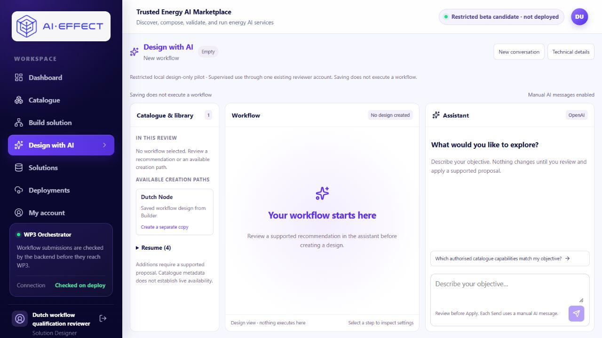

# Local pilot and release review

Baseline: [PR #19 at 94c28277](https://github.com/IRESI-EU/ai-effect-solution-studio/tree/94c28277a60cc18d3e2095455844cde36afae463).
This milestone prepares supervised sessions for two or three first-time users on
http://127.0.0.1:23121/design-ai. It is not a production release.

## Evidence and component review

| Evidence / boundary | Review |
|---|---|
| Platform-controlled parameter delivery | [PR #18](https://github.com/IRESI-EU/ai-effect-solution-studio/pull/18), [two completed runs and protected artifacts](PARAMETERISATION_PLATFORM_VERIFICATION_2026-11-12.md). No repeat execution. |
| Genuine interpretation and composition controls | [PR #19](https://github.com/IRESI-EU/ai-effect-solution-studio/pull/19), [actual A/B responses and accounting](LOCAL_COMPOSITION_ACCEPTANCE_2026-11-12.md). No repeat model calls. |
| Verified production API baseline | 89072340c9a13f3aa49d3e433380de8928cc16dd. Use apps/api and relevant deploy paths in the cumulative comparison; current image/source recorded after packaging below. |
| Verified production web baseline | df5b75873326ab56cad608990f3bd4add125bcc4. Use apps/web and its dependency/build paths in the cumulative comparison. This is the actual server baseline, not historic Vercel metadata. |
| Authentication and reviewer boundary | Existing session authentication/RBAC and ownership checks remain authoritative. Restricted routes require an exact existing active reviewer ID; no admin bypass. Local pilot additionally requires the qualified local profile, one configured reviewer and shared accounting. Participants share a supervised private session for aie37-designer; no new accounts or multi-user acceptance claim. |
| Contract boundary | Only the existing local pair and unchanged active contract pins qualify for design composition. Actual template policy remains in place. New compositions are design-only; the registered local experiment has no execution grant. |
| Partner and licensing | [Source-backed contract dossier](contracts/dutch-production/README.md), [unconfirmed partner patch](partner-review/dutch-parameters/README.md), and [platform proof licensing limits](PARAMETERISATION_PLATFORM_VERIFICATION_2026-11-12.md). Partner baseline has no license file; local reuse does not establish redistribution permission. Partner-native output association, approved family/contracts and production qualification remain outside this pilot. |
| Artifact ownership | Candidate generic preview requires authorized workflow/submission/task association and integrity checks; unknown associations and unqualified transports stay denied. Existing capture downloads are a separate guarded historical path. Review cumulative ownership/onboarding and deployment-claim changes. |
| Accounting | One canonical Windows ledger; exact environment/consumer and single-reviewer API binding. Original USD0.10 ceiling, ten permits / USD0.050 lifetime reservations, fixed USD0.005 each. One unresolved permit blocks dispatch; unknown usage stays held, no retries/refund/fallback or copied allowance. Container-to-host verified private TLS, loopback authority and Windows host availability are operational dependencies. See [accounting runbook](../deploy/restricted-beta/ACCOUNTING.md). |
| Migrations | Additive 003_design_ai_pilot.sql, 004_instance_submissions.sql and 005_local_capture_records.sql above production. No new application migration in this milestone. Existing synthetic migration/restore and consistent production backup rehearsal remain in [the engineering review](DESIGN_AI_BETA_ENGINEERING_2026-11-11.md); no production DB access or migration is required for local preparation. |
| Local backup / rollback | Existing retained component images/builds and consistent private pre-update database dumps remain. New source-only API/web packages use pinned offline inputs; no data volume is replaced. Code rollback must never restore an old database over new writes or replace/revert the canonical ledger. Disable the provider before any rollback. |

## Narrow preparation changes

New conversation creates a unique normal-route conversation URL and remounts the
workspace with a separate browser storage key. Previous discovery, accepted
draft/conversation and server-side saved work remain. It makes no API/model
request or draft. It requires no hidden bootstrap page, alternate hostname,
account or synthetic profile. Operators may bookmark a conversation URL to
return to its browser-local history; saved drafts remain available in Resume.

The server supplies an explicit restricted local design-only notice. This flag
does not authorize a provider request or execution. Offline checks cover fresh
conversation isolation, named-reviewer guards, missing accounting/transport,
exhausted limits and composed execution denial. No paid smoke request is allowed.

## Participant and observer handoff

- [Participant brief](LOCAL_PILOT_PARTICIPANT_BRIEF_2026-11-12.md)
- [Blank observer template](LOCAL_PILOT_OBSERVER_TEMPLATE_2026-11-12.md)

Prepare one fresh normal conversation for each person using New conversation,
keeping previous URLs/history. Initially suggest two Sends per participant.
Further clarification still uses the same ten-call scope; no automatic retry.
Do not record agent preparation as human observations. Completed observations
belong only in the private local record, not this repository.

## Production release decisions remain separate

- Cumulative draft-stack code review and required checks/attribution; no merge
  or self-approval. Vercel author/access failures remain distinct from code.
- Normal production sign-in and exact existing production reviewer identity.
  Do not retry/reset the earlier failed temporary credential or invent reviewers.
- Responsible Dutch owner selection, contract/version/protocol confirmation,
  licensing permission and task-specific output-association engineering for
  partner-native runtime use. Local platform-controlled proof is not that approval.
- Hosted authority/storage/transport durability, private networking, secret
  management and operational ownership. Do not silently choose an architecture.
- Production schema inventory, migration/backup/restore/rollback plan and actual
  environment compatibility. No production deployment or new composed execution.

## Activation record

Preparation checkpoint only: focused checks and packaging are recorded next.
No pilot amendment or paid request has occurred at this source checkpoint.
Human observations remain blank.

## Completed preparation and local activation

**LOCAL PILOT READY.** Source/tests were published at
[9e21d1b0ba17e1d122c08dd155dd66d348eafbd8](https://github.com/IRESI-EU/ai-effect-solution-studio/commit/9e21d1b0ba17e1d122c08dd155dd66d348eafbd8)
in draft [PR #20](https://github.com/IRESI-EU/ai-effect-solution-studio/pull/20),
stacked on PR #19, before activation. No merge, tracker or production change.
Later changes are this sanitized evidence. Full numeric/source record:
[local readiness JSON](LOCAL_PILOT_READINESS_2026-11-12.json).

| Current component | Exact identity |
|---|---|
| API/web application source | 9e21d1b0ba17e1d122c08dd155dd66d348eafbd8 |
| API image | sha256:d8b3673a30168239dfdf5de5518cb7f628cace897128635b52424da2943c60d4 |
| Web image / BUILD_ID | sha256:75a5374bdb6f0e08a810ebdd564b1640649fcd65ffe4b843b71588e8b25f197e / osSD-WxNhHuZ2gPiGZGCo |
| Platform / inputs | linux/amd64; unchanged pinned dependency images, Python/Node base digests and lock files, enumerated in the JSON |
| Listener boundary | Actual Windows listeners 23121, 28185 and 28205 all bind 127.0.0.1; no LAN or public exposure |

Both API and web changed for the narrowly scoped controls/notice and were
packaged once from tracked source with no networking/pulls. The original
images/builds remain intact. No service, stack, database, profile or migration
was introduced. No worker/runtime was started or restarted.

Cumulative reviewer diffs against the verified production trees:
[API baseline → current source](https://github.com/IRESI-EU/ai-effect-solution-studio/compare/89072340c9a13f3aa49d3e433380de8928cc16dd..9e21d1b0ba17e1d122c08dd155dd66d348eafbd8)
(filter apps/api and deploy/migrations; 96 files, 11,970 additions/38 deletions);
[web baseline → current source](https://github.com/IRESI-EU/ai-effect-solution-studio/compare/df5b75873326ab56cad608990f3bd4add125bcc4..9e21d1b0ba17e1d122c08dd155dd66d348eafbd8)
(filter apps/web; 46 files, 2,618 additions/376 deletions).
These are direct tree comparisons; the draft stack remains unmerged. Required
checks and author attribution are preserved. Review the material boundaries in
the table above rather than treating local pilot readiness as release approval.

### Allowance and no-call verification

The supported audited operator applied **15→25** on the same canonical ledger,
with attributable PR #19 acceptance-pass evidence and both settled permits.
All 15 existing rows and prior scopes remain; no ledger copy/reset or checkpoint
reopening. The new local-pilot-20261112 scope is bound to
normal-aie37-api-reviewer-aie37-designer, retained-normal-local-aie37 and the
unchanged exact PostgreSQL fingerprint. The API additionally enforces only the
existing active reviewer aie37-designer, with no admin bypass.

At handoff: **15/25 shared calls; 0/10 pilot calls; ten remain.**
Per-request reservation USD0.005; scope lifetime reservation cap USD0.050;
unchanged global ceiling USD0.10. Conservative accounted total USD0.005228875;
remaining USD0.094771125; zero outstanding reservations.
New Codex calls, tokens, reservations, spend and workflows: **zero**.
No smoke request or execution grant was created.

The genuine provider is connected using verified private HTTPS to the existing
Windows loopback authority. gpt-6-luna, low, Standard, output ≤2,000, framed input
≤32,000, 30m cache TTL, no automatic retry or fallback. Pricing was rechecked
against the [official model](https://developers.openai.com/api/docs/models/gpt-6-luna)
and [cache documentation](https://developers.openai.com/api/docs/guides/prompt-caching):
USD0.10 input/0.01 cache read/0.125 short write/0.50 output per million tokens.
The accounting policy conservatively charges all input at the maximum short
write rate; no discount is needed to remain within the ceiling.

Checks: **82 focused offline backend tests**, **14 host frontend checks**,
host typecheck, **15 packaged frontend checks**, packaged typecheck and both
offline builds passed. No unrelated full suite was repeated. The 68 serving API
Python files matched the package manifest. Actual named-user guards rejected the
other existing account; anonymous/unnamed/admin-bypass, unavailable accounting,
failed TLS/transport, exhausted scopes/counts and composed execution denial are
covered by offline tests with synthetic ledgers/SDK doubles. No real denied
submission or model call was used to test those boundaries.

Current normal discovery still advertises pair-a5c5793a07b3017820d63c7a at
26add1b21313352f06577e801fb4178c012cd3b4ed7f3d0505d5e7401a10a0db,
accepting seed 43 under the same active contract pins/binding. The actual
registered-template policy is unchanged. The accepted draft/conversation, all
saved rows and execution records, four existing drafts and all 36 capture hashes
remain unchanged. Both earlier parameterisation runs and artifacts remain.
Human observations are **prepared; awaiting human sessions**.

### Operator instructions

Normal start: http://127.0.0.1:23121/design-ai.
The [prepared empty conversation](http://127.0.0.1:23121/design-ai?conversationId=540a54f5-fce9-48c6-9741-d2fb5049a060)
was opened through New conversation on that same origin, with no messages,
proposal, draft or inherited acceptance. For each participant press **New
conversation**; bookmark their URL privately if needed. Resume retains saved
drafts, and the accepted composition/conversation URL is unchanged.

Sign in as aie37-designer@example.test using the existing private
<original checkout>/local-backups/aie37-profile-20261028/reviewer.json.
Participants operate this supervised single-account session. No credential is
published; do not record passwords in notes or screenshots.

Existing services and authority are running. Private operator files are in
<original checkout>/local-backups/supervised-local-pilot-20261112:

~~~powershell
# Only when startup is needed; no amendment, build, pull or model request.
.Start-Pilot.ps1
# Read-only allowance check.
<existing-python> .pilot_operator.py status
# End participant input, wait for settlement, then disconnect paid access.
.Stop-Pilot.ps1
~~~

Start-Pilot reuses the existing authority if listening, or starts that same
canonical ledger/TLS service independently with private logs if stopped.
It stages only the retained API/web, verifies authenticated accounting, then
connects the existing key. A missing authority/certificate or failed preflight
leaves requests denied; no replacement allowance or broader recovery.
The retained certificate currently expires 15 November 2026; revalidate it before
later sessions rather than disabling TLS or repeatedly restarting.

Stop-Pilot refuses to interrupt unresolved accounting. After settlement it
recreates **api only** with the provider key empty and verifies key/grant absence.
The web, database, captures and private authority remain for read-only review.
This is the recommended shutdown of paid pilot access. Do not use Docker down,
delete volumes, restore a prior ledger or start stopped workers. An operator may
separately stop the web using pilot_operator.py stop-web if the UI is no longer
needed. The start/stop wrappers were parsed and their underlying staging,
connection/status paths exercised; shutdown was not run because the requested
pilot is being left ready.

Private blank P1/P2/P3 observer copies are under participant-observations/.
The 46,511-byte consistent database backup has verified pg_restore contents and
SHA-256 de913de66116fa1a4f4f78891054c5788165d2598b83b8c25cbb8e645e5d06a3.
Prior API dd79cf9a36ac and web fba983fef01d images are retained. Code rollback
first disconnects the provider and reuses those images/ports/mounts; no database
restore or allowance rollback is part of a source-only rollback. Restoring old
application code must preserve the newer authority binding and fail closed.

