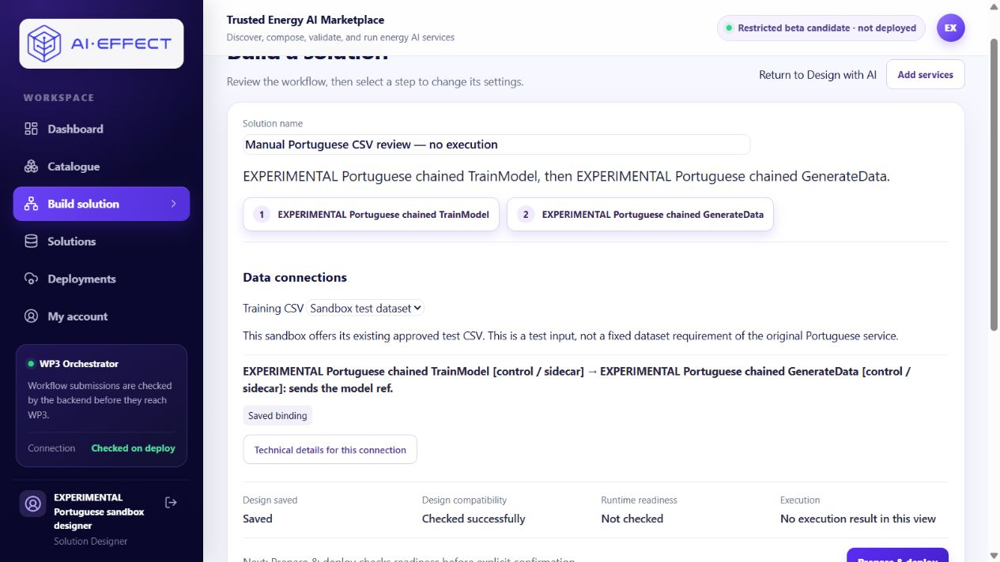

# Fresh Portuguese Builder input — 2026-11-13

Starting Portal PR #22: `08130d445b37841ef131913d6a6a51012ad64d7a`.
The completed connected execution and its original evidence are unchanged; this
is a design-only follow-up. No new workflow submission or algorithm is authorized.

## Focused implementation checkpoint

Fresh Builder designs previously discarded run_input when design_metadata was
null; dirty-state detection had the same conditional. The published connection
action was inside a technical dialog. Dataset input required editing hidden JSON.

Builder now persists normalized workflow input even without prior metadata,
preserves existing provenance/authority fields, includes input in dirty state and
invalidates checked results when input changes. Null/empty objects normalize to
no input. Save/reload and copy retain the input, parameters, pins and binding.

Data connections shows Training CSV for a workflow requiring dataset_ref. A
minimal authenticated endpoint returns only the retained sandbox's configured
label/opaque reference to its existing designer. Other users/profiles receive no
choice; anonymous access is rejected. The control calls it Sandbox test dataset
and explains that this is this profile's test input, not a fixed CSV requirement
of the original Portuguese service. No paths, tokens, uploads or dataset catalogue
are exposed. The existing adapter mapping into uploaded_file is unchanged.

Use published connection is visible directly beside an unbound compatible edge,
using the existing explicit pin/binding callback. Incompatible or ambiguous
contracts do not acquire that action. Technical identifiers stay in the dialog.
Missing training input shows “Select a training CSV before validating.” beside
the control; normal backend compile still rejects missing or unauthorized input.
Reverse direction remains blocked.

Focused checks: 41 backend route/binding regressions, 19 frontend helper checks
and typecheck passed. An initial new regression compared hydrated service metadata
to its intentionally minimal fixture; it was corrected to assert unchanged
configuration and pins, then the complete focused set passed. No implementation
failure or real execution was concealed. SQLite tests do not establish PostgreSQL
concurrency. Actual browser acceptance is pending the separately recorded update.

The initial unsaved UI rehearsal confirmed the new CSV and connection controls.
Source inspection during that rehearsal also found that first Save did not add
the new solution ID to the URL, so a direct refresh would reopen an empty Builder.
First Save now navigates to that saved Builder URL. The unsaved rehearsal is not
the acceptance record; the final fresh manual assembly will verify this path.

## Retained-profile update boundary

Only Portal API/web may be rebuilt and replaced, using the existing offline
build_candidate.py and pinned retained inputs. Preserve previous image IDs and
private compose backup. Populate PORTUGUESE_TRAINING_DATASET_REF from the existing
private policy's dataset_ref, paired with the existing evidence owner and exact
pt_parameter_sandbox database identity. Do not change any runtime/contract/worker,
mount, port, account, provider or ledger configuration. No migration is required.

Private records: original checkout local-backups/portuguese-builder-20261113.
They include a consistent PostgreSQL dump, all five existing saved designs,
completed journal/audit rows, ledger hash and the prior compose configuration.
Never stage these private records or credentials.

## Actual fresh manual acceptance — 2026-11-14

**Passed Save → refresh → Validate design.** This is a new browser-created draft,
not the prepared example or a repeated execution:
[Manual Portuguese CSV review — no execution](http://127.0.0.1:23124/builder?solutionId=e0814ad1-3d96-453b-96e7-ae0124bb43b4).

The agent signed in as the existing sandbox designer, started at empty /builder
(zero processing operations), added chained TrainModel and chained GenerateData
from the visible palette, separated overlapping nodes on the canvas and connected
Workflow Input → TrainModel → GenerateData → Workflow Output using visible handles.
It selected **Use published connection** directly in Data connections, selected
**Sandbox test dataset** in **Training CSV**, and used the actual inspector to set
epochs 2 / batch size 4 / generation count 10.

First Save created the new owned solution and navigated to its Builder URL.
Refresh retained the CSV choice, both 0.2.0 contract pins, model_ref binding and
parameters. **Validate design** displayed **Checked successfully**. Removing the
CSV then showed **Unsaved changes**, reset compatibility to **Not checked** and
displayed **Select a training CSV before validating.** Restoring the saved choice
kept it saved but required validation again; that also passed.

The first read-back represented batch/count as published defaults under the
retained pins. To leave an explicit final record, the agent edited each field
away and back using the UI, then repeated Save → refresh → Validate. Final stored
overrides are exactly epochs 2 / batch_size 4 / number_of_examples 10. Normal
authenticated GET read-back independently confirmed these values, input, pins
and binding; it performed no design write. No preparation script or direct API
write prepopulated this acceptance design. One earlier unsaved UI rehearsal was
discarded before the final fresh assembly; no extra saved review copy was made.

### Serving source, builds and preservation

- Input/persistence/action implementation and focused tests:
  `04682b5b1397d3c91904ada9898101b3f4adc7de` (API serving source).
- First-Save URL correction: `905e5e29740904b9723035faa6ffdfc2dfce580c`
  (web serving source; includes the preceding input fix).
- API image: `sha256:8139fef6a80a194b242085cdb9122ea6ac1259a3c8c9c3a780f4164a8d168872`.
- Web image: `sha256:b6c76b978d9e2edab677e2316e960a76cf65a8eb7349d177854955f289090cd2`.
- The pinned offline API/web builds passed; the follow-up URL correction required
  only a web rebuild. No original Portuguese/runtime image was changed.
- [Sanitized acceptance record](../deploy/portuguese_sandbox/manual-builder-verification.json)
  contains exact configuration/binding, image and rollback identities.

All five pre-existing designs compare equal to their saved baseline. All five
completed job rows, model mappings, authorization/audit rows and Redis work state
compare equal; the connected historical evidence remains available and valid.
Both workers remain stopped, the execution scope remains closed, and the shared
ledger remains byte-identical at 25/25. No new workflow, training, generation,
provider request, grant, registration or contract change occurred. Only Portal
API/web containers were replaced. Private rollback compose/build records remain
in local-backups/portuguese-builder-20261113; previous images are retained. No
database migration or restoration was needed.

Browser automation briefly stalled before palette opening; reconnecting the same
tab restored control. That interruption is separate from the successful manual
application acceptance. These are agent observations, not independent usability
results. The test CSV remains sandbox-only; runtime readiness and execution were
intentionally not checked or invoked. No remaining blocker for this local manual
Save/refresh/validation path was observed.

### Browser checklist

1. Open the review URL and sign in with the existing sandbox credentials.
2. Check Training CSV = Sandbox test dataset and the saved TrainModel → GenerateData binding.
3. Select each step: epochs 2, batch size 4, generated sequences 10. Technical
   details retain pt-chain-train-v2 / pt-chain-generate-v2 at 0.2.0.
4. Refresh, then choose Validate design; expect Checked successfully. Do not choose
   Prepare & deploy or submit another execution.

For a new manual design, use Add services, connect the visible handles, choose
Use published connection, select the CSV, edit settings and Save. No JSON editing,
upload, operator script or execution is required.
