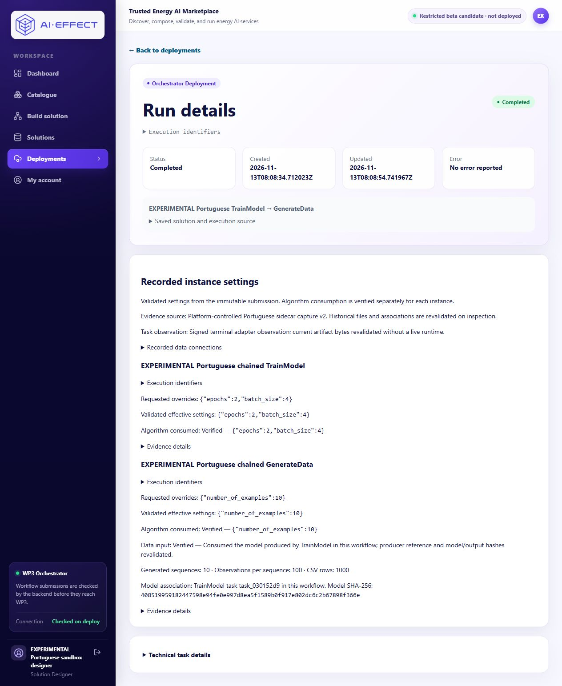

# Portuguese chained workflow — 2026-11-13

Starting review heads: Portal PR #22 c6e97b3e7ec1c9f7e2255123c5058a56e3a8472b;
maintained WP3 PR #4 4f349c2e39c885633b38c6a961070514dd7b4497.

## Preserved owner failure

Owner solution 0fe46709-e564-4a82-b9f2-a7d6d94a8483 remains unchanged.
Actual processing edge is GenerateData → TrainModel; it has no selected slot
binding and no separate operation-contract pins. Its parameter configurations
pin pt-sandbox-generate-v1 / pt-sandbox-train-v1, both 0.1.0. Generation count is
20; training settings are epochs 2 and requested batch_size 6.

The old frontend reports the actual reverse direction as a catalogue-label
mismatch. Its summary instead says TrainModel is connected to GenerateData,
naming the receiver first. That wording is ambiguous even though it describes
the same saved edge. More seriously, normal compile and runtime-preflight both
returned 200 for this unqualified legacy edge. This is not compatibility proof.
The complete responses, saved graph and rendered failed validation were retained
privately before edits. No Save, training or generation occurred on this design.

TrainModel needs an authorized dataset_ref workflow input and emits model_ref.
GenerateData emits CSV sequences; it cannot supply the required dataset_ref.
The 0.1 contracts do not declare a cross-operation binding. Matching/reversing
labels cannot fix that missing runtime delivery.

## Source checkpoint: explicit model handoff

New separate experimental registrations/contracts use 0.2.0. The original 0.1
definitions, registrations, historical references, three completed jobs and
original Portuguese APIs/images remain unchanged.

Workflow input → TrainModel → GenerateData → Workflow output:
- TrainModel accepts a separate inline authorized dataset_ref.
- Its model_ref output is an HTTP JSON reference, forwarded unchanged through
  the existing whole-output-v1 binding to GenerateData.model_ref.
- The generator does not fetch arbitrary URLs. It resolves that exact local
  producer-reference URI against the guarded journal, same owner/workflow/task,
  authorization, model identity and artifact digest.
- Models use workflow/task-derived identities; no bootstrap-model substitution.
- A separate read-only observer reuses the retained original ML dependencies
  and model volume read-only to inspect the saved model configuration/hash.
  It does not change the original API or run an algorithm.
- Four capability entries distinguish historical 0.1 and chained 0.2 operation
  versions. Runtime binding negotiation checks the exact version and normalized
  I/O contract digest with private server-owned control authorization.
- Unknown, cross-owner/workflow, stale, corrupt and unrelated references fail.
- Versioned signed terminal captures correlate both tasks and their model/output
  hashes. Portal reads only bounded, derived paths through read-only volumes,
  validates ownership and immutable submissions, authenticates capture records
  and rehashes artifacts. Historical inspection does not require live runtime.
  Old 0.1 settings/results remain readable without fabricated consumption claims.

The journal adds authorization, audit, scoped-job and run-specific model tables.
No old row, limit, checkpoint or model mapping is replaced. An explicit operator
creates a new attributable one-workflow/one-training/one-generation authorization,
binds its exact frozen snapshot to the returned workflow once, and closes it.
The worker CLI processes only that workflow and uses its private service key;
the daemon and owner-created jobs must remain stopped. No automatic retry.

Builder uses explicit source → target summaries, explains workflow-only inputs
and required model_ref bindings, declines unsupported published directions,
retains bindings during setting edits, and counts processing operations
separately from structural input/output nodes. Legacy label checks remain for
unqualified connections; pinned connections use authoritative contract checks.

## Offline verification

- 52 WP3 experimental protocol/journal/observer tests passed, with upstream and
  saved-model-loader doubles. No scientific execution in these tests.
- 51 focused Portal chain, evidence, ownership, binding and standalone tests passed.
  SQLite fixtures do not establish PostgreSQL concurrency.
- 20 focused browser-helper tests passed; typecheck passed.
- Batch-clamp tests distinguish requested/validated 6 from observed model batch 4
  with four training sequences. The new real phase requests batch 4.
- Invalid directions, missing bindings, representations/version drift, model
  provenance, corruption, runtime outage, uncertainty, duplicate dispatch and
  immutable Save/copy/settings behavior are covered.
- The observer's initial legacy validator import stalled Windows test collection.
  It was changed to strict modern Pydantic APIs supported by the verified retained
  ML environment (2.10.6); its two focused checks then passed. No real job failed.

## Activation boundary

No new real job at this source checkpoint. The authorized new phase is exactly
one combined submission, training epochs 2/requested batch 4, generation count 10,
fixed sequence length 100/CSV, existing CPU 2/RAM 3 GiB ML limits and synthetic
dataset. Old authorization remains exhausted. Publish integration/configuration
before dispatch, inspect queues, freeze inputs/pins/resources and use a new
audited journal authorization. Failure or uncertain submission ends the attempt;
no retry, repaired-result pass, replacement workflow or substitute model.

Provider disconnected; shared LLM allowance remains 25/25. No original service,
production, merge, partner-repository or tracker changes.

## Actual connected verification — 2026-11-13, separately recorded

The preceding activation-boundary statement records the source checkpoint; it is
not overwritten by this later result. The single authorized combined phase passed.
Source/tests and integration configuration were published before dispatch:
WP3 `30e1ac403c7434149f3ff3568843f2cc75702413`, Portal serving source
`654f3a68481738c902e9673d2f35f9c95715a6e9`, operator/configuration checkpoint
`1d147ffc5accb40ad4f50555ec463bbabb7b1ba1`. Exact image identities, immutable
parameters, task associations and hashes are in
[sanitized actual evidence](../deploy/portuguese_sandbox/chain-verification.json).

- [Saved corrected Builder](http://127.0.0.1:23124/builder?solutionId=3cf4c4fe-36f9-4141-8bca-f6421f0b16d8)
- [Completed results](http://127.0.0.1:23124/deployments/wf-a891cece9438#results)
- Submission `a25d6868-b346-429f-a3df-238e20078eed`; workflow
  `wf-a891cece9438`, completed at `2026-11-13T08:08:54.741967Z`.

TrainModel learned from the separate authorized synthetic dataset. GenerateData
then consumed the opaque reference to that exact newly trained model, through
the saved model_ref → model_ref / whole-output-v1 binding. It did not reuse the
earlier standalone model. New contracts are `pt-chain-train-v2` and
`pt-chain-generate-v2`, both version `0.2.0`.

| Instance | Requested | Validated effective | Verified observation | Outcome |
| --- | --- | --- | --- | --- |
| TrainModel / `task_030152d9` | epochs 2, batch_size 4 | epochs 2, batch_size 4 | Saved model: epochs 2, batch_size 4, max_sequence_len 100, sample_len 1 | Completed |
| GenerateData / `task_f6c5c14e` | number_of_examples 10 | number_of_examples 10 | Ten example markers, each 100 CSV observations; 1000 data rows total | Completed |

The pinned implementation clamps batch size to the available training-sequence
count. Four sequences are available here, so requested 4 and observed 4 agree;
this does not establish that every requested batch size is consumed unchanged.
The model hash observed before generation, captured by both tasks and rehashed
on inspection is
`408519959182447598e94fe0e997d8ea5f1589b0f917e802dc6c2b67898f366e`.
The generated CSV SHA-256 is
`f8b2ca463392571f573a899eabd414b7ee07101521782cfd3cfdca27e31d3d57`.
The training JSON reference SHA-256 is
`a6bb82d518da9cdc1dc47f5bcdc5529211808e029c5e2ea53a81dc3adb486d26`.

### Agent checks and preservation

The agent exercised epochs/batch/count edits to 1/6/20, Save and reload in the
actual Builder; the binding and pins survived. It then restored and saved the
approved 2/4/10 values, reloaded and passed normal Validate design. Normal
compile/runtime-preflight, actual CPU 2/RAM 3 GiB limits, empty queues and the
absence of other nonterminal workflows were frozen before dispatch.

Exactly one new submission, one TrainModel and one GenerateData ran, with no
retry or substitute model. New journal scope `pt-chain-20261113-01` records
create/bind/reservation/close events attributable to
`as-via-Codex/user-authorized-20261113`. It is now **closed**. The targeted worker
exited 0; both targeted and legacy workers are stopped and queue lengths are zero.
The original one-training/two-generation scope remains exhausted; journal totals
are three original jobs plus two new jobs, all completed.

All three original saved designs, including the failed owner design, compare
equal to their pre-update responses. The three old journal rows and standalone
model mapping compare equal. The old model SHA and both CSV hashes were checked
again against their original records. A consistent pre-update PostgreSQL dump,
private compose backup, frozen request and signed captures remain local.
Provider settings remain disconnected; no shared ledger is attached to this
profile. The shared ledger is byte-identical at 25/25 with zero outstanding
reservations; no provider request or ledger change occurred.

Refreshed results display each instance's requested/effective/consumed settings,
the producer model association and CSV counts. This also passed while the new
read-only model observer was stopped: the portal revalidated recorded terminal
captures and current artifact bytes without contacting it. The observer was
then restored; no worker or algorithm was restarted.

These are agent observations, not independent participant usability results.
The focused offline tests listed above use protocol/loader doubles; this section
records the separate real local algorithm executions. No unrelated full test
inventory was repeated for the final evidence-only checkpoint.

### Browser-only owner review

Sign in at `http://127.0.0.1:23124/login` as
`pt-sandbox-designer@example.test`, using the existing private
`local-backups/portuguese-sandbox-20261112/profile/credentials.json` in the
original checkout. Do not publish that file or its password.

1. Open the saved Builder above; review the two processing steps and saved
   TrainModel → GenerateData model-reference connection.
2. Select each step to inspect the saved 2/4/10 settings; no editing is needed.
3. Open the results URL and inspect requested, effective and consumed settings,
   verified producer association and 10 × 100 observation counts.
4. Refresh results; the same historical evidence remains available. Do not
   select Prepare & deploy or confirm another execution.

This is a platform-controlled experimental sidecar, not partner-native support.
Partner approval, hosted distribution/compatibility, multi-tenant model authority
and scientific quality remain unverified. ApplyFunction remains unavailable.
Original 0.1 jobs retain their actual settings/results but receive no fabricated
v2 consumption evidence. Production, all earlier demonstrations and the failed
owner design remain unchanged.
