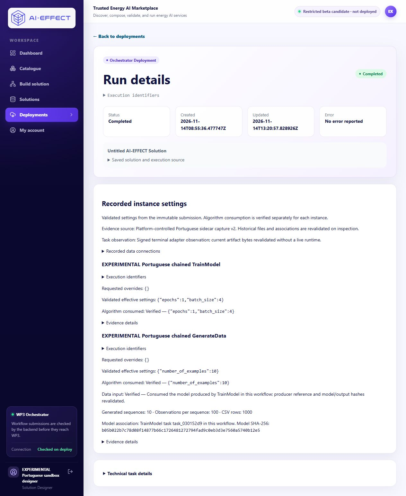
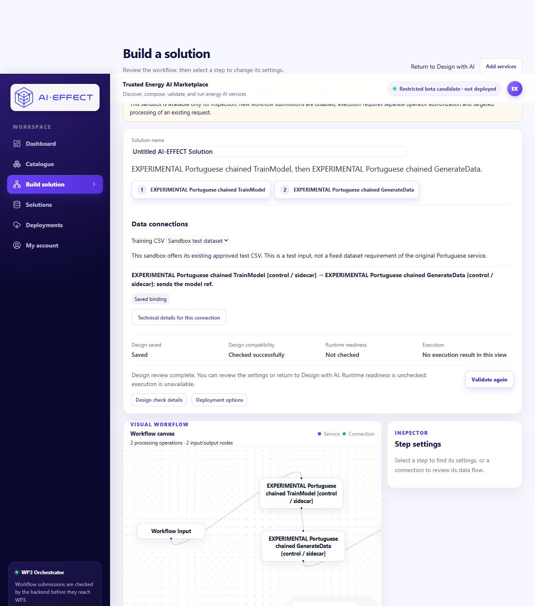

# Existing Portuguese request recovery — 2026-11-14

Starting Portal PR #22: db4cb0ee4669c3f96c27d58e83165d3d750971c5.
Maintained WP3 PR #4: a0fd73c7a55148a8df471c918ec45da4f4aad668;
serving adapter/targeted-worker implementation: 30e1ac403c7434149f3ff3568843f2cc75702413.

## Demonstrated cause and initial state

Normal authorized responses associate workflow **wf-375a888b8976** with the
owner's existing solution **d733ce01-6489-4865-aec5-c96ffdf2ec9b** and immutable
submission **eae852db-3af3-42a0-9bf6-e7e12a126744**. The immutable SHA-256 is
`0b8817eff18d6e1c8eb67706d4f6cdd968c62f7630a682a3a913cb5e672ec95c`.
Submitted parameter overrides are empty objects; the pinned 0.2.0 contracts
produce effective epochs **1**, batch size **4**, and count **10**, matching the
owner's expected values. The authorized test dataset_ref is present separately.

WP3 reported running immediately after submission at 08:55:36 UTC. In fact both
tasks were pending, with unchanged creation/update timestamps, no task outputs
and one queued training task. Both workers had exited before submission. The
adapter journal had only the five earlier completed jobs, no reservation for
this workflow, and its prior authorization was closed. Inspection of upstream
processes/logs, model/progress files and derived run-specific identities found
no new model identity for this request. Adapter reservation precedes upstream
dispatch. These independent dispatch/task/worker facts establish that neither
algorithm had started; missing capture alone was not used as proof.

The cause has two parts: WP3's start_workflow sets running when it merely enqueues
the root task, and Portal's readiness/submission path checked service health and
contract compatibility without enforcing this sandbox's closed execution scope
or stopped processing. A healthy inspection endpoint did not establish executable
capacity. All raw before responses and private logs remain preserved locally.

An initial strict contract comparison stopped on serialization differences
(`enum:null` versus omitted optional fields). Applying the actual compiler's
Pydantic/exclude-none normalization confirmed identical definitions and pins;
there was no contract/version drift or changed acceptance expectation.

## Recovery of this existing workflow only

The user authorized recovery after unstarted state was established. The supported
additive journal operator created and bound **pt-owner-recovery-20261114-01** to
the existing workflow, frozen request and canonical task configurations. Actor:
`as-via-Codex/user-authorized-owner-recovery-20261114`. No earlier scope or row
was reset or reopened; no SQLite accounting was hand-edited.

Before starting processing, the operator rechecked immutable snapshot equality,
pending unchanged task states and exactly one root queue entry. A unique named
one-shot worker processed only this workflow; an exclusive local attempt marker,
atomic queue pop and guarded per-task journal reservations prevented redispatch.
The general daemon remained stopped. No workflow was submitted or copied.

| Task | Actual outcome | Verified settings / association |
| --- | --- | --- |
| TrainModel / task_030152d9 | Completed once | Saved model epochs 1, batch_size 4, max_sequence_len 100, sample_len 1 |
| GenerateData / task_f6c5c14e | Completed once | Consumed this workflow's newly produced model; 10 sequences × 100 observations = 1000 CSV rows |

Workflow completed at **13:20:57.828926 UTC**, using the original ML image and
retained CPU 2 / RAM 3 GiB limits. Producer/consumer captures and current artifact
bytes agree on model SHA-256
`b05b022b7c78d08f14877b66c1726481272794fad9c0eb3d3e7560a5740b12e5`.
CSV SHA-256:
`98fc83609c6690612b1fcd239ba45df167fa2915fdeee4ef13fa5b2ccf198f60`.
The saved-model observer independently confirmed actual configuration and hash.

[Exact results](http://127.0.0.1:23124/deployments/wf-375a888b8976#results) ·
[Sanitized recovery evidence](../deploy/portuguese_sandbox/owner-recovery-verification.json).

The new authorization is **closed**, targeted worker exited **0** and all workers
are stopped. Remaining queue lengths are zero. Five original job records and
model mappings, old authorization/audit rows, all seven pre-existing owner
designs, original model files/hashes and prior workflows compare unchanged.
All seven job output artifacts were rehashed against their recorded digests.
There are now seven completed journal jobs: the original five plus these two.
Shared provider ledger remains byte-identical at 25/25, zero outstanding. No
provider request, allowance change, extra workflow, retry or original Portuguese
service/image/API change occurred.

## Narrow readiness and status correction

This retained sandbox is an operator-controlled inspection environment, with no
interactive execution grant or general worker. Portal now denies runtime readiness
and every new submission server-side before health checks, attempt creation or
enqueueing. It does not infer authorization from a running service. The same policy
is shown in Builder as **INSPECTION ONLY**; design validation and review remain
available, while Prepare/Confirm actions are suppressed. This is not an automatic
activation mechanism for future grants or a new job-management framework.

For this exact configured database/profile only, reported running plus all-pending
tasks is displayed as **Submitted — waiting to run**, with the raw reported status
retained and an explanation that no task has been claimed. A claimed running task
is distinguished explicitly; unavailable/inconclusive task facts display unknown,
not invented active execution or completion. No artifact absence is used in this
classification. Terminal states remain unchanged. Legacy sandbox status aliases
now use the actual owned workflow/task routes instead of placeholder success.
Other profiles keep their existing behavior and authorization boundaries.

Focused offline checks: **61 backend tests** (ownership, repeat confirmation,
stopped/closed inspection policy, healthy-service denial, status facts, contracts
and historical evidence), **21 frontend helper tests**, and typecheck passed.
SQLite fixtures do not establish PostgreSQL concurrency. No unrelated full suite
or additional algorithm execution was used for these regressions. Retained
API/web packaging and rendered verification are recorded at the follow-up
checkpoint; WP3 runtime bytes need no change for this correction.

Private records/rollback: original checkout local-backups/portuguese-recovery-20261114
contains the consistent pre-recovery PostgreSQL dump, immutable responses, raw
logs, model-file inventories, supported operator events and exact worker records.
Never overwrite the new journal/model/capture history with an older backup.
Scientific quality, partner approval and hosted production compatibility remain
unverified. No merge, production deployment, tracker or partner-repository update.

## Served correction and rendered check

Both retained Portal components now serve source
`002686f04fb584d5bea2f1556d8e994405f1db45`, built offline for linux/amd64:

- API `sha256:22c4994a05dce43bde2472a20f73ee27605a955a28ae6085742364ad32d672be`.
- Web `sha256:ced615705bfc07ad59fd6489491959d9b0a3ff18a54421ad9a6df6aa37d477f6`.

Only API/web were replaced, using the documented no-deps/no-build/pull-never
update. All other service configuration and runtime images remain unchanged;
old API/web images and private compose pins are retained for rollback. No schema
migration or database restore occurred. Builds and staged secret scans passed.

The genuine authenticated runtime-preflight route returned **HTTP 409** with
execution_state **inspection_only**. No live submission POST was used to test
the denial; duplicate-confirmation/no-enqueue coverage is offline and mocked at
the side-effect boundary. Genuine and former-placeholder status aliases both
return **completed** for this workflow through existing ownership checks.

Browser inspection of the owner's existing Builder shows **INSPECTION ONLY**,
saved input/binding and successful design compatibility, followed by **Validate
again**, with no Prepare/Confirm action. Nothing was edited or saved during that
inspection. Refreshed results show actual completion, effective and independently
verified consumed settings, model association and ten 100-row sequences.

These are agent-rendered observations, not independent usability evidence.
Maintained WP3 draft PR #4 documentation checkpoint:
`1a6a792aa3effbfaeb979aaeaa03a7535e53e4bd`; runtime bytes remain unchanged at
the previously qualified experimental source. No new WP3 runtime build or test
run is claimed for that documentation-only checkpoint. Final read-back again
confirmed all seven owner designs, five earlier jobs, old model/output hashes,
closed scopes, stopped workers, empty queues and unchanged 25/25 ledger.
