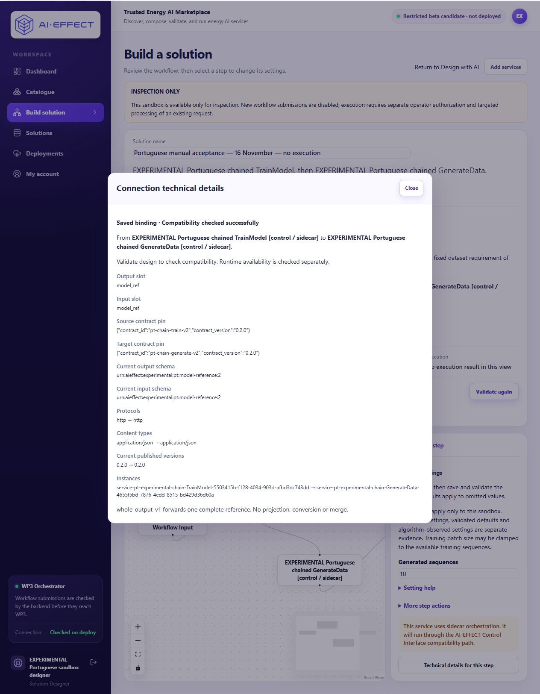
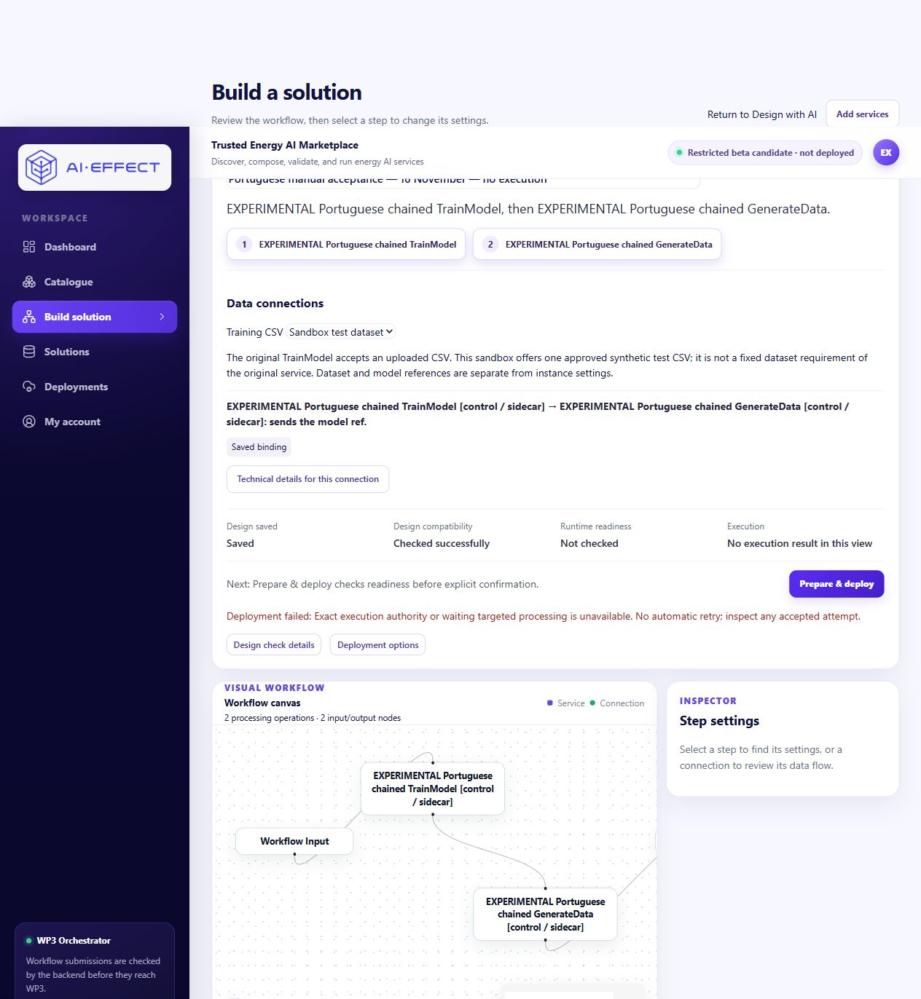
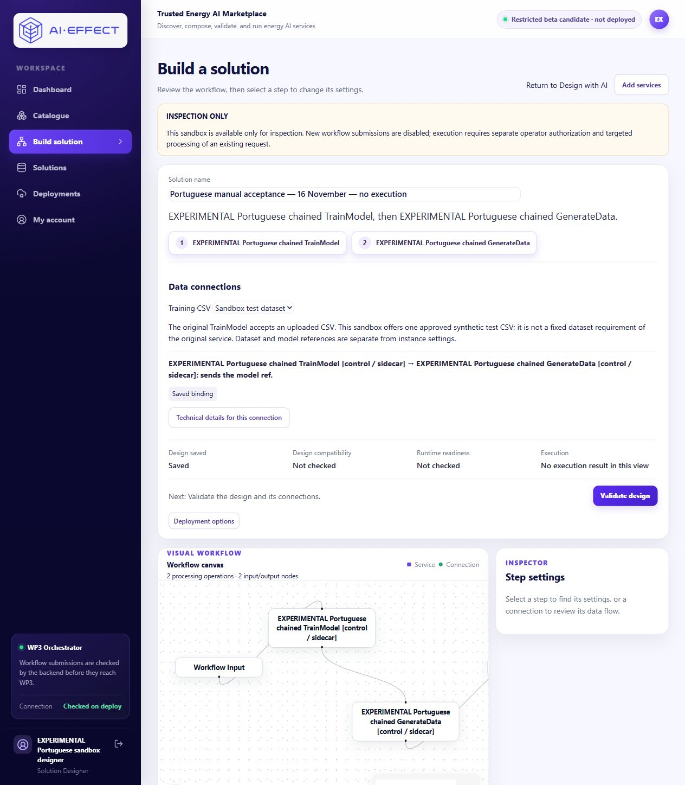
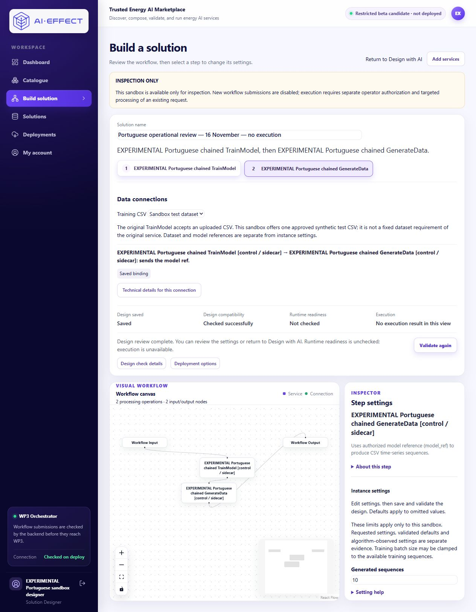

<!-- CURRENT-STATUS-START -->
## Current status — operational correction verified, execution awaiting approval

- **Proven parameterisation:** earlier real local Portuguese parameter consumption and exact model handoff remain valid. Seven historical jobs, eight original designs, artifacts and closed scopes preserved.
- **Operational correction:** adapter-before-standby helper and bounded read-only probe recovery implemented. Disposable-state activation tests and real non-executing probe/API-isolation checks pass. Fresh manual Builder Save → refresh → Validate passes. No preparation blocker observed.
- **Release decision:** approve [the new exact candidate proposal](../deploy/portuguese_sandbox/proposed-supervised-operational-20261116.json) before one new attempt. No live scope/standby was created; no new workflow, training, generation or provider request. Corrected live activation/algorithm success remains untested.
- [Current verification](../deploy/portuguese_sandbox/operational-verification-20261116.json); [original failed readiness/closure](../deploy/portuguese_sandbox/supervised-acceptance-20261116-verification.json). Historical findings below remain intact.
- Design with AI remains disconnected. The native-only new-pair composer excludes sidecars/adapters and external workflow-input routing. These restrictions are unchanged.
<!-- CURRENT-STATUS-END -->

# Portuguese Builder and supervised boundary — 2026-11-16

Later authorized recovery investigation:
[demonstrated settings-save/rename blocker and required operator observation](PORTUGUESE_RECOVERY_BLOCKER_2026-11-16.md).
Packaging and new browser acceptance remain blocked; historical results below
have not been reclassified as fresh observations.

**Source/tests prepared; retained application update and fresh browser acceptance
blocked by unavailable Docker engine. Execution remains disabled.** No new
authorization, workflow, training, generation or provider request occurred.

## Preserved checkpoint and actual availability

Both isolated review worktrees were clean and matched the recorded remote draft
heads: Portal PR #22 `643999dd46196f216c0524203d9da846d9092ad9` and maintained
WP3 PR #4 `1a6a792aa3effbfaeb979aaeaa03a7535e53e4bd`. The original checkout's
uncommitted/untracked work was left untouched. C: had 67.34 GiB free initially.
Applicable web AGENTS.md and installed Next client-component guidance were read.

The retained compose still pins Portal API/web serving source
`002686f04fb584d5bea2f1556d8e994405f1db45` and experimental runtime source
`30e1ac403c7434149f3ff3568843f2cc75702413`. Last verified image IDs:

| Component | Retained image |
| --- | --- |
| API | `sha256:22c4994a05dce43bde2472a20f73ee27605a955a28ae6085742364ad32d672be` |
| Web | `sha256:ced615705bfc07ad59fd6489491959d9b0a3ff18a54421ad9a6df6aa37d477f6` |
| Adapter | `sha256:1305664435c30980c2649defc1a798fc2262e9ca835f8348ecbe2c43ae89034f` |
| Targeted worker | `sha256:985d157eb09413f52fda426d98a567cad7ffe805fdd9aeb2a34447953ed100cf` |

There is **no currently verified serving source**: the engine connection fails
at `npipe:////./pipe/dockerDesktopLinuxEngine` with “The system cannot find the
file specified.” One normal Desktop launch did not restore that pipe. No settings
repair, reset, repeated startup, forced termination or alternative stack was used.
Ports 23124 and 28188 were not listening. Actual browser navigation to
`http://127.0.0.1:23124/builder` returned **ERR_CONNECTION_REFUSED**. This is the
fresh browser acceptance result: **blocked**, not a passed synthetic rehearsal.

Consequently current container identities, stopped workers, queues, journal and
artifact bytes cannot be freshly inspected. The unchanged 14 November record
remains the last live verification: wf-375a888b8976 completed; immutable submission
`eae852db-3af3-42a0-9bf6-e7e12a126744`, SHA
`0b8817eff18d6e1c8eb67706d4f6cdd968c62f7630a682a3a913cb5e672ec95c`;
effective/observed epochs 1 and batch 4; same-workflow model handoff; generation
10 × 100 = 1000 rows; seven completed journal jobs; both additive scopes closed,
three workers stopped and queues empty. This pass does not recast those historical
facts as new observations. See [original recovery](PORTUGUESE_OWNER_RECOVERY_2026-11-14.md).

The private preservation record is still present, SHA
`0897a1e76b2acdf1c9404ecebc695433dc2bbc573458dd722c1b8b200811a570`.
The provider ledger was checked read-only **now**: byte-identical SHA
`cf9fa12e87633b9e260d3983a3dd9e5c51df346c04237b3babd255ee66cd7d2b`,
25/25 calls, zero outstanding. Private configuration still has no supervised-mode
activation, provider key or execution grant. No profile/configuration was rewritten.

## Focused implementation

Portal source/test checkpoint: `4b4d1922ade0d9f1624b39b5465509c7904da969`.
Builder revision integration: `722a3c36c3fcc666d6384ff5c4746dea0c3337a1`.
Maintained WP3 source/test checkpoint: `183b533ed23de7c77fb9e5a4712033e72f1ce6a5`.
Final admission/transport source: Portal
`1354a141a0d76ee90ed6eb5ae1ce1b6d5242608b`, maintained WP3
`822c05cf1cac09c9448f423a1359369b6fc61aac`.

Inspection-only is still the default for this exact database/owner profile.
Three explicit server settings select a future supervised mode, existing
authorization ID and private adapter URL. They do not create authority. Other
profiles keep their current paths. Legacy placeholder submission stays denied.

The existing worker_cli can only process an already allocated workflow ID. It has
no pre-submission consumer readiness signal. A process/container health check
therefore cannot solve admission. The new experimental one-shot standby reuses
the maintained Worker/WorkflowEngine/Redis queue and existing authorization
journal. It waits for **one authorization**, probes Redis, the actual ML OpenAPI,
read-only observer and authenticated adapter capability response, and refreshes
a six-second waiting lease. It checks for unrelated unresolved workflows/queues.
Readiness does not pop tasks, bind a workflow, reserve a job or call an algorithm.
An additive journal table records the one processor identity/lease; it never
resets historical grants or jobs. A dead/consumed processor is not replaced.

Server readiness requires the configured active reviewer, owned current saved
design, exact input/settings/pins/binding, canonical compile/transport checks,
prepared matching journal authority, unchanged test dataset and fresh waiting
processor lease. Submission rechecks scope/lease and the reviewed policy hash.
A reviewer-row lock serializes admission across saved designs; the existing
ExecutionSubmission records a durable dispatching attempt **before** the HTTP
submission. Repeated identical confirmation returns the existing identity, while
conflicts or uncertain attempts cannot dispatch again.
The sandbox's normal submission transport also refuses redirects and environment
proxy fallback; other profiles retain their original transport behavior.

The returned workflow identity is persisted before its exact authority is bound.
The waiting processor can then claim only that workflow once. Loss of processing
or response is retained as an uncertain attempt/queued workflow, never retried or
marked complete. Existing adapter task reservations still precede algorithm
dispatch. The earlier task-fact queued/claimed status correction is retained.
This is not a distributed exactly-once guarantee; reconciliation is required on
any uncertainty. PostgreSQL lock behavior has not been integration-tested here.

Builder now explains which Portuguese entries are chained versus retained
standalone history. Training CSV explains the original uploaded-CSV API and this
sandbox's one synthetic input. Settings distinguish sandbox limits, references,
validated defaults and actual consumption, including batch-size clamping. Results
continue using the existing independent per-task model/output/consumption evidence;
no new success inference or reconstruction from the editable design was added.

For future supervised preparation, an unchanged saved design is no longer saved
again by Prepare: otherwise updated_at would invalidate the exact frozen request.
This change is confined to explicit supervised mode. Inspection and other profiles
retain their existing behavior.

## Checks and integration boundary

- Focused Portal set: **75 passed**; after final integration, **16 admission tests
  passed** separately. Existing evidence/ownership, fresh input persistence,
  missing/unauthorized input, invalid binding/parameters, queued-versus-claimed,
  historical inspection and other-profile regressions are included in that set.
- Focused WP3 experimental set: **64 passed**, including 12 new standby/journal
  checks, concurrent bind/processor claim, lease expiry, failed dependencies,
  default-disabled routes, private auth, policy drift and no readiness consumption.
- Frontend helper checks: **23 passed**. Typecheck passed.
- Initial test import error was fixed; sandbox test-directory access errors were
  resolved by running the same isolated tests with normal host file access.
  These interruptions are retained in private logs, not counted as passing runs.
- All execution boundaries used doubles/disposable databases and disabled external
  networking. No fresh scientific or real execution evidence is claimed. SQLite
  tests do not establish PostgreSQL concurrency.
- Staged secret scans passed before publication. No unrelated full suite was run;
  older unrelated baseline failures remain recorded in their original reports.
- API/web/worker image builds, retained-profile update, current live preservation
  checks and fresh UI Save → refresh → Validate are **not completed**, because the
  retained engine/database are unavailable. No rollback image/build was replaced.

Private records: original checkout `local-backups/portuguese-supervised-20261116`.
Credentials remain only in the existing
`local-backups/portuguese-sandbox-20261112/profile/credentials.json`; use the
`email` and `password` fields locally. No account or password was changed.

## Browser steps after retained review recovery and packaging

These steps are **pending**, not something the current unavailable URL can do now:

1. Open `http://127.0.0.1:23124/builder`, sign in with the existing credential file,
   and start an empty design. Add **chained TrainModel**, then **chained GenerateData**.
2. Connect Input → TrainModel → GenerateData → Output on the canvas. In Data
   connections choose **Use published connection** for model_ref and **Training
   CSV → Sandbox test dataset**.
3. Select each instance and set epochs **2**, batch **4**, generated sequences **10**.
   Save and refresh the new saved URL. Do not use a helper/API write to assemble it.
4. Validate design. Verify settings, dataset, both 0.2.0 pins and published binding
   survived. The default **INSPECTION ONLY** boundary must remain visible.
5. Inspect existing completed results without executing; no Prepare/Confirm or
   new job is authorized in this pass. Record agent and human observations separately.

No new review-design URL exists yet. The previous genuine manual UI acceptance
is preserved at solution e0814ad1-3d96-453b-96e7-ae0124bb43b4; it is not substituted
for this pass. Independent usability and hosted/node readiness remain unverified.

## Concrete next supervised acceptance proposal — NOT AUTHORIZED / NOT ACTIVATED

After engine recovery, package the reviewed source offline, preserve rollback
pins/consistent database backup, update only necessary retained review components,
and complete the fresh UI acceptance above with execution disabled. See the
[supervised runbook](../deploy/portuguese_sandbox/SUPERVISED_RUNBOOK.md).
Freeze that exact owned saved design/request revision before seeking execution
approval. No authority should be created while these prerequisites are incomplete.

Proposed scope: **one new workflow, at most one TrainModel and one GenerateData**;
no retries, replacement scope or general worker. Train epochs **2**, batch size
**4**; GenerateData **10** sequences; fixed existing sequence length **100**.
Pins: `pt-chain-train-v2` / `pt-chain-generate-v2`, both **0.2.0**, published
model_ref → model_ref binding. Input `pt-approved-synthetic-data`, SHA
`36c7721e9254d1abd24cf6999bb693fc6d3ccf28e377431c0562a32d6efe17a8`.
Retain CPU 2 / RAM 3 GiB. The 400-row CSV yields four training sequences, so
expected observed batch size is 4; record requested/effective/observed separately.

Expected proof: new workflow/task identities; one newly trained model with saved
epochs 2/batch 4; signed producer and consumer association to that model's actual
hash; exactly ten sequence markers, each 100 observations, 1000 CSV rows; authorized
downloads matching recorded hashes. Hashes for new outputs cannot be predicted.

Only after separate explicit authorization: use the existing create operator for
one new attributable frozen policy; start one named standby for that scope; enable
only this retained sandbox's supervised flags; obtain read-only readiness; make
one visible confirmation. Any drift, lost lease, unknown response, failure or
missing proof stops acceptance without retry. After terminal reconciliation, stop
the one-shot processor, close that scope, disable both supervised flags, check
all queues and old evidence, and verify the exhausted 25/25 ledger unchanged.
Do not run this proposal or ask for execution approval until the blocked design
and packaging prerequisites are complete. No partner-native/node-ready claim.

## 16 November recovery / packaging checkpoint (non-executing)

Starting reviews: Portal 54dd3f09e75d2c8e21bb79f4ead9c1c8066e811c,
maintained WP3 17f32be413fe64532373f70d8b862002c3427a8c.
The owner reported Engine running after a normal Windows Start launch and a
successful disposable AppData create/write/rename test in normal PowerShell
outside Codex. Docker CLI subsequently responds inside Codex (server 29.9.2).
These observations do not establish the original rename failure's root cause.
No further Desktop repair, settings/ACL change or restart was performed.

No retained containers started automatically. Only this profile's retained
PostgreSQL, Redis, ML, orchestrator, adapter, observer, API and web were started.
All three workers remain stopped; supervision is disabled and provider is
 disconnected. Before packaging, authenticated read-only checks confirmed the
owner workflow Completed, unchanged immutable submission, seven completed
journal jobs and rehashed outputs, old designs/models, closed scopes, empty
queues and unchanged ledger SHA/count 25/25 with zero outstanding reservations.
A new consistent pg_dump and exact private compose/container rollback snapshot
are retained under original-checkout local-backups/pt-accept-20261116.

The original packager stopped on missing dependency image
8a998103f1ea42cb1a8fd461e8e3fbf32c992d98b60c3147917f9cac95a758e1.
Its older staging web dependency image is also absent. Instead of downloading
or changing dependencies, the packager now pins the retained current verified
API/web 002686f04fb5 images by exact IDs. All 48 installed Python requirements
match requirements.lock (CPython 3.12.14); web pnpm-lock.yaml and package.json
hashes match exactly (Node 24.15.0). Existing lock comparisons, pip check,
no-network build, source-only context and tag-drift checks remain mandatory.
No historical image is relabelled or overwritten. This is a build-input repair,
not a runtime dependency upgrade. Actual build/test/browser results are appended
separately after they finish; this checkpoint alone is not acceptance.

## Later 16 November checkpoint: recovery, packaging and fresh UI acceptance passed

This supersedes only the earlier availability/preparation status. Original failed
observations above remain historical; their root cause is not established.
No further Docker repair, settings/ACL change or restart occurred.

Portal serving source **75ccb8fd09be477d5517bea26c139011f9436ad6**, maintained adapter/worker
packaged source **17f32be413fe64532373f70d8b862002c3427a8c**. Exact images, build contexts,
retained dependency inputs and checks: [sanitized verification](../deploy/portuguese_sandbox/recovery-browser-verification-20261116.json).
Only API/web/adapter were replaced. All **53** retained container names remain;
other identities/images/mounts are unchanged, including original ML. Desktop
normalized the adapter read-only Windows bind source to its Linux host path;
credentials/policy/token hashes match the exact host files. Journal volume
unchanged, all three workers stopped, supervision/provider disabled. Other
profiles remain stopped. No live scope was created.

Four actual PostgreSQL concurrency cases **passed** (1.70s, 50 existing
deprecation warnings): real reviewer-row blocking for concurrent confirmations
of same/different designs and uncertain dispatch. HTTP/dispatch were doubles;
only suite-created random test databases were used and removed, no algorithms.
Frontend helpers **23 passed**; packaged frontend checks **18 passed**; Next
production compilation, TypeScript and build passed. API all 48 exact Python pins
and pip check passed. Adapter/standby imports passed with networking disabled;
worker main was never invoked. The API no-network/default-PG import initially
failed because postgres could not resolve; a separate disposable SQLite startup/
import passed, then the retained actual PostgreSQL application started normally.
No unrelated full test inventory or dependency download/upgrade was performed.

### Fresh manual browser acceptance (agent, not independent usability)

[New saved design](http://127.0.0.1:23124/builder?solutionId=b4e48556-c3a5-4a73-903d-c2a2618756fd) began from empty `/builder`, not a
copied/prepared design. Palette added chained TrainModel and chained GenerateData;
Training CSV selected **Sandbox test dataset**; canvas edges were drawn and
**Use published connection** selected. Epochs 2, batch 4 and generation count 10
were reviewed. Save created the new owned URL; refresh retained dataset,
settings, both instance identities, 0.2.0 pins and model_ref binding.
**Validate design: Checked successfully.** No preparation/API design write.

Raw saved overrides contain epochs 2 only; batch 4 and count 10 are omitted
pinned defaults. Refreshed controls and normal compilation both resolve 2/4/10.
These are validated settings, not new algorithm-consumption evidence. Browser
shows INSPECTION ONLY, runtime unchecked and execution unavailable; preflight of
the exact normal browser request returns **409 / inspection_only**. No live
submission was used to test denial.

[Historical owner results](http://127.0.0.1:23124/deployments/wf-375a888b8976#results) still show
Completed, recorded consumed 1/4 training, same-producer model SHA, and 10 x 100 =
1000 output rows with workers stopped. Immutable snapshot equals the prior
record. Seven journal jobs/output hashes, earlier models/designs, closed scopes,
terminal workflow records and empty queues all rechecked. Ledger byte-identical,
**25/25**, zero outstanding. New training/generation/provider requests: **0**.

### Backup and rollback

Original-checkout `local-backups/pt-accept-20261116/database-before.dump` is a new
consistent pg_dump; pg_restore TOC verified, SHA
`03237dde2c6bdc2d8c1b9769fbbc8a655fab7db309fd9004863a9d6117d7c0ec`.
Private compose-before/container-before records and old API/web/adapter images
are retained. No migration. Rollback stops only those three roles, restores only
their old image pins from compose-before and uses the existing no-deps/no-build/
pull-never up command. Do not restore the older database over new designs or
evidence, start workers, rerun bootstrap or modify another profile.

### Exact later execution proposal: NOT AUTHORIZED

[Frozen normal browser request, contracts, resources and closure checks](../deploy/portuguese_sandbox/proposed-supervised-acceptance-20261116.json).
Saved revision **`2026-11-16T11:26:14.691950`**.
Request SHA256 **`96f346d9e87f5c68bc45b5e35d7c62ad671591a012711d53ef383c50addca00b`** using json.dumps(request, sort_keys=True),
verified through the serving schema. It includes every normal Builder node
field; the earlier provisional minimal operator-helper hash is not authority.
No live policy/scope was created. Both supervision flags remain disabled.

Proposed limit: one workflow, one TrainModel (2 epochs/batch 4), one GenerateData
(10 sequences), existing 400-row dataset/hash, sequence length 100; ML CPU 2/RAM
3 GiB; named targeted standby CPU 1/RAM 384 MiB, no restart, wait <=300 seconds,
six-second lease; zero retries/replacement. Exact candidate/serving images and
all component limits are frozen. The current adapter image and retained
historical registry image are separately identified; no registration/contract
was changed and no new execution qualification is claimed.

Only after separate explicit approval: recheck revision/request/contracts/data/
images/resources and empty queues, create one new attributable scope through the
supported operator, enable only this profile's flags, start one named standby,
require normal readiness and confirm once through Builder. Stop on drift, lost
lease, failure, uncertainty or missing proof. Reconcile without retry. Verify new
model settings/hash, signed same-model handoff, ten sequences/1000 rows and
hashed authorized downloads. Then stop worker, close scope, disable both flags,
inspect queues and old evidence/ledger. No production/partner-native claim.

Operator check: open new URL; inspect CSV and step settings; inspect connection
Technical details; refresh and Validate; confirm INSPECTION ONLY. Existing
sign-in: original-checkout
`local-backups/portuguese-sandbox-20261112/profile/credentials.json`, identifier
`pt-sandbox-designer@example.test`. Never reproduce the password. Independent
human usability, scientific suitability and production compatibility remain
unverified. C: headroom after packaging: 63.78 GiB.

## Supervised acceptance attempt: FAILED READINESS, no dispatch (16 November)

The owner explicitly authorized exactly the frozen request at Portal
`cd9a6527aea5084c63bfaccad3b35ca7713c4ea5`, saved design
`b4e48556-c3a5-4a73-903d-c2a2618756fd`, revision `2026-11-16T11:26:14.691950`,
SHA **`96f346d9e87f5c68bc45b5e35d7c62ad671591a012711d53ef383c50addca00b`**. The original proposal and successful design-only
acceptance above remain unchanged. This is a separate failed live-readiness
observation; it must not be reported as a completed algorithm acceptance.

Before authority, the authenticated saved record/revision/hash, active complete
contract definitions, dataset bytes/hash, compiled instance configurations and
model_ref binding all matched. Actual images/resources matched the frozen
proposal. The historical registered adapter image was retained exactly; current
served adapter image separately matched the proposal. Actual orchestrator
parameter compatibility, adapter binding/I/O hashes and pinned worker capability
identity all passed read-only checks. Seven old jobs/models/artifacts, closed
scopes, empty terminal workflow queues and byte-identical 25/25 ledger were verified.

Supported operator created one attributable scope
**`pt-supervised-browser-20261116-01`**. One named standby
`ai-effect-pt-supervised-20261116-01` started with the pinned candidate, existing
journal volume, CPU 1 / RAM 384 MiB, restart=no and at most 300-second wait.
Only this profile's API/adapter supervision flags were enabled. In the actual
Builder, Validate succeeded; **Prepare & deploy was clicked once**. Readiness
returned: “Exact execution authority or waiting targeted processing is unavailable.
No automatic retry; inspect any accepted attempt.” **Confirm was never clicked.**
No alternate submit/bind route, saved-design edit, retry or replacement was used.

### Demonstrated failure and closure

The startup order launched the standby before the adapter flag change recreated
its dependency. Docker records standby start at 11:50:06.723526Z and adapter
stop/destroy at 11:50:08.734564Z / 11:50:08.793937Z. The worker traceback fails in
its first read-only `/control/capabilities` probe with
`httpx.ConnectError: [Errno -3] Temporary failure in name resolution` for
`pt-adapter`; retained State.FinishedAt is 11:50:09.795329387Z, exit 1.
No fresh waiting-processor lease was established. The worker ended through its
finally path; no processor claim or workflow binding event exists. This is an
activation-sequencing failure, not a demonstrated parameter or contract mismatch.
No recovery retry was attempted after the readiness denial.

| Item | Actual outcome |
| --- | --- |
| New workflow / qualified task identities / results URL | None created |
| TrainModel / GenerateData calls | **0 / 0** |
| Requested overrides | Train epochs 2; batch/count omitted pinned defaults |
| Validated effective settings | epochs 2, batch 4; generation 10 |
| New observed consumption / saved model / output / downloads | **Not available: no dispatch** |
| Scope | Closed unbound at **2026-11-16T11:52:03.031550+00:00**, zero scoped jobs |
| Processor | Retained exited 1, finished lease 0; never restarted |
| Other workers | Three retained workers stopped |
| Queues and old evidence | Unchanged, no unresolved queued work |
| Provider | 0 requests; unchanged **25/25**, zero outstanding |

Closure used the supported operator, not journal edits. Private compose was
restored byte-for-byte, disabling both flags and removing active scope settings;
only API/adapter were recreated with the same frozen images/volumes. All original
53 container names/images remain, with the failed named standby as the sole added
container. All eight saved designs are equal to before. Seven completed journal
jobs, prior authorization rows/events, model bytes/mtimes, artifact hashes,
immutable historical submissions and queue records passed read-only preservation.
No new ExecutionSubmission row references this scope. Provider ledger SHA remains
`cf9fa12e87633b9e260d3983a3dd9e5c51df346c04237b3babd255ee66cd7d2b`. Original Portuguese ML code/image unchanged.

[Exact sanitized attempt/closure evidence](../deploy/portuguese_sandbox/supervised-acceptance-20261116-verification.json).
Private records/logs/configuration are retained under original-checkout
`local-backups/pt-supervised-live-20261116`; none of the credentials/database/model
bytes/raw private configuration were published. This evidence-only update did not
rerun unrelated tests or build/change application source.

There is **no new results URL**. [Historical completed owner results](http://127.0.0.1:23124/deployments/wf-375a888b8976#results)
remain available and are explicitly earlier execution evidence.

### Required next work, not another attempt

Review/non-executingly verify startup ordering: stage and stabilize the adapter's
supervised flag before launching a one-shot standby; keep the API inspection-only
until that exact processor has a fresh healthy lease. An API-only activation then
must not recreate the adapter beneath the standby. This ordering correction is
not applied here. Do not restart this processor, reopen this closed scope, retry
readiness or infer permission for a new workflow. Any later algorithm attempt
requires a new explicit decision and supported exact-request scope.

This attempt establishes preflight/request compatibility and fail-closed
readiness; it establishes **no new algorithm consumption**. Earlier local signed
parameter/model-handoff evidence remains valid. Before Portuguese node access:
finish stable local supervision and its separately authorized acceptance; obtain
owner-confirmed service family/image/version, parameter semantics and bounds,
input/model/output contracts; obtain approved node endpoint/authentication,
storage/input permissions and resource limits; then verify task-specific handoff
and parameter delivery on that actual node under separately bounded approval.
Local sidecar support is not partner-native approval, scientific qualification,
independent usability or production compatibility.

## Operational correction and non-executing acceptance — 16 November, later checkpoint

This new preparation record preserves the original failed readiness observation.
Its scope stays closed and consumed processor stopped. Docker responded normally;
no settings repair/restart was performed. The settings rename failure's original
root cause remains undetermined. No new live authority was created.

### Correction and actual serving identity

The single supervised_session.py helper checks separately created, unused exact
authority; stabilizes the adapter with API admission OFF; starts one named
standby; verifies a fresh lease; enables/recreates ONLY API; then checks unchanged
adapter identity and a fresh lease again. It never creates authority, binds or
submits. Drift checks cover saved revision/request/settings/contracts/dataset,
serving images/resources, disconnected provider, old stopped workers, journal
and ledger. Private configuration is backed up; post-close restore refuses a
running worker or unrelated changes. See the current SUPERVISED_RUNBOOK.md.

Transient read-only DNS/connection/startup probes retry only before binding,
within 30 seconds from startup: total probe budget 3 seconds; HTTP/Redis operation
timeout at most 1 second; poll 1 second; lease 6 seconds; standby max 300 seconds.
Failed probes revoke the lease. Authentication/capability/policy failures are
permanent and actionable. All queues are checked before first readiness and
again against the exact bound workflow before processing. Intervening health
renewals cannot mistake the accepted root entry just before binding for unrelated
work. Binding, claim, dispatch and algorithm processing remain single-attempt;
uncertainty requires reconciliation, never replacement or redispatch.

| Component | Source | Exact image |
| --- | --- | --- |
| API retained | 75ccb8fd09be477d5517bea26c139011f9436ad6 | sha256:401b6358bbf35a7c8f7bfa4e0c6bc65df4c8f4f54cedb27ad83b00cbc44cfa6e |
| Web updated | 642d2594001792a41b82a30dc51abc050ad98dbc | sha256:1bb228f840aad90f938faf5b918d6e806a972b8578889b10c046a59015c364ec |
| Adapter updated | c98b454b1a9ce9b9a154ad82ef104678ba78b443 | sha256:7709b05cb41329a2ef55a05816c82e2d9371cdde131ee92e2c0a31fc8247a8c6 |
| Candidate standby, not started | c98b454b1a9ce9b9a154ad82ef104678ba78b443 | sha256:75dc18e23e464b3b1ad6c4368f965dcf8185d163a20dd0d92276f6408f217bdb |

Historical catalogue image remains
sha256:1305664435c30980c2649defc1a798fc2262e9ca835f8348ecbe2c43ae89034f.
It was not relabelled or substituted into the frozen request. Real authenticated
capability equality verifies candidate worker/adapter parameter and I/O compatibility.
Original Portuguese ML remains
sha256:557246d79612eaa2106266d60cc6b36970634afebb659e371658cce6a1f1f61f,
2 CPUs / 3 GiB. No ML source/image/API change.

Source-only packagers used exact retained dependency/base inputs, linux/amd64,
fresh tags, no downloads/pulls and network-disabled builds. Only web/adapter image
pins changed; API was recreated for the non-executing API-isolation check with
its retained image/configuration. No migration. Original ML/observer/orchestrator/
PG/Redis identities and every mount retained. Private backup/build records:
local-backups/pt-operational-20261116 in the original checkout. Consistent PG dump:
44,482 bytes, SHA256 dd8d2c3a01364b2335b88da2fc5a2411d8760aaa9b841eaa6302301b58a10c7c;
pg_restore --list passed. Rollback uses previous web/adapter pins from
compose-before.private.json with scoped no-deps/no-build/pull-never recreation,
retaining the current database/journal. Never restore an older database over evidence.

### Checks and limits

- WP3 affected probe/supervision/chain: **49 passed**, one existing Starlette warning.
  Helper: **8 passed**. Frontend review/persistence/connection/status helpers:
  **24 passed**. Packaged frontend **18 passed**. Host TypeScript and offline Next
  production build passed. Adapter/worker imports passed with networking disabled.
- Full activation ordering/fresh lease/deadline/permanent failure/rollback and
  duplicate/uncertain processing protections use disposable state and doubles.
  No live authority/standby manufactured an activation pass.
- Real candidate probe-only passed against retained Redis/ML/observer/adapter.
  A separate read-only process **without journal mount or Worker processing**
  recovered from deliberate transient DNS failure, then passed **24 healthy cycles**.
  API-only recreation left adapter identity/start time unchanged and did not
  interrupt/restart that process. This proves dependency/isolation behavior,
  not a live waiting-processor lease.
- API admission code unchanged: entire API tree
  def28b353f5278a74f6d55d88d758f6eccaecbd8 matches previously tested served source.
  Reused four actual PostgreSQL concurrency passes, 50 existing warnings, 1.70s,
  mocked dispatch and suite-created disposable databases. SQLite checks do not
  establish PostgreSQL concurrency. No unrelated suite repeated.
- One helper rerun hit sandbox temporary-file access; normal host access passed
  all eight. Node isolated subprocess test invocation hit spawn EPERM; supported
  in-process isolation passed all 24. No product/security workaround introduced.

### Fresh visible Builder acceptance and preserved evidence

[New separate manually assembled design](http://127.0.0.1:23124/builder?solutionId=ebde9866-4a03-4911-91fc-21dec22582a5)
started from empty Builder. The agent added chained TrainModel/GenerateData from
the real palette, selected Sandbox test dataset, drew input/train/generate/output
edges, selected Use published connection, pinned published defaults and edited/
reviewed 2 epochs, batch 4 and 10 sequences. Initially overlapping canvas nodes
were moved clear of the minimap through the UI before connection. No preparation
script, API design write, saved-template copy or execution.

**Save → refresh → Validate: Checked successfully.** Normal authenticated read/
compile confirmed dataset, allocated identities, settings, 0.2.0 pins and model_ref
binding. Omitted raw batch/count values resolve through pinned defaults; these
are validated settings, not new algorithm consumption. INSPECTION ONLY is visible;
runtime unchecked and execution unavailable. Normal preflight of the frozen
approved request returns **409 / inspection_only**, without submission.

Review:
1. Open the new design; confirm Sandbox test dataset and INSPECTION ONLY.
2. Select TrainModel (2/4), then GenerateData (10).
3. Open connection Technical details: model_ref → model_ref, both 0.2.0 pins.
   Validate again if desired. Do not edit the frozen approved design.
4. Inspect [historical completed results](http://127.0.0.1:23124/deployments/wf-375a888b8976#results):
   requested/effective/observed settings stay distinct; both tasks completed,
   same-workflow model association, 10 × 100 / 1,000 rows. No new run.

All eight original designs unchanged; seven journal jobs complete; three scopes
closed; failed consumed processor and other workers stopped; no unresolved queues.
Immutable submission/models/output hashes/mounts preserved. Historical result
stays 1/4/10; not rewritten to today's validated 2/4/10. All 54 pre-existing
containers retained; only API/web/adapter recreated; one additional exited
read-only probe retained. Provider disconnected and ledger byte-identical
25/25, zero outstanding reservations.

Existing reviewer: pt-sandbox-designer@example.test. Read its existing
local-backups/portuguese-sandbox-20261112/profile/credentials.json locally; never
print the password. Agent checks are not independent human usability observations.

### Exact remaining execution decision

[New completed operational candidate proposal](../deploy/portuguese_sandbox/proposed-supervised-operational-20261116.json):
unchanged saved design b4e48556-c3a5-4a73-903d-c2a2618756fd,
revision 2026-11-16T11:26:14.691950, request SHA256
96f346d9e87f5c68bc45b5e35d7c62ad671591a012711d53ef383c50addca00b.
The new manual review design is separate; it does not replace the frozen request.
Only operational candidate images/procedure changed. Old proposal/failure preserved.

Proposed unused scope pt-supervised-operational-20261116-01: one new workflow,
at most one training 2/4 and one generation 10 × 100 from its exact produced model;
approved 400-row synthetic CSV/hash, 0.2.0 pins/model_ref, ML 2 CPUs / 3 GiB;
zero automatic execution retry, uncertain redispatch or replacement scope.
All-role images/resources and closure checks are in the proposal. Private policy
file is labelled NOT-APPROVED and has not been created in the live journal.

After separate approval: revalidate drift; supported attributable operator create;
single helper activation; normal Builder readiness and one confirmation. Reconcile
terminal evidence; stop named processor, close scope, restore inspection config,
recheck queues/history/ledger. No preparation blocker observed; approval is the
remaining local decision. Corrected live activation and new algorithms remain
unverified. Portuguese-node access, partner approval, broader composition and
production compatibility are not established.
